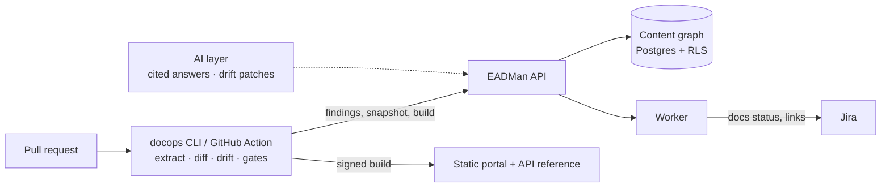

# EADMan: Enterprise Application Document Management

**Docs never drift from the code. Every release ships with accurate, traceable documentation.**

EADMan (Enterprise Application Document Management) is a docs-as-code platform. It links every doc page to the things it describes (API operations, config keys, infrastructure), to the tickets that required it, and to the releases that shipped it, and it checks those links on every pull request. This repository holds the complete design package and a working MVP scaffold.

Start with the [Executive Summary](docs/00-executive-summary.md).

## Deliverables

| # | Deliverable | Where |
|---|---|---|
| 0 | Executive summary | [docs/00-executive-summary.md](docs/00-executive-summary.md) |
| 1 | Product requirements: personas, jobs to be done, user stories with acceptance criteria, non-goals, metrics | [docs/01-product-requirements.md](docs/01-product-requirements.md) |
| 2 | System architecture: component and sequence diagrams, storage, tenancy, SLOs | [docs/02-system-architecture.md](docs/02-system-architecture.md) · [ADRs](docs/adr/README.md) |
| 3 | Data model: content-graph ERDs and full DDL | [docs/03-data-model.md](docs/03-data-model.md) · [migration](packages/db/migrations/0001_init.sql) |
| 4 | API design: OpenAPI 3.1 spec and webhook catalog | [docs/04-api-design.md](docs/04-api-design.md) · [api/openapi.yaml](api/openapi.yaml) |
| 5 | CLI and CI: commands, `docops.yaml` schema, pipelines | [docs/05-cli-and-ci.md](docs/05-cli-and-ci.md) · [schema](packages/config/schema/docops.schema.json) · [pipelines](examples/ci) |
| 6 | Jira integration: Forge app, custom fields, automation | [docs/06-jira-integration.md](docs/06-jira-integration.md) · [apps/jira-forge](apps/jira-forge) |
| 7 | AI design: RAG, drift algorithm, prompts, evals, guardrails | [docs/07-ai-design.md](docs/07-ai-design.md) · [packages/ai](packages/ai) |
| 8 | Security and compliance: STRIDE, RBAC matrix, audit schema | [docs/08-security-compliance.md](docs/08-security-compliance.md) |
| 9 | Roadmap: MVP, V1, V2, team, milestones | [docs/09-roadmap.md](docs/09-roadmap.md) |
| 10 | Working MVP scaffold | [docs/10-mvp-scaffold.md](docs/10-mvp-scaffold.md) |
| 11 | Competitive positioning | [docs/11-competitive-positioning.md](docs/11-competitive-positioning.md) |

## Quick start

```bash
npm ci
npm test
```

```bash
npm run typecheck
```

See drift detection on the sample service. The demo replays a PR that renames an API field, adds an endpoint and changes a config default, without touching the docs:

```bash
npm run demo
```

Gate this repository's own design docs. They must document 100% of our own API:

```bash
npm run dogfood
```

More commands (local API and worker, build, publish, preview) are in [docs/10-mvp-scaffold.md](docs/10-mvp-scaffold.md#1-quick-start). The container image, a Docker Compose stack and a Helm chart with air-gapped values are in [deploy/](deploy/README.md). The Jira Forge app is in [apps/jira-forge](apps/jira-forge/README.md).

## How the pieces fit



## Principles

- **Git is the source of truth.** The database is a rebuildable index.
- **Deterministic first.** AI suggests; humans approve. Nothing is published silently.
- **Runs anywhere.** Customer CI, SaaS cells, self-hosted or air-gapped.
- **Open standards.** Markdown/MDX, OpenAPI, Mermaid, CloudEvents, OpenTelemetry, SARIF, OCSF. Full export.

## License

Apache License 2.0. See [LICENSE](LICENSE) and [NOTICE](NOTICE).
