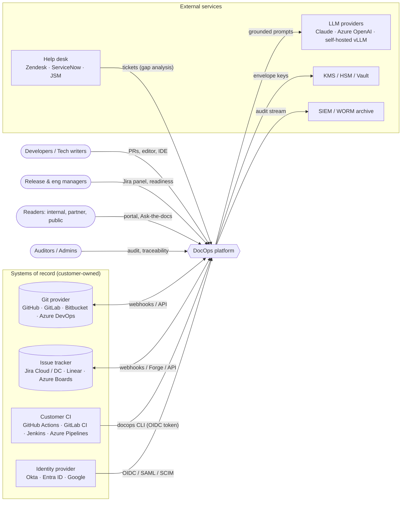
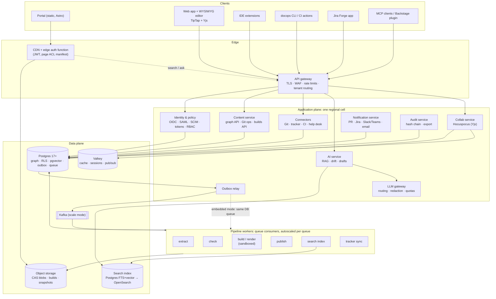
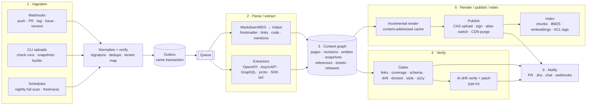
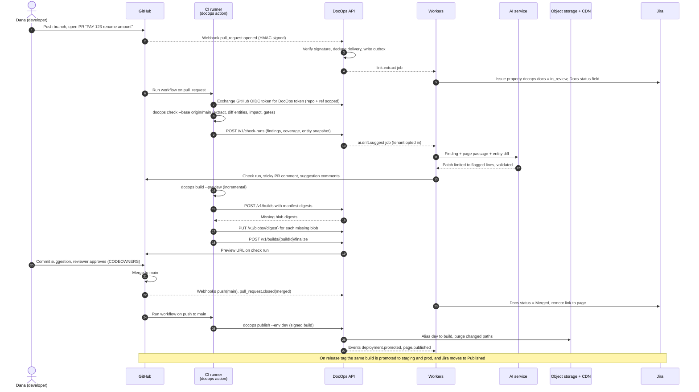
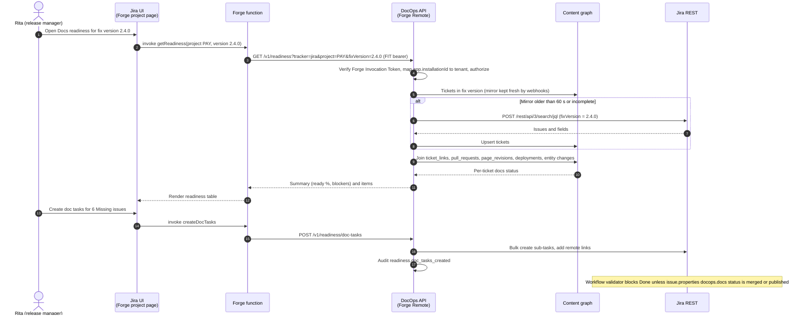
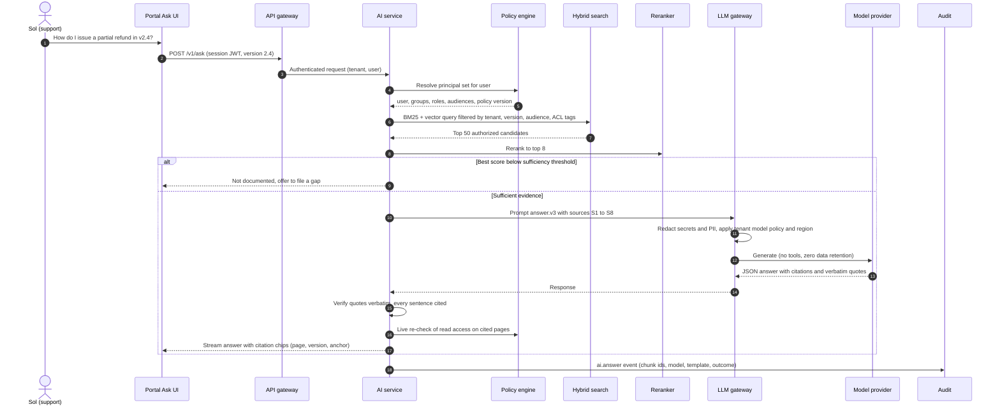
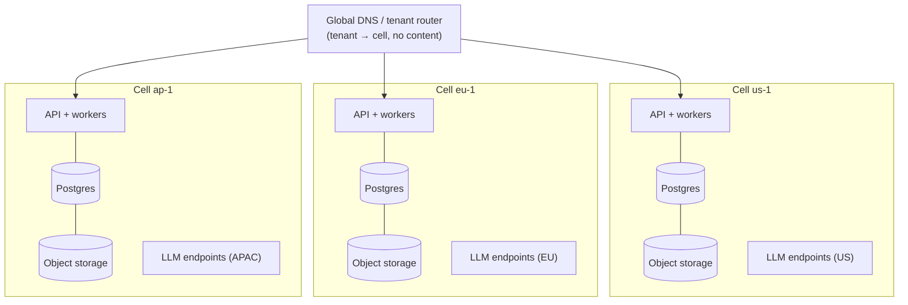

# DocOps: System Architecture

This document covers the component and deployment architecture, the content pipeline, the three critical sequence flows, storage, eventing, tenancy, encryption, extensibility, observability and SLOs. Decisions with real trade-offs are listed with their options and a recommendation, and each is recorded as an ADR in [`docs/adr/`](adr/README.md).

## 1. Architectural principles

| # | Principle | Consequence |
|---|---|---|
| P1 | **Git is the source of truth.** Postgres holds an *index* of Git, trackers and CI, plus operational telemetry. | Every table is classed as *Derived*, *Mirrored* or *Operational* ([Data Model §2](03-data-model.md#2-source-of-truth-classification)). `docops reindex` rebuilds the derived classes from scratch. |
| P2 | **Deterministic first, AI second.** | Gates block only on deterministic evidence by default. AI findings carry confidence and provenance and are advisory. |
| P3 | **Run compute where the code is.** | The `docops` CLI extracts, checks and builds inside the customer's CI. Hosted workers handle what needs central state (graph, search, AI, publish) and browser-originated edits, inside sandboxes. |
| P4 | **Static serving and dynamic intelligence.** | The portal is immutable static output on a CDN, with 99.95% availability independent of the app plane. Search and AI are progressive enhancements that degrade gracefully. |
| P5 | **Tenant isolation at every layer.** | RLS, a tenant-scoped principal on every query, per-tenant encryption keys, tenant-partitioned indexes and queues with per-tenant quotas. |
| P6 | **Open standards and no lock-in.** | Markdown/MDX, OpenAPI, AsyncAPI, Mermaid, CloudEvents, Standard Webhooks, OpenTelemetry, SCIM, OIDC/SAML, SARIF, OCSF. Full export. |
| P7 | **Modular monolith first, then services.** | Clear module boundaries and contracts in one deployable, split out by queue or scaling need ([ADR-0002](adr/0002-modular-monolith-first.md)). Fewer moving parts for self-hosted and air-gapped customers. |

## 2. Context



## 3. Component architecture

### 3.1 Component diagram



### 3.2 Component responsibilities

| Component | Responsibilities | Owns (writes) | Scales on |
|---|---|---|---|
| **API gateway** (Envoy, or the cloud equivalent) | TLS termination, WAF, JWT validation, rate limiting per tenant and token, request size limits, routing to cells | — | RPS |
| **Identity & policy** | OIDC/SAML login, SCIM 2.0, sessions, API tokens (hashed), CI OIDC token exchange (RFC 8693), role bindings, policy evaluation, the *principal set* used for ACL filtering | `users`, `groups`, `role_bindings`, `api_tokens` | RPS (CPU-light) |
| **Content service** | Content-graph read API, check-run ingestion from the CLI, build and deployment API (CAS uploads), Git operations (mirror fetch, API-based commits for editor changes), coverage and readiness queries | graph tables, `builds`, `deployments` | RPS |
| **Connectors** | Inbound webhook verification and normalization (GitHub, GitLab, Bitbucket, Azure DevOps, Jira, CI), outbound calls (check runs, PR comments, Jira properties and fields), provider rate-limit budgeting | `webhook_deliveries`, `tickets`, `pull_requests` | Webhook RPS |
| **Pipeline workers** | `extract` (parse docs, run extractors), `check` (hosted gates, nightly full scans), `build` (render in sandboxed microVMs), `publish` (alias switch, CDN purge, signing), `index` (chunk, embed, upsert), `tracker sync` (Jira status push) | `page_revisions`, `entities`, `findings`, `chunks` | Queue depth and lag |
| **AI service** | Ask-the-docs (RAG), drift verification and patch suggestions, drafts, release notes, gap clustering. Stateless; every output becomes an `ai_suggestions` or `ai_answers` row | `ai_suggestions`, `ai_answers` | Concurrent requests |
| **LLM gateway** | Provider abstraction (Anthropic, Azure OpenAI, Bedrock, Vertex, OpenAI-compatible self-hosted), per-tenant model allowlist and region pinning, secret/PII redaction, token quotas, retries and fallback, cost accounting | usage metrics | Tokens/s |
| **Collab service** | Yjs document sync through Hocuspocus, presence, awareness, draft checkpoints to a Git branch | Yjs snapshots | WebSocket connections |
| **Notification service** | Fan-out to PR comments, Jira, Slack/Teams, email, in-app; digests; freshness SLA reminders | `notifications` | Events |
| **Audit service** | Append-only, per-tenant hash-chained events; signed checkpoints; export to WORM storage and SIEM (OCSF) | `audit_events` | Events |
| **Portal** | Static Astro site per (space, version, audience); edge auth for private portals; client search (Pagefind) as a fallback; islands for try-it, Ask and Jira status | — | CDN |

### 3.3 Deployment topology

**Recommendation:** start as a *modular monolith* with three deployables and split later along queue boundaries ([ADR-0002](adr/0002-modular-monolith-first.md)).

| Deployable | Contains | MVP replicas | Split-out trigger |
|---|---|---|---|
| `docops-api` | gateway adapters, identity, content, connectors (webhook ingress), AI request path | 3+ (HPA on CPU/RPS) | Connector webhook bursts affecting API latency → split `docops-connectors` |
| `docops-worker` | every queue consumer; `WORKER_QUEUES=extract,check,build,...` selects the role | 2+ per queue group (KEDA on queue lag) | Already independently scalable per queue |
| `docops-collab` (V1) | Hocuspocus WebSocket server | 2+ (sticky by document) | — |
| Portal | static assets on CDN plus edge functions | n/a | — |

Self-hosted footprint: Postgres, S3-compatible storage (MinIO), Valkey, and the three deployables. Kafka, OpenSearch and a GPU inference server are optional add-ons enabled through Helm values.

## 4. Content pipeline



Stage contracts:

| Stage | Input | Output | Idempotency key | Typical latency |
|---|---|---|---|---|
| Normalize | provider webhook | `ingest.*` event | provider delivery ID (`X-GitHub-Delivery`, Jira `X-Atlassian-Webhook-Identifier`) | < 50 ms |
| Extract | `(repo, commit, paths)` | page revisions, entity snapshots | `(repo, commit, path, extractor@version)` | 1–20 s |
| Check | `(base, head)` snapshots | findings | `(repo, head, base, ruleset hash)` | 2–30 s |
| Render | page plus dependency hashes | HTML blobs | `sha256(inputs + renderer version)` | ms per page |
| Publish | build manifest | deployment alias | `(build_id, environment)` | < 5 s |
| Index | page revision | chunks | `(page_revision_id, chunker version)` | 1–10 s |

## 5. Critical flows

### 5.1 (a) PR → drift check → preview → merge → publish



Design notes:
- **Fail-open by default.** If DocOps is unreachable, the CLI runs every deterministic gate locally (`--offline` semantics), reports them, and marks platform-dependent steps as skipped. `ci.failOnPlatformError: true` makes it fail closed.
- **Sticky comments** are found by a hidden marker (`<!-- docops:comment:v1 -->`) and updated in place. Re-runs never spam the PR.
- **Coalescing.** A new push to the same PR cancels the in-flight hosted jobs for that PR (latest-wins key `(repo, pr)`).

### 5.2 (b) Jira release readiness



Readiness status per ticket is a pure function, `status(ticket) = f(docs_required, links, PR states, deployments, staleness)` ([Jira design §6](06-jira-integration.md#6-docs-status-state-machine)). The same function runs in the API, in `docops readiness` and in tests.

### 5.3 (c) AI cited answer with permission filtering



Two independent controls prevent leakage: **pre-filtering** inside the retrieval query, so the model never sees unauthorized text, and **post-verification** against live policy, which catches revocations that happened after indexing. Details are in [AI design §2](07-ai-design.md#2-rag-pipeline).

## 6. Storage

### 6.1 Overview

| Store | Holds | Source-of-truth class | Backup / RPO | Notes |
|---|---|---|---|---|
| **Git** (customer's provider) | Pages, snippets, `docops.yaml`, sources, CODEOWNERS, release notes | **Truth** | Customer-managed | We read through mirrors and APIs; we write only through PRs, or commits on PR branches |
| **Postgres** | Content graph, tickets mirror, builds, findings, suggestions, audit, outbox, queue | Derived, Mirrored, Operational | PITR, RPO ≤ 5 min, RTO ≤ 1 h | RLS on every tenant table |
| **Object storage** | CAS blobs (rendered files), build manifests, extractor snapshots, Yjs snapshots, exports | Derived (rebuildable), except exports | Versioned buckets, cross-region replication | Content-addressed by `sha256` |
| **Search index** | Chunks, BM25 terms, embeddings, ACL tags | Derived | Rebuild from the graph | Postgres by default, OpenSearch at scale |
| **Valkey** | Sessions, caches, rate-limit counters, Yjs pub/sub | Ephemeral | None needed | Loss is tolerated |
| **Queue** | Work items | Ephemeral (outbox is durable) | Outbox replay | See §7 |

### 6.2 Decision: graph storage ([ADR-0003](adr/0003-postgres-content-graph.md))

| Option | Pros | Cons |
|---|---|---|
| **Postgres relational graph** (recommended) | One datastore for self-hosters; transactions with the outbox; RLS; mature ops; recursive CTEs cover our ≤ 6-hop traversals (requirement → ticket → commit → PR → page → release) | Deep, ad hoc graph analytics are less ergonomic |
| Neo4j / graph DB | Expressive traversals | Another stateful system to secure, back up and residency-pin; licensing for clustering |
| DynamoDB-style KV | Elastic scale | Not self-hostable; poor for ad hoc joins; no RLS |

### 6.3 Decision: search backend ([ADR-0005](adr/0005-search-backend.md))

| Option | Pros | Cons | When |
|---|---|---|---|
| **Postgres FTS + pgvector (HNSW) with RRF fusion** | No extra system; transactional ACL updates; filtering in SQL; iterative index scans keep recall under selective filters | Weaker BM25 relevance than Lucene; vector scale limits per node | Default: self-hosted and SaaS tenants up to about 5M chunks |
| **OpenSearch (BM25 + k-NN + hybrid normalization)** | Best-in-class keyword relevance, analyzers and language plugins; scales horizontally | Another cluster to operate; eventual consistency of ACL updates | SaaS cells and large tenants |
| Vespa / dedicated vector DB | Excellent hybrid ranking | Niche operational skill set | Not planned |

The `SearchBackend` interface (index, delete, query with mandatory `filter.principals`) keeps the two interchangeable. ACL-tag updates go through the same interface and are tested for parity.

## 7. Eventing, queues and idempotency

### 7.1 Decision: queue technology ([ADR-0004](adr/0004-outbox-and-queue.md))

| Option | Pros | Cons | Verdict |
|---|---|---|---|
| **Postgres queue** (`FOR UPDATE SKIP LOCKED`) plus a **transactional outbox** | Zero extra infrastructure; enqueueing commits atomically with state; 1–5k jobs/s | Throughput ceiling; polling | **Default** for MVP, self-hosted and air-gapped |
| **Kafka** (MSK, or Strimzi for self-hosted) | Replay, partitioned ordering, fan-out to analytics | Operational weight | **Scale mode** for SaaS cells: the outbox relay publishes to Kafka |
| SQS/SNS | Fully managed, simple | AWS-only, no replay, 256 KB limit | Rejected (portability) |
| NATS JetStream | Light, replayable | Smaller enterprise footprint | Viable alternative for self-hosted |

### 7.2 Event envelope

Every internal and external event is a **CloudEvents 1.0** envelope carrying a W3C `traceparent` extension, so one trace covers webhook → check → comment.

```json
{
  "specversion": "1.0",
  "id": "01JAX4Q4T8N8Y0Q8C3M6Z7V2PB",
  "source": "docops://cells/us-1/connectors/github",
  "type": "docops.git.pull_request.opened",
  "subject": "repositories/2f1c.../pulls/42",
  "time": "2026-10-18T14:02:11Z",
  "tenantid": "0192a1f0-...",
  "traceparent": "00-4bf92f3577b34da6a3ce929d0e0e4736-00f067aa0ba902b7-01",
  "datacontenttype": "application/json",
  "data": { "...": "..." }
}
```

### 7.3 Delivery semantics

- **At-least-once delivery, effectively-once effects.** Each consumer writes `(consumer, event_id)` to `processed_events` in the same transaction as its state change. External side effects use natural keys: a sticky comment marker, a check run `external_id`, Jira property keys and remote link `globalId`.
- **Ordering.** Partition key `(tenant_id, repository_id, ref)` for Git events and `(tenant_id, issue_key)` for tracker events. Consumers reject events older than the stored `source_updated_at`, so the last writer wins on newer data.
- **Retries.** Exponential backoff with jitter (1 s → 15 min, 10 attempts), then a dead-letter queue with an alert and a replay CLI (`docops-admin dlq replay`).
- **Coalescing.** Build and check jobs carry a `coalesce_key`. A newer job supersedes queued older ones.
- **Priority lanes.** `publish.prod` > `check.pr` > `build.preview` > `index` > `reindex`. Per-tenant concurrency caps prevent noisy neighbors.

## 8. Multi-tenancy, encryption and residency

### 8.1 Isolation tiers ([ADR-0006](adr/0006-tenancy-isolation.md))

| Layer | Pooled (Team) | Silo (Enterprise) | Dedicated (single-tenant SaaS) | Self-hosted / air-gapped |
|---|---|---|---|---|
| Compute (API) | Shared | Shared | Dedicated cluster | Customer |
| Workers / build sandboxes | Shared pool, per-tenant microVM per job | Dedicated node pool | Dedicated | Customer |
| Postgres | Shared DB, RLS | Dedicated database (same cluster), RLS | Dedicated cluster | Customer |
| Search | Tenant-partitioned index | Dedicated index | Dedicated cluster | Customer |
| Object storage | Shared bucket, tenant prefix plus prefix-scoped IAM | Dedicated bucket | Dedicated account | Customer |
| Encryption keys | Per-tenant DEK, platform KEK | Per-tenant KEK, optional customer CMK | Customer CMK | Customer KMS / Vault |
| LLM | Platform provider accounts, zero retention | Tenant-selected provider | Customer's provider accounts | Local models |

Tenant context is mandatory. Every database transaction runs `SET LOCAL app.tenant_id = $1` through `withTenant()`, and RLS policies (`FORCE ROW LEVEL SECURITY`) reject rows from other tenants even if application code forgets a `WHERE` clause. The application role has no `BYPASSRLS`; only the migration role does.

### 8.2 Encryption

- **In transit.** TLS 1.3 at the edge (HSTS, modern ciphers) and mTLS between services (Linkerd or Istio; SPIFFE identities). Database and storage connections require TLS.
- **At rest.** Storage-level AES-256 everywhere, plus **envelope encryption** for sensitive columns: Git and Jira tokens, webhook secrets, AI prompt and response logs, Yjs snapshots. A key hierarchy of *root KMS key → tenant KEK (or customer CMK) → per-data-class DEKs* keeps DEKs cached in memory for ≤ 5 min.
- **BYOK / CMK.** AWS KMS, Azure Key Vault, GCP KMS or HashiCorp Vault Transit. If the customer revokes the key, the tenant becomes unreadable within the DEK cache TTL (crypto-shredding on offboarding).
- **Embeddings** are treated as sensitive, because inversion attacks can recover text from them. They're encrypted at rest, never returned by the API, and deleted with the source.

### 8.3 Data residency: cell architecture



- Each cell is a full, independent stack. A tenant is pinned to its home cell, and content, backups, logs, search and LLM inference stay in-region.
- The global control plane stores only the tenant directory (tenant ID → cell, custom domains) and billing aggregates.
- Support access to a cell is just-in-time, approved, time-boxed and audited to the tenant's log.
- Cells also bound the blast radius. Deployments roll cell by cell behind canaries.

## 9. Scalability, performance and SLOs

### 9.1 Build performance budget (5k pages, hosted worker, 16 vCPU)

| Step | Approach | p95 budget |
|---|---|---|
| Fetch sources | Partial clone (`--filter=blob:none`) plus sparse checkout of the docs root and sources; warm mirror cache | 6 s |
| Resolve config, graph and dependencies | Cached dependency graph (page → snippets, variables, components, sources) | 2 s |
| Parse and render | Worker-thread pool; per-page content-addressed cache keyed on `sha256(source + dep hashes + renderer version + config hash)`; MDX compile about 10–20 ms per page cold | 12 s cold, < 3 s warm |
| Reference generation | OpenAPI, AsyncAPI and SDK pages generated from snapshot hashes; skipped when unchanged | 4 s |
| Search index (Pagefind) | Incremental by fragment | 8 s |
| Upload | CAS: only new digests upload (typically < 2% of files) | 5 s |
| Sign and finalize | One manifest signature (cosign / KMS) | 1 s |
| **Total** | | **≈ 38 s cold (SLO < 60 s), ≈ 12 s typical PR** |

### 9.2 Search latency budget (p95 < 200 ms at the API)

Gateway and authentication 10 ms → principal set (cached 60 s, busted on revocation events) 5 ms → BM25 and vector queries run in parallel under the ACL filter, 60 ms (HNSW `ef_search` 64, iterative scans) → RRF fusion 2 ms → snippet highlighting 15 ms → serialization 5 ms. The total is about 100 ms, leaving headroom for tail effects. Reranking applies to AI answers only.

### 9.3 SLOs

| SLO | SLI (good events / valid events) | Objective | Alerting |
|---|---|---|---|
| Portal availability | CDN 2xx/3xx/404 responses / all requests (synthetic probes in 5 regions) | 99.95% / 30 days | Multi-window burn rate (14.4× over 1 h and 5 m pages; 6× over 6 h and 30 m pages; 1× over 3 d opens a ticket) |
| Build latency | Builds ≤ 5k pages finishing < 60 s / all such builds | 95% / 7 days | Burn rate on the latency SLI |
| Search latency | `/v1/search` requests < 200 ms / all | 95% / 7 days | Burn rate |
| API availability | Non-5xx / all (excluding client errors) | 99.9% / 30 days | Burn rate |
| Check freshness | PR check results posted < 3 min after CI completes / all | 99% / 7 days | Burn rate |
| Tracker sync freshness | Jira Docs status updated < 60 s after the triggering event / all | 99% / 7 days | Burn rate |
| AI answer latency | Time to first token < 2.5 s / all answers | 95% / 7 days | Ticket only |

The portal's SLO is achievable because serving is static. Origins are dual-region object storage with replication, the CDN has origin failover, and the edge validates sessions locally using cached JWKS, so an application-plane outage doesn't affect reading. Dynamic features degrade: search falls back to the static Pagefind index on public and partner portals, and Ask shows a banner.

## 10. Extensibility

| Surface | Contract | Notes |
|---|---|---|
| **REST API** | [OpenAPI 3.1](../api/openapi.yaml), versioned `/v1`, additive changes only, 12-month deprecation | Cursor pagination, `Idempotency-Key`, RFC 9457 errors |
| **GraphQL** (V1) | Read-only content graph (`page → entities → tickets → releases`) | Persisted queries; cost limits |
| **Outbound webhooks** | CloudEvents payloads signed per [Standard Webhooks](https://www.standardwebhooks.com/) | Catalog in [API design §4](04-api-design.md#4-webhook-event-catalog) |
| **Plugin SDK** | `@docops/plugin-sdk`: `Extractor`, `Rule`, `Component`, `TrackerConnector` | Declarative capabilities manifest |
| **MCP server** (V1) | `search_docs`, `get_page`, `ask_docs` tools, permission-scoped to the calling user | Lets AI agents use governed docs |
| **Backstage plugin** (V1) | Entity docs tab with coverage, freshness and readiness | Complements TechDocs |

**Plugin execution model.** Plugins run natively inside the CLI, in the customer's CI, under the customer's trust. On hosted workers they run in a WASM sandbox (Extism / WASI). The capability manifest declares file globs, an optional network allowlist, and CPU and memory limits. Rules receive an immutable mdast and return diagnostics, so they have no side effects.

```ts
// @docops/plugin-sdk (excerpt)
export interface Extractor {
  id: string;                       // "openapi", "terraform", ...
  version: string;                  // participates in cache keys
  matches(path: string): boolean;
  extract(file: SourceFile, ctx: ExtractContext): Promise<EntityDefinition[]>;
}
export interface Rule {
  id: `${string}/${string}`;        // "style/inclusive-language"
  defaultLevel: "off" | "warn" | "block";
  check(page: ParsedPage, ctx: RuleContext): Iterable<Finding>;
}
```

## 11. Observability

- **Tracing.** OpenTelemetry SDKs in every deployable, with auto-instrumentation for HTTP, `pg` and `fetch`. Trace context is persisted in outbox rows and queue headers, and the CLI propagates `traceparent` so CI spans join platform spans. Pipeline stages produce spans named `docops.extract`, `docops.check.rule/<id>`, `docops.render.page` and so on. Tail-based sampling keeps 100% of errors and slow traces.
- **Metrics.** RED metrics per route; `docops_queue_lag_seconds{queue}`, `docops_build_duration_seconds{pages_bucket}`, `docops_findings_total{rule,severity}`, `docops_finding_dismissals_total{rule,reason}`, `docops_llm_tokens_total{provider,model,purpose}`, `docops_search_latency_seconds`.
- **Logs.** Structured JSON with `trace_id`, `tenant_id` and `request_id`. Secrets are redacted at the logger. Customer content is never logged.
- **Product telemetry** (opt-out for self-hosted) is separate from operational telemetry.
- **Self-hosted.** The Helm chart ships an OTel Collector config and Grafana dashboards (SLOs, queues, builds), and exports to any OTLP backend.

## 12. Technology choices

| Concern | Suggested | Recommendation | Why |
|---|---|---|---|
| Service language | TypeScript/Node or Go | **TypeScript on Node 24 LTS** for all services, the CLI, actions, the Forge app, the portal and the editor. Go is held in reserve for profiled hot paths | One language means shared types for the content-graph schema, config schema and rule SDK across CLI, server and UI. Forge, GitHub JS actions, TipTap and Astro are TS-native ([ADR-0001](adr/0001-typescript-everywhere.md)) |
| HTTP framework | — | **Hono** | Web-standard Request/Response; runs on Node, edge functions and Lambda; trivially testable |
| Portal | Next.js / Astro | **Astro** (static output and islands) plus Pagefind | Ships near-zero JS by default, which helps performance and accessibility. MDX is first-class. Static output matches the availability goal ([ADR-0008](adr/0008-portal-and-editor.md)) |
| Editor | ProseMirror/TipTap plus Yjs | **TipTap (MIT core) + Yjs + Hocuspocus** | Mature ecosystem. Opaque MDX nodes guarantee round-trip fidelity |
| Markdown pipeline | — | **unified / remark / rehype (mdast/hast)** | The standard AST lets the plugin SDK reuse the remark-lint ecosystem; MDX support is native |
| Database | Postgres + pgvector | **Postgres 17+ with pgvector**; RLS | See §6.2 |
| Search | pgvector or OpenSearch | **Both, behind an interface**, Postgres by default | See §6.3 |
| Cache | Redis | **Valkey** (BSD-licensed, protocol-compatible) | Avoids source-available and AGPL license questions for self-hosted distribution |
| Queue | Kafka/SQS | **Postgres outbox and queue by default, Kafka in scale mode** | See §7.1 |
| Object storage | S3-compatible | **S3 API** (MinIO, Ceph or cloud), plus native Azure Blob and GCS drivers | Air-gapped friendly |
| Runtime | Kubernetes, Terraform | **Kubernetes + Helm** (product) and **Terraform** (our SaaS cells); Argo CD for our GitOps | — |
| Build sandbox | — | **Firecracker microVMs** (SaaS), **gVisor** (self-hosted K8s) | MDX, doc tests and plugins execute untrusted code |
| Authorization | — | **In-process policy engine** over role bindings with ACL tags; **Cedar** (embedded) for ABAC in V2 | No extra service to run; fast list filtering ([ADR-0007](adr/0007-authorization-model.md)) |
| LLM access | — | **LLM gateway** with Anthropic Claude as the default provider; OpenAI-compatible adapters for self-hosted (vLLM, Ollama); embeddings through TEI (BGE-M3) when air-gapped | Model-agnostic and region-pinnable |

## 13. Failure modes and degradation

| Failure | Detection | Behavior |
|---|---|---|
| Git provider outage or rate limiting | 5xx and 429 on connector calls; secondary rate-limit headers | Queue retries with provider-specific budgets; CLI checks unaffected (local git) |
| Jira outage | Connector error rate | Docs status pushes queue up and replay. The workflow validator reads the last pushed issue property, so it stays fail-safe |
| LLM provider outage | LLM gateway health checks | Fall back to the secondary provider if the tenant allows it; otherwise AI features show "unavailable". Deterministic gates are unaffected |
| Postgres primary failure | Patroni / RDS failover | API returns 503 for 30–60 s. Portal unaffected. CI gates fail open with a warning by default |
| Queue backlog | `queue_lag_seconds` SLO burn | Autoscale workers (KEDA); shed `reindex`; coalesce builds; prod publish lane is reserved |
| Bad deploy of DocOps | Canary SLO burn | Automatic rollback per cell |
| CDN outage | Synthetic probes | Multi-CDN DNS failover (Enterprise tier) |

## 14. Open architecture questions

1. Should hosted builds for browser-originated edits run in the customer's CI (through a `workflow_dispatch` round trip) instead of our sandboxes? This trades latency for trust and is currently configurable per tenant.
2. Should we offer a per-tenant semantic cache for Ask, with the cache key including the principal-set hash? Hit rates are unproven, so this is deferred to V1 data.
3. Should we adopt OpenFGA for very large page-level ACL graphs, beyond what in-process evaluation handles? We'll revisit once a tenant exceeds 100k page-level grants.
