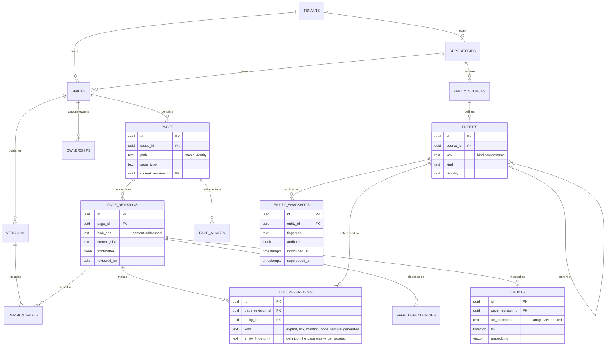
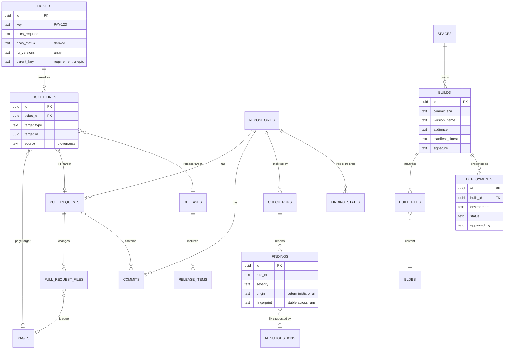
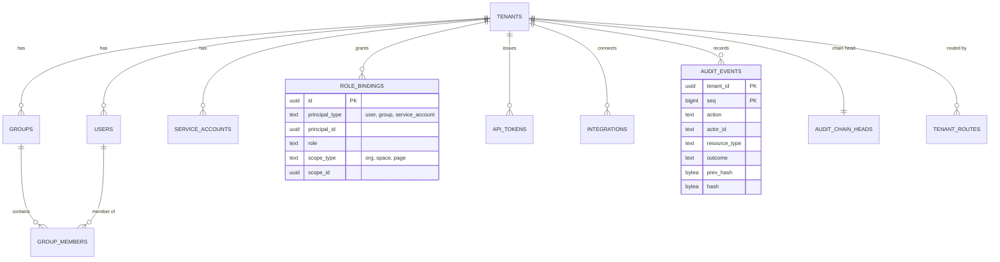

# EADMan: Content Graph Data Model

The content graph is the core of EADMan. It connects **pages** to the **entities** they describe, to the **tickets** that required them, to the **pull requests and commits** that changed them, and to the **releases and deployments** that shipped them. This document has the ERDs, the source-of-truth classification of every table, the key queries, and the complete DDL.

The DDL in §7 is embedded verbatim from [`packages/db/migrations/0001_init.sql`](../packages/db/migrations/0001_init.sql). A test (`packages/db/test/docs-sync.test.ts`) fails if this document and the migration drift apart.

## 1. Modeling decisions

| Decision | Choice | Rationale |
|---|---|---|
| Store | PostgreSQL 17+ (tested on 18), relational graph | See [ADR-0003](adr/0003-postgres-content-graph.md). Traversals are shallow and well known. |
| Identifiers | UUIDv7 generated by the application (or `uuidv7()` on PG18) | Time-ordered keys give B-tree locality. Identifiers are globally unique across cells for export and merge. |
| Enumerations | `text` + `CHECK` | Evolving them is cheaper than `ALTER TYPE`. |
| Tenancy | `tenant_id` on every tenant table, plus RLS with `FORCE ROW LEVEL SECURITY` | Defense in depth against a missing `WHERE` ([§5](#5-tenancy-and-row-level-security)) |
| Page identity | `(space, path)`; renames go to `page_aliases` | Paths are the stable identity in Git. Aliases preserve URLs and history. |
| Revisions | Content-addressed (one row per distinct Git blob) | Unchanged pages share revisions across versions, so storage stays O(changes). |
| Entity history | New `entity_snapshots` row only when the **fingerprint** changes | O(changes), not O(commits × entities) |
| Staleness | `doc_references.entity_fingerprint` stores the entity definition a page was written against | Staleness becomes an indexed comparison, not a diff |

### 1.1 Entity keys

An entity key is `{kind}:{sourceKey}:{localName}`. Keys are stable across commits, human-readable in findings, and usable in frontmatter.

| Kind | Example key | Surface forms (mention detection) |
|---|---|---|
| `api.operation` | `api.operation:payments-api:POST /v1/payments` | `POST /v1/payments`, `/v1/payments`, `createPayment` |
| `api.parameter` | `api.parameter:payments-api:GET /v1/payments:query.limit` | `limit` (contextual: only with the parent operation nearby) |
| `api.schema` | `api.schema:payments-api:Payment` | `Payment` (in code spans) |
| `api.property` | `api.property:payments-api:Payment.amount_cents` | `amount_cents` (contextual) |
| `config.key` | `config.key:payments-config:PAYMENTS_TIMEOUT_MS` | `PAYMENTS_TIMEOUT_MS` |
| `cli.flag` (V1) | `cli.flag:docops-cli:check --base` | `--base` (contextual) |
| `event.message` (V1) | `event.message:payments-events:payment.settled` | `payment.settled` |
| `tf.variable` (V2) | `tf.variable:infra:db_instance_class` | `db_instance_class` |

### 1.2 Fingerprints

`fingerprint = sha256(JCS(normalize(attributes)))`, where JCS is RFC 8785 canonical JSON. Normalization:

- drops presentation-only fields (`x-docops-*`, `examples`, key order);
- trims whitespace in descriptions and collapses runs of whitespace;
- resolves internal `$ref`s, so a refactor into a component doesn't count as a change.

A change in the fingerprint is the trigger for drift analysis.

## 2. Source-of-truth classification

The principle *"nothing important lives only in a database"* is enforced per table:

| Class | Meaning | Rebuild / export path |
|---|---|---|
| **D** (Derived) | Computed from Git (pages, config, sources, CODEOWNERS) and CI uploads | `docops reindex --space <key>` rebuilds it from Git at any time |
| **M** (Mirrored) | Copied from a system of record (Git provider, tracker, IdP) | Resynced from the provider API; deleting it loses nothing |
| **O** (Operational) | Facts that originate in EADMan (audit, check runs, AI suggestions, deployments, dismissals, role bindings) | Exported continuously (audit goes to WORM storage and the SIEM) and on demand (`POST /v1/exports`, JSONL with schemas) |
| **P** (Platform) | Routing and plumbing with no tenant content (outbox, queue, delivery ledger) | Ephemeral or replayable |

| Table | Class | Purpose | Retention |
|---|---|---|---|
| `tenants`, `tenant_routes` | P | Tenant directory and pre-auth routing | Lifetime |
| `users`, `groups`, `group_members` | M | Identities from SCIM or the IdP | Until deprovisioned + 30 d |
| `service_accounts`, `api_tokens`, `role_bindings` | O | Access control (role bindings can be managed as code) | Lifetime; every change audited |
| `integrations` | O | Connections and encrypted credentials | Lifetime |
| `repositories`, `spaces`, `versions` | D | Repository and space configuration from `docops.yaml` and tags | Rebuildable |
| `pages`, `page_revisions`, `version_pages`, `page_dependencies`, `page_aliases` | D | Page identity, content-addressed revisions, version membership, build dependencies, redirects | Rebuildable |
| `page_reviews`, `ownerships` | D | Freshness evidence and owners (PR reviews, frontmatter, CODEOWNERS) | Rebuildable |
| `entity_sources`, `entities`, `entity_snapshots`, `doc_references` | D | What docs describe, and how definitions evolve | Rebuildable |
| `pull_requests`, `pull_request_files`, `commits` | M | Delivery history | Rebuildable from the provider |
| `tickets` | M | Tracker mirror (`docs_status` is derived) | Rebuildable from the tracker |
| `ticket_links` | D/M | Links from frontmatter, PRs and commits (D), or from the tracker panel (M: also stored as Jira issue properties and remote links) | Rebuildable |
| `releases`, `release_items` | D/M | Git tags and tracker fix versions | Rebuildable |
| `blobs`, `builds`, `build_files`, `deployments` | O | Immutable artifacts and promotions (evidence) | Builds 90 d (previews 7 d after PR close); deployments for life |
| `check_runs`, `findings`, `finding_states` | O | Gate results and finding lifecycle (dismissals) | 13 months (configurable) |
| `chunks` | D | Search and RAG index | Rebuildable |
| `ai_suggestions`, `ai_answers` | O | AI provenance and decisions | 13 months (configurable; questions encrypted or hashed) |
| `analytics_events` | O | Portal analytics | 25 months, aggregated after 90 d |
| `audit_events`, `audit_chain_heads` | O | Hash-chained audit log | 1 year by default, up to 7 years (regulated) |
| `outbox`, `jobs`, `processed_events`, `webhook_deliveries` | P | Eventing plumbing | 7–30 d |
| `webhook_subscriptions` | O | Outbound webhook configuration | Lifetime |

## 3. Entity-relationship diagrams

### 3.1 Content graph core



### 3.2 Delivery, traceability and verification



### 3.3 Identity, governance and audit



## 4. Key queries

The engine computes these in TypeScript when the CLI runs offline. The API runs the same logic as SQL; the test suite asserts both paths agree.

**Coverage per entity kind for a published version (L2 = referenced by a non-generated page)**

```sql
SELECT e.kind,
       count(*)                                         AS public_entities,
       count(*) FILTER (WHERE EXISTS (
         SELECT 1
         FROM doc_references r
         JOIN version_pages vp ON vp.page_revision_id = r.page_revision_id
         WHERE r.entity_id = e.id
           AND vp.version_id = $1
           AND r.kind <> 'generated'))                  AS documented_l2
FROM entities e
JOIN entity_sources s ON s.id = e.source_id
JOIN spaces sp ON sp.repository_id = s.repository_id
JOIN versions v ON v.space_id = sp.id AND v.id = $1
WHERE e.visibility = 'public' AND e.removed_at_sha IS NULL
GROUP BY e.kind;
```

**Stale pages: written against an entity definition that has since changed**

```sql
SELECT p.path, e.key, r.entity_fingerprint AS written_against, cur.fingerprint AS current,
       cur.introduced_at AS entity_changed_at
FROM pages p
JOIN doc_references r   ON r.page_revision_id = p.current_revision_id
JOIN entities e         ON e.id = r.entity_id
JOIN entity_snapshots cur ON cur.entity_id = e.id AND cur.superseded_at IS NULL
WHERE p.space_id = $1
  AND p.deleted_at IS NULL
  AND r.kind <> 'generated'
  AND r.entity_fingerprint <> cur.fingerprint;
```

**Traceability for a fix version: requirement → ticket → commit/PR → page → release**

```sql
SELECT t.parent_key            AS requirement,
       t.key                   AS ticket,
       t.docs_status,
       pr.number               AS pull_request,
       pr.merge_commit_sha,
       pr.merged_at,
       p.path                  AS doc_page,
       d.environment,
       d.promoted_at,
       b.manifest_digest       AS build_digest
FROM tickets t
LEFT JOIN ticket_links l      ON l.ticket_id = t.id AND l.target_type = 'pull_request'
LEFT JOIN pull_requests pr    ON pr.id = l.target_id
LEFT JOIN pull_request_files f ON f.pull_request_id = pr.id AND f.page_id IS NOT NULL
LEFT JOIN pages p             ON p.id = f.page_id
LEFT JOIN LATERAL (
  SELECT dep.* FROM deployments dep
  JOIN builds bb ON bb.id = dep.build_id
  WHERE dep.space_id = p.space_id AND dep.environment = 'prod'
    AND dep.promoted_at >= pr.merged_at
  ORDER BY dep.promoted_at
  LIMIT 1) d ON true
LEFT JOIN builds b            ON b.id = d.build_id
WHERE t.project_key = $1 AND $2 = ANY (t.fix_versions)
ORDER BY t.key, pr.merged_at;
```

**Permission-filtered hybrid retrieval (simplified; RRF with k = 60)**

```sql
WITH kw AS (
  SELECT id, row_number() OVER (ORDER BY ts_rank_cd(tsv, q) DESC) AS rnk
  FROM chunks, websearch_to_tsquery('english', $1) q
  WHERE space_id = $2 AND version_name = $3 AND acl_principals && $4::text[] AND tsv @@ q
  ORDER BY ts_rank_cd(tsv, q) DESC LIMIT 50),
vec AS (
  SELECT id, row_number() OVER (ORDER BY embedding <=> $5::vector) AS rnk
  FROM chunks
  WHERE space_id = $2 AND version_name = $3 AND acl_principals && $4::text[]
  ORDER BY embedding <=> $5::vector LIMIT 50)
SELECT id, sum(1.0 / (60 + rnk)) AS score
FROM (SELECT * FROM kw UNION ALL SELECT * FROM vec) u
GROUP BY id ORDER BY score DESC LIMIT 20;
```

RLS adds `tenant_id = current tenant` to every one of these queries automatically.

## 5. Tenancy and row-level security

- Every tenant table has `ENABLE` and `FORCE ROW LEVEL SECURITY` with the policy `tenant_id = NULLIF(current_setting('app.tenant_id', true), '')::uuid`. `NULLIF` matters: once a session has set the GUC, an unset value reads as `''` rather than `NULL`, and `''::uuid` would raise an error instead of matching nothing.
- The application role `docops_app` has no `BYPASSRLS`. The migration role owns the tables.
- Pre-tenant lookups (API token → tenant, webhook or Forge app installation → tenant) use `tenant_routes`, which holds no content, and the `SECURITY DEFINER` function `auth_lookup_api_token()`.
- Platform tables (`jobs`, `outbox`, `processed_events`, `webhook_deliveries`, `token_replay_cache`) carry only references. Workers dequeue across tenants and then enter `withTenant()` for every state change.
- `packages/db/test/rls.test.ts` verifies isolation: reads without context return nothing, a cross-tenant `INSERT` violates the policy, and audit rows can't be updated.

## 6. Lifecycle, scale and migrations

- **Volume model (largest tenant):** 50k pages × ~40 revisions = 2M `page_revisions`; ~200k entities; ~4M `doc_references`; ~1.5M `chunks`. Within a single Postgres primary (r7g.4xlarge-class) with headroom. The silo tier gives large tenants their own database.
- **Partitioning (production):** `audit_events` and `analytics_events` by month (pg_partman); `chunks` by `LIST(tenant_id)` for the largest pooled tenants. Retention drops whole partitions after export.
- **Deletion:** repository disconnect cascades through `D` and `M` rows. Tenant offboarding exports, then crypto-shreds (destroys the tenant KEK) before deleting rows.
- **Migrations:** expand → migrate → contract (zero downtime). Every migration is reversible or has a documented roll-forward; `docops-admin migrate --dry-run` prints the plan. Migrations run in CI against PGlite and Postgres 16, 17 and 18. Every API and worker replica runs `migrate()` at start-up: it takes a transaction-scoped advisory lock and applies all pending files in one transaction, so concurrent starts queue behind the first one and a failed run leaves nothing behind. Migration files therefore cannot contain statements that refuse to run inside a transaction, such as `CREATE INDEX CONCURRENTLY`.

## 7. DDL

<!-- docops:include path="../packages/db/migrations/0001_init.sql" lang="sql" -->
```sql
-- DocOps content graph schema, migration 0001.
-- Canonical DDL. docs/03-data-model.md embeds this file verbatim, and
-- packages/db/test/docs-sync.test.ts fails if the two drift apart.
--
-- Conventions
--   * ids are UUIDv7, generated by the application (time-ordered B-tree locality)
--   * enumerations are text + CHECK (cheaper to evolve than CREATE TYPE ... AS ENUM)
--   * every tenant table carries tenant_id and is protected by row-level security
--   * source-of-truth class per table: [D] derived from Git/CI, [M] mirrored from
--     a tracker/provider/IdP, [O] operational, [P] platform (no tenant content)

CREATE EXTENSION IF NOT EXISTS vector;

-- ---------------------------------------------------------------------------
-- 1. Tenancy, identity and access
-- ---------------------------------------------------------------------------

-- [P] One row per customer organization.
CREATE TABLE tenants (
  id            uuid PRIMARY KEY,
  slug          text NOT NULL UNIQUE CHECK (slug ~ '^[a-z0-9][a-z0-9-]{1,62}$'),
  name          text NOT NULL,
  region        text NOT NULL CHECK (region IN ('us', 'eu', 'apac', 'self-hosted')),
  isolation     text NOT NULL DEFAULT 'pooled'
                CHECK (isolation IN ('pooled', 'silo', 'dedicated', 'self-hosted')),
  kms_key_ref   text,                         -- customer-managed key (BYOK) reference
  ai_enabled    boolean NOT NULL DEFAULT false,
  settings      jsonb NOT NULL DEFAULT '{}',
  created_at    timestamptz NOT NULL DEFAULT now()
);

-- [P] Routes inbound traffic to a tenant before tenant context exists
-- (GitHub installation id, Jira cloudId, custom domain). No content.
CREATE TABLE tenant_routes (
  kind          text NOT NULL CHECK (kind IN ('github_installation', 'gitlab_group', 'jira_cloud',
                                              'jira_dc', 'custom_domain', 'forge_installation')),
  external_key  text NOT NULL,
  tenant_id     uuid NOT NULL REFERENCES tenants(id) ON DELETE CASCADE,
  created_at    timestamptz NOT NULL DEFAULT now(),
  PRIMARY KEY (kind, external_key)
);

-- [M] Users, provisioned by SCIM or just-in-time from the IdP.
CREATE TABLE users (
  id            uuid PRIMARY KEY,
  tenant_id     uuid NOT NULL REFERENCES tenants(id) ON DELETE CASCADE,
  email         text NOT NULL,
  display_name  text,
  idp_subject   text,                         -- OIDC sub / SAML NameID
  scim_id       text,
  status        text NOT NULL DEFAULT 'active'
                CHECK (status IN ('active', 'suspended', 'deprovisioned')),
  created_at    timestamptz NOT NULL DEFAULT now(),
  UNIQUE (tenant_id, email)
);

-- [M] Groups from SCIM, Git provider teams, or local.
CREATE TABLE groups (
  id            uuid PRIMARY KEY,
  tenant_id     uuid NOT NULL REFERENCES tenants(id) ON DELETE CASCADE,
  name          text NOT NULL,
  scim_id       text,
  source        text NOT NULL DEFAULT 'local' CHECK (source IN ('local', 'scim', 'git_team')),
  UNIQUE (tenant_id, name)
);

CREATE TABLE group_members (
  tenant_id     uuid NOT NULL REFERENCES tenants(id) ON DELETE CASCADE,
  group_id      uuid NOT NULL REFERENCES groups(id) ON DELETE CASCADE,
  user_id       uuid NOT NULL REFERENCES users(id) ON DELETE CASCADE,
  PRIMARY KEY (group_id, user_id)
);

-- [O] Non-human principals (CI pipelines, integrations).
CREATE TABLE service_accounts (
  id            uuid PRIMARY KEY,
  tenant_id     uuid NOT NULL REFERENCES tenants(id) ON DELETE CASCADE,
  name          text NOT NULL,
  description   text,
  created_at    timestamptz NOT NULL DEFAULT now(),
  UNIQUE (tenant_id, name)
);

-- [O] API tokens. Only a SHA-256 hash is stored; the secret is shown once.
CREATE TABLE api_tokens (
  id             uuid PRIMARY KEY,
  tenant_id      uuid NOT NULL REFERENCES tenants(id) ON DELETE CASCADE,
  principal_type text NOT NULL CHECK (principal_type IN ('user', 'service_account')),
  principal_id   uuid NOT NULL,
  name           text NOT NULL,
  token_hash     bytea NOT NULL UNIQUE,
  token_prefix   text NOT NULL,               -- first characters, for identification in UIs
  scopes         text[] NOT NULL,
  expires_at     timestamptz,
  last_used_at   timestamptz,
  revoked_at     timestamptz,
  created_at     timestamptz NOT NULL DEFAULT now()
);

-- [O] Role bindings: principal x role x scope. Audited; optionally managed as code.
CREATE TABLE role_bindings (
  id             uuid PRIMARY KEY,
  tenant_id      uuid NOT NULL REFERENCES tenants(id) ON DELETE CASCADE,
  principal_type text NOT NULL CHECK (principal_type IN ('user', 'group', 'service_account')),
  principal_id   uuid NOT NULL,
  role           text NOT NULL CHECK (role IN ('org_owner', 'org_admin', 'space_admin', 'maintainer',
                                               'editor', 'commenter', 'viewer', 'auditor',
                                               'billing_admin', 'ci_publisher')),
  scope_type     text NOT NULL CHECK (scope_type IN ('org', 'space', 'page')),
  scope_id       uuid,                        -- NULL for org scope
  created_by     text NOT NULL,
  created_at     timestamptz NOT NULL DEFAULT now(),
  UNIQUE NULLS NOT DISTINCT (tenant_id, principal_type, principal_id, role, scope_type, scope_id)
);

-- [O] Connections to external systems. Credentials are envelope-encrypted (tenant DEK).
CREATE TABLE integrations (
  id                     uuid PRIMARY KEY,
  tenant_id              uuid NOT NULL REFERENCES tenants(id) ON DELETE CASCADE,
  kind                   text NOT NULL CHECK (kind IN ('github_app', 'gitlab', 'bitbucket', 'azure_devops',
                                                       'jira_cloud', 'jira_dc', 'linear', 'azure_boards',
                                                       'slack', 'teams', 'zendesk', 'servicenow')),
  external_id            text NOT NULL,       -- installation id, cloudId, base URL
  display_name           text,
  config                 jsonb NOT NULL DEFAULT '{}',
  credentials_ciphertext bytea,
  status                 text NOT NULL DEFAULT 'active'
                         CHECK (status IN ('active', 'needs_attention', 'disabled')),
  created_at             timestamptz NOT NULL DEFAULT now(),
  updated_at             timestamptz NOT NULL DEFAULT now(),
  UNIQUE (tenant_id, kind, external_id)
);

-- ---------------------------------------------------------------------------
-- 2. Repositories, spaces, versions and pages
-- ---------------------------------------------------------------------------

-- [D] A connected repository.
CREATE TABLE repositories (
  id               uuid PRIMARY KEY,
  tenant_id        uuid NOT NULL REFERENCES tenants(id) ON DELETE CASCADE,
  integration_id   uuid REFERENCES integrations(id) ON DELETE SET NULL,
  provider         text NOT NULL CHECK (provider IN ('github', 'gitlab', 'bitbucket', 'azure_devops', 'local')),
  external_id      text,
  full_name        text NOT NULL,             -- acme/payments
  default_branch   text NOT NULL DEFAULT 'main',
  web_url          text,
  config_path      text NOT NULL DEFAULT 'docops.yaml',
  config_digest    text,                      -- sha256 of the last valid docops.yaml
  last_indexed_sha text,
  last_indexed_at  timestamptz,
  status           text NOT NULL DEFAULT 'active'
                   CHECK (status IN ('active', 'needs_attention', 'disconnected')),
  UNIQUE (tenant_id, provider, full_name)
);

-- [D] A documentation space = one docops.yaml project (one portal).
CREATE TABLE spaces (
  id               uuid PRIMARY KEY,
  tenant_id        uuid NOT NULL REFERENCES tenants(id) ON DELETE CASCADE,
  repository_id    uuid REFERENCES repositories(id) ON DELETE CASCADE,
  key              text NOT NULL,             -- docops.yaml project.id
  name             text NOT NULL,
  docs_root        text NOT NULL DEFAULT 'docs',
  default_audience text NOT NULL DEFAULT 'internal',
  base_url         text,
  settings         jsonb NOT NULL DEFAULT '{}',
  UNIQUE (tenant_id, key)
);

-- [D] Published versions, from Git tags or branches.
CREATE TABLE versions (
  id            uuid PRIMARY KEY,
  tenant_id     uuid NOT NULL REFERENCES tenants(id) ON DELETE CASCADE,
  space_id      uuid NOT NULL REFERENCES spaces(id) ON DELETE CASCADE,
  name          text NOT NULL,                -- "2.4", "latest", "main"
  git_ref       text NOT NULL,                -- refs/tags/v2.4.0
  commit_sha    text NOT NULL,
  kind          text NOT NULL CHECK (kind IN ('tag', 'branch')),
  status        text NOT NULL DEFAULT 'building' CHECK (status IN ('building', 'published', 'archived')),
  is_default    boolean NOT NULL DEFAULT false,
  published_at  timestamptz,
  UNIQUE (space_id, name)
);

-- [D] Stable page identity (path relative to docs root); renames recorded in page_aliases.
CREATE TABLE pages (
  id                  uuid PRIMARY KEY,
  tenant_id           uuid NOT NULL REFERENCES tenants(id) ON DELETE CASCADE,
  space_id            uuid NOT NULL REFERENCES spaces(id) ON DELETE CASCADE,
  path                text NOT NULL,          -- guides/refunds.md
  slug                text NOT NULL,          -- guides/refunds
  title               text NOT NULL,
  page_type           text NOT NULL DEFAULT 'other'
                      CHECK (page_type IN ('guide', 'how_to', 'tutorial', 'concept', 'reference',
                                           'generated_reference', 'runbook', 'adr', 'postmortem',
                                           'release_notes', 'onboarding', 'snippet', 'other')),
  audience            text[] NOT NULL DEFAULT '{}',
  current_revision_id uuid,
  deleted_at          timestamptz,
  created_at          timestamptz NOT NULL DEFAULT now(),
  UNIQUE (space_id, path)
);

-- [D] Content-addressed page revisions (one per distinct Git blob).
CREATE TABLE page_revisions (
  id            uuid PRIMARY KEY,
  tenant_id     uuid NOT NULL REFERENCES tenants(id) ON DELETE CASCADE,
  page_id       uuid NOT NULL REFERENCES pages(id) ON DELETE CASCADE,
  commit_sha    text NOT NULL,
  blob_sha      text NOT NULL,
  content_hash  text NOT NULL,                -- sha256 of normalized source
  title         text NOT NULL,
  frontmatter   jsonb NOT NULL DEFAULT '{}',
  headings      jsonb NOT NULL DEFAULT '[]',  -- [{depth, text, anchor}]
  word_count    integer NOT NULL DEFAULT 0,
  reviewed_on   date,                         -- frontmatter `reviewed:`
  author        text,
  committed_at  timestamptz NOT NULL,
  UNIQUE (page_id, blob_sha)
);

ALTER TABLE pages ADD CONSTRAINT pages_current_revision_fk
  FOREIGN KEY (current_revision_id) REFERENCES page_revisions(id) ON DELETE SET NULL;

-- [D] Which revision of each page belongs to each version.
CREATE TABLE version_pages (
  tenant_id        uuid NOT NULL REFERENCES tenants(id) ON DELETE CASCADE,
  version_id       uuid NOT NULL REFERENCES versions(id) ON DELETE CASCADE,
  page_id          uuid NOT NULL REFERENCES pages(id) ON DELETE CASCADE,
  page_revision_id uuid NOT NULL REFERENCES page_revisions(id) ON DELETE CASCADE,
  PRIMARY KEY (version_id, page_id)
);

-- [D] Build dependency edges (snippets, variables, components, reference sources, assets).
CREATE TABLE page_dependencies (
  tenant_id        uuid NOT NULL REFERENCES tenants(id) ON DELETE CASCADE,
  page_revision_id uuid NOT NULL REFERENCES page_revisions(id) ON DELETE CASCADE,
  dep_type         text NOT NULL CHECK (dep_type IN ('snippet', 'variable', 'component', 'source', 'asset')),
  dep_key          text NOT NULL,
  dep_hash         text NOT NULL,
  PRIMARY KEY (page_revision_id, dep_type, dep_key)
);

-- [D] Old paths kept for redirects after renames.
CREATE TABLE page_aliases (
  tenant_id   uuid NOT NULL REFERENCES tenants(id) ON DELETE CASCADE,
  space_id    uuid NOT NULL REFERENCES spaces(id) ON DELETE CASCADE,
  old_path    text NOT NULL,
  page_id     uuid NOT NULL REFERENCES pages(id) ON DELETE CASCADE,
  created_at  timestamptz NOT NULL DEFAULT now(),
  PRIMARY KEY (space_id, old_path)
);

-- [D] Review evidence used by freshness (approving PR reviews, frontmatter attestations).
CREATE TABLE page_reviews (
  id               uuid PRIMARY KEY,
  tenant_id        uuid NOT NULL REFERENCES tenants(id) ON DELETE CASCADE,
  page_id          uuid NOT NULL REFERENCES pages(id) ON DELETE CASCADE,
  page_revision_id uuid REFERENCES page_revisions(id) ON DELETE SET NULL,
  reviewer         text NOT NULL,
  reviewed_at      timestamptz NOT NULL,
  source           text NOT NULL CHECK (source IN ('pr_review', 'frontmatter', 'attestation')),
  pull_request_id  uuid
);

-- [D] Ownership from CODEOWNERS, frontmatter `owners:` and docops.yaml `owners:`.
CREATE TABLE ownerships (
  id                 uuid PRIMARY KEY,
  tenant_id          uuid NOT NULL REFERENCES tenants(id) ON DELETE CASCADE,
  space_id           uuid NOT NULL REFERENCES spaces(id) ON DELETE CASCADE,
  subject_type       text NOT NULL CHECK (subject_type IN ('space', 'page', 'path_glob', 'entity')),
  subject            text NOT NULL,           -- page id, glob, or entity key
  owner              text NOT NULL,           -- @org/team, @user or email
  source             text NOT NULL CHECK (source IN ('codeowners', 'frontmatter', 'config', 'ui')),
  freshness_sla_days integer CHECK (freshness_sla_days > 0),
  UNIQUE (space_id, subject_type, subject, owner, source)
);

-- ---------------------------------------------------------------------------
-- 3. Entities: the things documentation describes
-- ---------------------------------------------------------------------------

-- [D] A configured reference source (docops.yaml sources[]).
CREATE TABLE entity_sources (
  id                uuid PRIMARY KEY,
  tenant_id         uuid NOT NULL REFERENCES tenants(id) ON DELETE CASCADE,
  repository_id     uuid NOT NULL REFERENCES repositories(id) ON DELETE CASCADE,
  source_key        text NOT NULL,            -- "payments-api"
  format            text NOT NULL CHECK (format IN ('openapi', 'asyncapi', 'graphql', 'protobuf', 'jsonschema',
                                                    'typescript', 'python', 'java', 'go', 'csharp', 'rust',
                                                    'terraform', 'cloudformation', 'helm', 'kubernetes',
                                                    'sql', 'custom')),
  path              text NOT NULL,
  extractor         text NOT NULL,
  extractor_version text NOT NULL,
  last_snapshot_sha text,
  UNIQUE (repository_id, source_key)
);

-- [D] Stable identity of an entity, e.g. key 'api.operation:payments-api:POST /v1/payments'.
CREATE TABLE entities (
  id            uuid PRIMARY KEY,
  tenant_id     uuid NOT NULL REFERENCES tenants(id) ON DELETE CASCADE,
  source_id     uuid NOT NULL REFERENCES entity_sources(id) ON DELETE CASCADE,
  key           text NOT NULL,
  kind          text NOT NULL,                -- api.operation, api.parameter, config.key, ...
  name          text NOT NULL,
  parent_id     uuid REFERENCES entities(id) ON DELETE CASCADE,
  visibility    text NOT NULL DEFAULT 'public' CHECK (visibility IN ('public', 'internal', 'deprecated')),
  first_seen_sha text NOT NULL,
  removed_at_sha text,
  UNIQUE (source_id, key)
);

-- [D] Mainline history of an entity's definition; a new row only when the fingerprint changes.
CREATE TABLE entity_snapshots (
  id             uuid PRIMARY KEY,
  tenant_id      uuid NOT NULL REFERENCES tenants(id) ON DELETE CASCADE,
  entity_id      uuid NOT NULL REFERENCES entities(id) ON DELETE CASCADE,
  fingerprint    text NOT NULL,               -- sha256 of normalized attributes
  attributes     jsonb NOT NULL,
  surface_forms  text[] NOT NULL DEFAULT '{}', -- strings used to detect mentions in prose
  introduced_sha text NOT NULL,
  introduced_at  timestamptz NOT NULL,
  superseded_at  timestamptz,
  UNIQUE (entity_id, introduced_sha)
);

-- [D] Page -> entity edges. entity_fingerprint records which definition the page was written against.
CREATE TABLE doc_references (
  id                 uuid PRIMARY KEY,
  tenant_id          uuid NOT NULL REFERENCES tenants(id) ON DELETE CASCADE,
  page_revision_id   uuid NOT NULL REFERENCES page_revisions(id) ON DELETE CASCADE,
  entity_id          uuid NOT NULL REFERENCES entities(id) ON DELETE CASCADE,
  kind               text NOT NULL CHECK (kind IN ('explicit', 'link', 'mention', 'code_sample', 'generated')),
  line               integer,
  confidence         numeric(4, 3) NOT NULL DEFAULT 1.0 CHECK (confidence BETWEEN 0 AND 1),
  entity_fingerprint text NOT NULL,
  UNIQUE NULLS NOT DISTINCT (page_revision_id, entity_id, kind, line)
);

-- ---------------------------------------------------------------------------
-- 4. Delivery: commits, pull requests, tickets, releases
-- ---------------------------------------------------------------------------

-- [M] Pull/merge requests mirrored from the Git provider.
CREATE TABLE pull_requests (
  id                uuid PRIMARY KEY,
  tenant_id         uuid NOT NULL REFERENCES tenants(id) ON DELETE CASCADE,
  repository_id     uuid NOT NULL REFERENCES repositories(id) ON DELETE CASCADE,
  number            integer NOT NULL,
  title             text NOT NULL,
  body              text,
  state             text NOT NULL CHECK (state IN ('open', 'closed', 'merged')),
  author            text,
  head_ref          text,
  head_sha          text,
  base_ref          text,
  merge_commit_sha  text,
  merged_at         timestamptz,
  url               text NOT NULL,
  touches_docs      boolean NOT NULL DEFAULT false,
  source_updated_at timestamptz NOT NULL,
  UNIQUE (tenant_id, repository_id, number)
);

-- [M] Files changed by a pull request; page_id is set when the file is a doc page.
CREATE TABLE pull_request_files (
  tenant_id       uuid NOT NULL REFERENCES tenants(id) ON DELETE CASCADE,
  pull_request_id uuid NOT NULL REFERENCES pull_requests(id) ON DELETE CASCADE,
  path            text NOT NULL,
  change_type     text NOT NULL CHECK (change_type IN ('added', 'modified', 'removed', 'renamed')),
  previous_path   text,
  page_id         uuid REFERENCES pages(id) ON DELETE SET NULL,
  PRIMARY KEY (pull_request_id, path)
);

-- [M] Commits on tracked branches.
CREATE TABLE commits (
  tenant_id       uuid NOT NULL REFERENCES tenants(id) ON DELETE CASCADE,
  repository_id   uuid NOT NULL REFERENCES repositories(id) ON DELETE CASCADE,
  sha             text NOT NULL,
  message         text NOT NULL,
  author_name     text,
  author_email    text,
  committed_at    timestamptz NOT NULL,
  pull_request_id uuid REFERENCES pull_requests(id) ON DELETE SET NULL,
  PRIMARY KEY (repository_id, sha)
);

-- [M] Issue-tracker mirror (Jira, Linear, Azure Boards, GitHub Issues). docs_status is derived.
CREATE TABLE tickets (
  id                       uuid PRIMARY KEY,
  tenant_id                uuid NOT NULL REFERENCES tenants(id) ON DELETE CASCADE,
  tracker                  text NOT NULL CHECK (tracker IN ('jira', 'jira_dc', 'linear', 'azure_boards', 'github')),
  site                     text NOT NULL,     -- acme.atlassian.net or cloudId
  external_id              text NOT NULL,
  key                      text NOT NULL,     -- PAY-123
  project_key              text,
  title                    text NOT NULL,
  issue_type               text,
  status                   text,
  status_category          text CHECK (status_category IN ('todo', 'in_progress', 'done')),
  docs_required            text NOT NULL DEFAULT 'unknown' CHECK (docs_required IN ('yes', 'no', 'unknown')),
  docs_not_required_reason text,
  docs_status              text CHECK (docs_status IN ('not_required', 'missing', 'in_review',
                                                       'merged', 'published', 'stale')),
  docs_status_updated_at   timestamptz,
  fix_versions             text[] NOT NULL DEFAULT '{}',
  parent_key               text,              -- epic / requirement
  assignee                 text,
  url                      text NOT NULL,
  source_updated_at        timestamptz NOT NULL,
  synced_at                timestamptz NOT NULL DEFAULT now(),
  UNIQUE (tenant_id, tracker, site, key)
);

-- [D/M] Ticket <-> page / PR / commit / release / entity links, with provenance.
-- Links created in Jira are also written to Jira (issue property + remote link).
CREATE TABLE ticket_links (
  id          uuid PRIMARY KEY,
  tenant_id   uuid NOT NULL REFERENCES tenants(id) ON DELETE CASCADE,
  ticket_id   uuid NOT NULL REFERENCES tickets(id) ON DELETE CASCADE,
  target_type text NOT NULL CHECK (target_type IN ('page', 'pull_request', 'commit', 'release', 'entity')),
  target_id   uuid,                           -- page/pull_request/release/entity id
  target_ref  text,                           -- commit sha, or an unresolved page path
  source      text NOT NULL CHECK (source IN ('frontmatter', 'pr_title', 'pr_body', 'branch_name',
                                              'commit_message', 'tracker_panel', 'api', 'inferred')),
  created_by  text NOT NULL,
  created_at  timestamptz NOT NULL DEFAULT now(),
  UNIQUE NULLS NOT DISTINCT (ticket_id, target_type, target_id, target_ref, source)
);

-- [D/M] Releases from Git tags and tracker versions (Jira fixVersion).
CREATE TABLE releases (
  id                     uuid PRIMARY KEY,
  tenant_id              uuid NOT NULL REFERENCES tenants(id) ON DELETE CASCADE,
  space_id               uuid REFERENCES spaces(id) ON DELETE SET NULL,
  name                   text NOT NULL,       -- 2.4.0
  tag                    text,
  commit_sha             text,
  tracker_project_key    text,
  tracker_version_id     text,
  status                 text NOT NULL DEFAULT 'planned' CHECK (status IN ('planned', 'released', 'archived')),
  released_at            timestamptz,
  release_notes_page_id  uuid REFERENCES pages(id) ON DELETE SET NULL,
  UNIQUE NULLS NOT DISTINCT (tenant_id, space_id, name)
);

CREATE TABLE release_items (
  tenant_id   uuid NOT NULL REFERENCES tenants(id) ON DELETE CASCADE,
  release_id  uuid NOT NULL REFERENCES releases(id) ON DELETE CASCADE,
  item_type   text NOT NULL CHECK (item_type IN ('ticket', 'pull_request', 'commit')),
  item_ref    text NOT NULL,                  -- ticket key, PR number or sha
  item_id     uuid,
  PRIMARY KEY (release_id, item_type, item_ref)
);

-- ---------------------------------------------------------------------------
-- 5. Builds, deployments, checks and findings
-- ---------------------------------------------------------------------------

-- [O] Content-addressed blobs known to exist in object storage, per tenant
-- (no cross-tenant dedupe: dedupe across tenants would leak existence).
CREATE TABLE blobs (
  tenant_id    uuid NOT NULL REFERENCES tenants(id) ON DELETE CASCADE,
  digest       text NOT NULL CHECK (digest ~ '^[a-f0-9]{64}$'),
  size_bytes   bigint NOT NULL,
  content_type text NOT NULL,
  created_at   timestamptz NOT NULL DEFAULT now(),
  PRIMARY KEY (tenant_id, digest)
);

-- [O] Immutable builds of a space at a commit, for one version and audience.
CREATE TABLE builds (
  id                  uuid PRIMARY KEY,
  tenant_id           uuid NOT NULL REFERENCES tenants(id) ON DELETE CASCADE,
  space_id            uuid NOT NULL REFERENCES spaces(id) ON DELETE CASCADE,
  version_name        text NOT NULL,
  audience            text NOT NULL DEFAULT 'internal',
  commit_sha          text NOT NULL,
  ref                 text,
  pull_request_number integer,
  kind                text NOT NULL CHECK (kind IN ('preview', 'branch', 'release')),
  trigger             text NOT NULL CHECK (trigger IN ('ci', 'webhook', 'manual', 'schedule', 'editor')),
  status              text NOT NULL DEFAULT 'pending'
                      CHECK (status IN ('pending', 'uploading', 'ready', 'failed', 'expired')),
  manifest_digest     text,                   -- sha256 of the canonical manifest
  signature           text,                   -- manifest signature (cosign / KMS)
  page_count          integer,
  file_count          integer,
  total_bytes         bigint,
  cached_pages        integer,
  preview_url         text,
  created_by          text NOT NULL,
  started_at          timestamptz NOT NULL DEFAULT now(),
  finished_at         timestamptz,
  expires_at          timestamptz
);

-- [O] path -> blob mapping for a build (the manifest).
CREATE TABLE build_files (
  tenant_id    uuid NOT NULL REFERENCES tenants(id) ON DELETE CASCADE,
  build_id     uuid NOT NULL REFERENCES builds(id) ON DELETE CASCADE,
  path         text NOT NULL,
  digest       text NOT NULL,
  content_type text NOT NULL,
  PRIMARY KEY (build_id, path)
);

-- [O] Promotion of a build to an environment; one active deployment per slot.
CREATE TABLE deployments (
  id           uuid PRIMARY KEY,
  tenant_id    uuid NOT NULL REFERENCES tenants(id) ON DELETE CASCADE,
  build_id     uuid NOT NULL REFERENCES builds(id) ON DELETE RESTRICT,
  space_id     uuid NOT NULL REFERENCES spaces(id) ON DELETE CASCADE,
  environment  text NOT NULL,                 -- preview | dev | staging | prod | custom
  version_name text NOT NULL,
  audience     text NOT NULL,
  url          text,
  status       text NOT NULL DEFAULT 'active' CHECK (status IN ('active', 'superseded', 'rolled_back')),
  promoted_by  text NOT NULL,
  approved_by  text,
  promoted_at  timestamptz NOT NULL DEFAULT now()
);
CREATE UNIQUE INDEX deployments_one_active_idx
  ON deployments (space_id, environment, version_name, audience) WHERE status = 'active';

-- [O] A run of the quality gates (from the CLI in CI, or a hosted scan).
CREATE TABLE check_runs (
  id                  uuid PRIMARY KEY,
  tenant_id           uuid NOT NULL REFERENCES tenants(id) ON DELETE CASCADE,
  repository_id       uuid NOT NULL REFERENCES repositories(id) ON DELETE CASCADE,
  pull_request_number integer,
  head_sha            text NOT NULL,
  base_sha            text,
  ref                 text,
  source              text NOT NULL CHECK (source IN ('cli', 'hosted')),
  cli_version         text,
  ruleset_hash        text,
  status              text NOT NULL DEFAULT 'completed' CHECK (status IN ('queued', 'in_progress', 'completed')),
  conclusion          text CHECK (conclusion IN ('success', 'neutral', 'failure', 'skipped')),
  summary             jsonb NOT NULL DEFAULT '{}',  -- counts per severity/category, coverage
  external_check_id   text,                         -- e.g. GitHub check run id
  started_at          timestamptz NOT NULL DEFAULT now(),
  completed_at        timestamptz
);

-- [O] Individual findings of a check run.
CREATE TABLE findings (
  id               uuid PRIMARY KEY,
  tenant_id        uuid NOT NULL REFERENCES tenants(id) ON DELETE CASCADE,
  check_run_id     uuid NOT NULL REFERENCES check_runs(id) ON DELETE CASCADE,
  rule_id          text NOT NULL,              -- drift/stale-reference
  category         text NOT NULL,              -- links | coverage | schema | drift | doctest | style | a11y | ...
  severity         text NOT NULL CHECK (severity IN ('info', 'warning', 'error')),
  origin           text NOT NULL DEFAULT 'deterministic' CHECK (origin IN ('deterministic', 'ai')),
  message          text NOT NULL,
  file_path        text,
  line             integer,
  end_line         integer,
  entity_key       text,
  evidence         jsonb NOT NULL DEFAULT '{}',
  suggestion       jsonb,                       -- deterministic replacement or AI patch reference
  fingerprint      text NOT NULL,               -- stable across runs
  ai_suggestion_id uuid,
  created_at       timestamptz NOT NULL DEFAULT now()
);

-- [O] Lifecycle of a finding across runs, keyed by fingerprint (dismissals persist).
CREATE TABLE finding_states (
  tenant_id        uuid NOT NULL REFERENCES tenants(id) ON DELETE CASCADE,
  repository_id    uuid NOT NULL REFERENCES repositories(id) ON DELETE CASCADE,
  fingerprint      text NOT NULL,
  rule_id          text NOT NULL,
  status           text NOT NULL DEFAULT 'open' CHECK (status IN ('open', 'fixed', 'dismissed', 'accepted_risk')),
  first_seen_at    timestamptz NOT NULL DEFAULT now(),
  last_seen_at     timestamptz NOT NULL DEFAULT now(),
  introduced_sha   text,
  resolved_at      timestamptz,
  dismissed_by     text,
  dismissal_reason text CHECK (dismissal_reason IN ('false_positive', 'wont_fix', 'not_applicable', 'other')),
  dismissal_note   text,
  PRIMARY KEY (tenant_id, repository_id, fingerprint)
);

-- ---------------------------------------------------------------------------
-- 6. Search and AI
-- ---------------------------------------------------------------------------

-- [D] Retrieval chunks with permission tags. Embedding dimension matches the
-- configured model (1024 for BGE-M3 / voyage-class models).
CREATE TABLE chunks (
  id               uuid PRIMARY KEY,
  tenant_id        uuid NOT NULL REFERENCES tenants(id) ON DELETE CASCADE,
  page_revision_id uuid NOT NULL REFERENCES page_revisions(id) ON DELETE CASCADE,
  space_id         uuid NOT NULL REFERENCES spaces(id) ON DELETE CASCADE,
  version_name     text NOT NULL,
  audience         text NOT NULL,
  acl_principals   text[] NOT NULL,            -- e.g. {tenant:*} or {space:<id>:viewer, group:<id>}
  ordinal          integer NOT NULL,
  heading_path     text NOT NULL,              -- "Refunds > Partial refunds"
  anchor           text,
  url_path         text NOT NULL,
  content          text NOT NULL,
  content_hash     text NOT NULL,
  token_count      integer NOT NULL,
  lang             text NOT NULL DEFAULT 'en',
  tsv              tsvector GENERATED ALWAYS AS (
                     setweight(to_tsvector('english', heading_path), 'A') ||
                     setweight(to_tsvector('english', content), 'B')) STORED,
  embedding        vector(1024),
  embedding_model  text,
  indexed_at       timestamptz NOT NULL DEFAULT now()
);
CREATE INDEX chunks_scope_idx ON chunks (tenant_id, space_id, version_name, audience);
CREATE INDEX chunks_tsv_idx ON chunks USING gin (tsv);
CREATE INDEX chunks_acl_idx ON chunks USING gin (acl_principals);
CREATE INDEX chunks_embedding_idx ON chunks USING hnsw (embedding vector_cosine_ops) WITH (m = 16, ef_construction = 64);

-- [O] Every AI output is a suggestion with provenance and a human decision.
CREATE TABLE ai_suggestions (
  id                  uuid PRIMARY KEY,
  tenant_id           uuid NOT NULL REFERENCES tenants(id) ON DELETE CASCADE,
  kind                text NOT NULL CHECK (kind IN ('drift_patch', 'semantic_drift', 'draft',
                                                    'release_notes', 'gap_cluster')),
  status              text NOT NULL DEFAULT 'proposed'
                      CHECK (status IN ('proposed', 'accepted', 'edited', 'rejected', 'expired', 'failed_validation')),
  finding_id          uuid,
  page_id             uuid REFERENCES pages(id) ON DELETE SET NULL,
  pull_request_id     uuid REFERENCES pull_requests(id) ON DELETE SET NULL,
  provider            text NOT NULL,
  model               text NOT NULL,
  prompt_template     text NOT NULL,           -- e.g. drift-patch
  prompt_version      text NOT NULL,           -- e.g. 3
  input_refs          jsonb NOT NULL,          -- [{type, id, content_hash}]
  output              jsonb NOT NULL,
  patch               text,
  confidence          numeric(4, 3) CHECK (confidence BETWEEN 0 AND 1),
  validation          jsonb NOT NULL DEFAULT '{}',
  input_tokens        integer,
  output_tokens       integer,
  latency_ms          integer,
  created_at          timestamptz NOT NULL DEFAULT now(),
  decided_by          text,
  decided_at          timestamptz,
  resulting_commit    text,
  external_comment_url text
);

-- [O] Ask-the-docs answers. The question is stored as ciphertext (tenant DEK) or only hashed,
-- depending on the tenant's ai.logging setting.
CREATE TABLE ai_answers (
  id                  uuid PRIMARY KEY,
  tenant_id           uuid NOT NULL REFERENCES tenants(id) ON DELETE CASCADE,
  user_id             uuid REFERENCES users(id) ON DELETE SET NULL,
  session_id          text,
  question_hash       text NOT NULL,
  question_ciphertext bytea,
  space_id            uuid REFERENCES spaces(id) ON DELETE SET NULL,
  version_name        text,
  retrieved_chunk_ids uuid[] NOT NULL DEFAULT '{}',
  citations           jsonb NOT NULL DEFAULT '[]',
  status              text NOT NULL CHECK (status IN ('answered', 'partial', 'not_documented', 'refused', 'error')),
  provider            text,
  model               text,
  prompt_version      text,
  latency_ms          integer,
  input_tokens        integer,
  output_tokens       integer,
  feedback            smallint CHECK (feedback IN (-1, 1)),
  feedback_note       text,
  created_at          timestamptz NOT NULL DEFAULT now()
);

-- [O] Portal analytics (privacy-preserving: no raw IPs). Partition monthly in production.
CREATE TABLE analytics_events (
  id           bigserial PRIMARY KEY,
  tenant_id    uuid NOT NULL REFERENCES tenants(id) ON DELETE CASCADE,
  occurred_at  timestamptz NOT NULL DEFAULT now(),
  session_id   text NOT NULL,
  event_type   text NOT NULL CHECK (event_type IN ('page.viewed', 'page.dwell', 'page.feedback',
                                                   'search.performed', 'search.result_clicked',
                                                   'ask.asked', 'ask.feedback', 'support.form_viewed',
                                                   'support.suggestion_viewed', 'support.ticket_submitted')),
  space_id     uuid,
  version_name text,
  page_id      uuid,
  payload      jsonb NOT NULL DEFAULT '{}'
);
CREATE INDEX analytics_events_time_idx ON analytics_events (tenant_id, event_type, occurred_at);

-- ---------------------------------------------------------------------------
-- 7. Audit, eventing and webhooks
-- ---------------------------------------------------------------------------

-- [O] Append-only, per-tenant hash chain: hash = sha256(prev_hash || JCS(event)).
-- Partition monthly in production; retention drops whole partitions after export.
CREATE TABLE audit_events (
  tenant_id     uuid NOT NULL REFERENCES tenants(id),
  seq           bigint NOT NULL,
  id            uuid NOT NULL UNIQUE,
  occurred_at   timestamptz NOT NULL DEFAULT now(),
  actor_type    text NOT NULL CHECK (actor_type IN ('user', 'service_account', 'system', 'ai')),
  actor_id      text NOT NULL,
  actor_display text,
  actor_ip      inet,
  user_agent    text,
  auth_method   text,
  action        text NOT NULL,                -- page.published, role.granted, ai.answer, gate.overridden
  resource_type text NOT NULL,
  resource_id   text,
  outcome       text NOT NULL CHECK (outcome IN ('success', 'failure', 'denied')),
  reason        text,
  request_id    text,
  trace_id      text,
  details       jsonb NOT NULL DEFAULT '{}',
  prev_hash     bytea,
  hash          bytea NOT NULL,
  PRIMARY KEY (tenant_id, seq)
);

CREATE TABLE audit_chain_heads (
  tenant_id  uuid PRIMARY KEY REFERENCES tenants(id) ON DELETE CASCADE,
  last_seq   bigint NOT NULL,
  last_hash  bytea NOT NULL
);

CREATE FUNCTION audit_events_append_only() RETURNS trigger
LANGUAGE plpgsql AS $$
BEGIN
  RAISE EXCEPTION 'audit_events is append-only';
END;
$$;

CREATE TRIGGER audit_events_no_mutation
  BEFORE UPDATE OR DELETE ON audit_events
  FOR EACH ROW EXECUTE FUNCTION audit_events_append_only();

-- [P] Transactional outbox: written in the same transaction as the state change.
CREATE TABLE outbox (
  id            bigserial PRIMARY KEY,
  tenant_id     uuid,
  event_type    text NOT NULL,
  partition_key text NOT NULL,
  event         jsonb NOT NULL,               -- CloudEvents 1.0 envelope
  created_at    timestamptz NOT NULL DEFAULT now(),
  published_at  timestamptz
);
CREATE INDEX outbox_unpublished_idx ON outbox (id) WHERE published_at IS NULL;

-- [P] Postgres-backed job queue (embedded mode). Payloads carry references, never content.
CREATE TABLE jobs (
  id            uuid PRIMARY KEY,
  tenant_id     uuid REFERENCES tenants(id) ON DELETE CASCADE,
  queue         text NOT NULL,
  payload       jsonb NOT NULL,
  priority      smallint NOT NULL DEFAULT 100,   -- lower runs sooner
  coalesce_key  text,
  status        text NOT NULL DEFAULT 'queued'
                CHECK (status IN ('queued', 'running', 'succeeded', 'failed', 'dead', 'superseded')),
  attempts      integer NOT NULL DEFAULT 0,
  max_attempts  integer NOT NULL DEFAULT 10,
  run_after     timestamptz NOT NULL DEFAULT now(),
  locked_by     text,
  locked_until  timestamptz,
  last_error    text,
  traceparent   text,
  created_at    timestamptz NOT NULL DEFAULT now(),
  finished_at   timestamptz
);
CREATE INDEX jobs_ready_idx ON jobs (queue, priority, run_after) WHERE status = 'queued';
CREATE UNIQUE INDEX jobs_coalesce_idx ON jobs (queue, coalesce_key)
  WHERE status = 'queued' AND coalesce_key IS NOT NULL;

-- [P] Consumer idempotency ledger.
CREATE TABLE processed_events (
  consumer      text NOT NULL,
  event_id      text NOT NULL,
  processed_at  timestamptz NOT NULL DEFAULT now(),
  PRIMARY KEY (consumer, event_id)
);

-- [P] Inbound webhook deliveries (deduplicated by provider delivery id).
CREATE TABLE webhook_deliveries (
  id               uuid PRIMARY KEY,
  provider         text NOT NULL CHECK (provider IN ('github', 'gitlab', 'bitbucket', 'azure_devops', 'jira', 'ci')),
  delivery_id      text NOT NULL,
  event_type       text NOT NULL,
  tenant_id        uuid REFERENCES tenants(id) ON DELETE CASCADE,
  signature_valid  boolean NOT NULL,
  status           text NOT NULL CHECK (status IN ('accepted', 'duplicate', 'rejected', 'processed', 'failed')),
  payload_digest   text NOT NULL,
  error            text,
  received_at      timestamptz NOT NULL DEFAULT now(),
  UNIQUE (provider, delivery_id)
);

-- [O] Outbound webhook subscriptions (Standard Webhooks signing; secret envelope-encrypted).
CREATE TABLE webhook_subscriptions (
  id                uuid PRIMARY KEY,
  tenant_id         uuid NOT NULL REFERENCES tenants(id) ON DELETE CASCADE,
  url               text NOT NULL CHECK (url ~ '^https://'),
  description       text,
  event_types       text[] NOT NULL,
  secret_ciphertext bytea NOT NULL,
  active            boolean NOT NULL DEFAULT true,
  failure_count     integer NOT NULL DEFAULT 0,
  last_delivery_at  timestamptz,
  created_by        text NOT NULL,
  created_at        timestamptz NOT NULL DEFAULT now()
);

-- ---------------------------------------------------------------------------
-- 8. Secondary indexes for the hot query paths
-- ---------------------------------------------------------------------------

CREATE INDEX page_revisions_page_idx    ON page_revisions (page_id, committed_at DESC);
CREATE INDEX doc_references_entity_idx  ON doc_references (entity_id);
CREATE INDEX entity_snapshots_current   ON entity_snapshots (entity_id) WHERE superseded_at IS NULL;
CREATE INDEX entities_kind_idx          ON entities (tenant_id, kind) WHERE removed_at_sha IS NULL;
CREATE INDEX tickets_fix_versions_idx   ON tickets USING gin (fix_versions);
CREATE INDEX tickets_docs_status_idx    ON tickets (tenant_id, docs_status);
CREATE INDEX ticket_links_target_idx    ON ticket_links (target_type, target_id);
CREATE INDEX pull_requests_state_idx    ON pull_requests (repository_id, state);
CREATE INDEX findings_check_run_idx     ON findings (check_run_id);
CREATE INDEX findings_fingerprint_idx   ON findings (tenant_id, fingerprint);
CREATE INDEX check_runs_head_idx        ON check_runs (repository_id, head_sha);
CREATE INDEX builds_space_idx           ON builds (space_id, started_at DESC);
CREATE INDEX audit_events_resource_idx  ON audit_events (tenant_id, resource_type, resource_id);
CREATE INDEX audit_events_time_idx      ON audit_events (tenant_id, occurred_at);

-- ---------------------------------------------------------------------------
-- 9. Row-level security and roles
-- ---------------------------------------------------------------------------
-- The application connects as a member of docops_app (no BYPASSRLS) and runs every
-- transaction through withTenant(): SET LOCAL app.tenant_id = '<uuid>'.
-- NULLIF(...) makes an unset or reset setting match no rows instead of raising an error.

DO $$
DECLARE
  t text;
BEGIN
  FOREACH t IN ARRAY ARRAY[
    'users', 'groups', 'group_members', 'service_accounts', 'api_tokens', 'role_bindings',
    'integrations', 'repositories', 'spaces', 'versions', 'pages', 'page_revisions',
    'version_pages', 'page_dependencies', 'page_aliases', 'page_reviews', 'ownerships',
    'entity_sources', 'entities', 'entity_snapshots', 'doc_references', 'pull_requests',
    'pull_request_files', 'commits', 'tickets', 'ticket_links', 'releases', 'release_items',
    'blobs', 'builds', 'build_files', 'deployments', 'check_runs', 'findings', 'finding_states',
    'chunks', 'ai_suggestions', 'ai_answers', 'analytics_events', 'audit_events',
    'audit_chain_heads', 'webhook_subscriptions'
  ] LOOP
    EXECUTE format('ALTER TABLE %I ENABLE ROW LEVEL SECURITY', t);
    EXECUTE format('ALTER TABLE %I FORCE ROW LEVEL SECURITY', t);
    EXECUTE format(
      'CREATE POLICY tenant_isolation ON %I
         USING (tenant_id = NULLIF(current_setting(''app.tenant_id'', true), '''')::uuid)
         WITH CHECK (tenant_id = NULLIF(current_setting(''app.tenant_id'', true), '''')::uuid)', t);
  END LOOP;
END;
$$;

DO $$
BEGIN
  IF NOT EXISTS (SELECT 1 FROM pg_roles WHERE rolname = 'docops_app') THEN
    CREATE ROLE docops_app NOLOGIN;
  END IF;
END;
$$;

GRANT USAGE ON SCHEMA public TO docops_app;
GRANT SELECT, INSERT, UPDATE, DELETE ON ALL TABLES IN SCHEMA public TO docops_app;
GRANT USAGE, SELECT ON ALL SEQUENCES IN SCHEMA public TO docops_app;
REVOKE UPDATE, DELETE ON audit_events FROM docops_app;

-- Pre-tenant lookups (token -> tenant) run through SECURITY DEFINER functions owned
-- by the migration role, so docops_app never needs cross-tenant SELECT on api_tokens.
CREATE FUNCTION auth_lookup_api_token(p_hash bytea)
RETURNS TABLE (token_id uuid, tenant_id uuid, principal_type text, principal_id uuid,
               scopes text[], expires_at timestamptz, revoked_at timestamptz)
LANGUAGE sql STABLE SECURITY DEFINER SET search_path = public AS $$
  SELECT id, tenant_id, principal_type, principal_id, scopes, expires_at, revoked_at
  FROM api_tokens WHERE token_hash = p_hash
$$;
REVOKE ALL ON FUNCTION auth_lookup_api_token(bytea) FROM PUBLIC;
GRANT EXECUTE ON FUNCTION auth_lookup_api_token(bytea) TO docops_app;
```
<!-- docops:end-include -->

### 7.1 Later migrations

Later migrations only add to this schema (§6). `0002` adds the `tracker_app` role for the Jira app's per-installation service accounts and the `token_replay_cache` platform table, which stops a Forge Invocation Token from being accepted twice ([Security T04](08-security-compliance.md#2-threat-model-stride)).

<!-- docops:include path="../packages/db/migrations/0002_forge_invocations.sql" lang="sql" -->
```sql
-- DocOps 0002: calls from the Jira Forge app (Forge Invocation Tokens; docs/06 §3, docs/08 T04).
-- Expand only: the previous release keeps working against this schema (docs/03 §6).

-- The tracker_app role: what the Jira app's per-installation service account may do (docs/08 §3).
-- Roles are a CHECK constraint on role_bindings, so the constraint is replaced.
ALTER TABLE role_bindings DROP CONSTRAINT role_bindings_role_check;
ALTER TABLE role_bindings ADD CONSTRAINT role_bindings_role_check
  CHECK (role IN ('org_owner', 'org_admin', 'space_admin', 'maintainer', 'editor', 'commenter',
                  'viewer', 'auditor', 'billing_admin', 'ci_publisher', 'tracker_app'));

-- [P] IDs (jti) of accepted signed tokens, kept until the token expires, so that a token is accepted
-- once across every API replica (the FIT replay cache). No tenant and no content.
CREATE TABLE token_replay_cache (
  issuer      text NOT NULL,
  token_id    text NOT NULL,
  expires_at  timestamptz NOT NULL,
  PRIMARY KEY (issuer, token_id)
);
CREATE INDEX token_replay_cache_expiry_idx ON token_replay_cache (expires_at);

GRANT SELECT, INSERT, DELETE ON token_replay_cache TO docops_app;
```
<!-- docops:end-include -->
