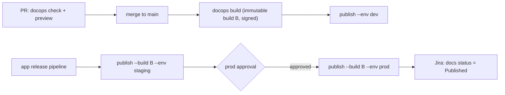

# DocOps: CLI and CI Specification

The `docops` CLI is the platform's primary execution engine ([ADR-0010](adr/0010-compute-in-customer-ci.md)). It runs in the customer's CI, where the code and caches already are, and it runs the same packages as the hosted workers, so a finding looks the same wherever it was produced.

## 1. Design principles

1. **Deterministic and offline-first.** `docops check --offline` runs every deterministic gate with no network access. Platform features (upload, preview, AI suggestions) add value on top of that and never gate correctness.
2. **Fast.** It checks a 5k-page repository in under 20 s on a CI runner. It is incremental by content hash, and with `--changed-only` it scopes reporting to changed files.
3. **Machine-readable everywhere.** Every command supports `--format json`, and reports have versioned schemas (`docops.report.v1`). Exit codes are stable.
4. **CI-native outputs.** SARIF (GitHub code scanning, Jenkins Warnings NG), GitLab Code Quality, JUnit, GitHub workflow annotations, and Markdown for PR comments.
5. **Secure by default.** Credentials come from CI workload identity (OIDC). Doc tests and plugins run only when explicitly enabled. External link checking refuses private and link-local addresses.

## 2. Installation and authentication

| Channel | Command |
|---|---|
| npm | `npm install --global @docops/cli@1` |
| Standalone binary (Node SEA, air-gapped) | `curl -fsSLO https://get.docops.example/cli/v1/docops-linux-x64 && chmod +x docops-linux-x64` |
| Container | `docker run --rm -v "$PWD:/repo" -w /repo ghcr.io/docops/cli:1 check` |
| This repository | `npm run docops -- <command>` |

Credentials are resolved in this order:

1. `--token` or `DOCOPS_TOKEN`.
2. CI workload identity, detected automatically:
   - GitHub Actions: `ACTIONS_ID_TOKEN_REQUEST_URL`
   - GitLab: `DOCOPS_ID_TOKEN` from `id_tokens:`
   - Azure Pipelines: `SYSTEM_OIDCREQUESTURI`
   - CircleCI: `CIRCLE_OIDC_TOKEN_V2`
3. `docops login` (OAuth device flow) for local use.

When none of these is available, the CLI runs offline.

## 3. Command reference

Global options: `-C, --cwd <dir>`, `-c, --config <file>` (default `docops.yaml`), `--format <fmt>`, `--report <fmt>=<file>` (repeatable), `--offline`, `--api-url <url>` (`DOCOPS_API_URL`), `--token <t>`, `--no-color`, `-q/--quiet`, `-v/--verbose`, `--version`, `--help`.

| Command | Purpose | Key options | Phase |
|---|---|---|---|
| `docops init` | Create `docops.yaml`, a docs skeleton and a CI workflow for the detected provider | `--provider github\|gitlab\|jenkins`, `--source <path>` | MVP |
| `docops config validate` | Validate `docops.yaml` against the [JSON Schema](../packages/config/schema/docops.schema.json); errors include line, column and JSON pointer | — | MVP |
| `docops extract` | Extract the page index and entities; print a snapshot | `--format json`, `--upload` | MVP |
| `docops check` | Run quality gates | `--base <ref>`, `--head <ref>`, `--only <groups\|rules>`, `--fail-on error\|warning\|never`, `--changed-only`, `--upload` | MVP |
| `docops diff` | Entity changes between refs and the pages they affect | `--base <ref>`, `--head <ref>`, `--format json\|text\|markdown` | MVP |
| `docops coverage` | Coverage per entity kind and the undocumented entities | `--kind <k>`, `--min <pct>` | MVP |
| `docops build` | Render the static site, including generated reference pages | `--out <dir>` (default `.docops/site`), `--version-name <v>`, `--audience <id>`, `--base-path <p>`, `--preview` | MVP |
| `docops preview` | Serve the site locally with live reload | `--port 4321`, `--open` | MVP |
| `docops publish` | Content-addressed upload of a build, then optional promotion | `--dir <dir>`, `--kind preview\|branch\|release`, `--env <name>`, `--build <id>` (promote an existing build), `--dotenv <file>` | MVP |
| `docops readiness` | Release readiness for a Jira fix version | `--project <KEY>`, `--fix-version <v>`, `--tickets <file.json>` (offline) | MVP |
| `docops link` | Add or remove a ticket link in page frontmatter | `docops link PAY-123 docs/guides/refunds.md [--remove]` | MVP |
| `docops new` | Create a page from a template | `docops new runbook docs/runbooks/db-failover.md` | MVP |
| `docops sync` | Rewrite `docops:include` blocks from their source files | `--check` | MVP |
| `docops release-notes` | Release notes from commits, PRs and tickets between refs | `--from <ref>`, `--to <ref>`, `--write <path>`, `--ai` | V1 |
| `docops test` | Run doc tests (fenced blocks marked `test`) | `--only <lang>`, `--timeout <ms>` | V1 |
| `docops ask` | Ask-the-docs from the terminal | `"<question>"`, `--version <v>` | V1 |
| `docops login` / `whoami` | Authenticate (device flow) or show the principal | — | MVP |
| `docops export` | Export tenant metadata (JSONL) | `--include graph,audit,...` | V1 |
| `docops reindex` | Rebuild the derived graph for a space from Git (admin) | `--space <key>` | V1 |

**Exit codes**

| Code | Meaning |
|---|---|
| 0 | Success. No blocking findings, or `--fail-on never`. |
| 1 | Quality gate failed (blocking findings remain after dismissals and waivers). |
| 2 | Usage or configuration error (`config/invalid`). |
| 3 | Internal error. |
| 4 | Platform unreachable, with `ci.failOnPlatformError` set (otherwise a warning and exit 0 or 1). |

### 3.1 `docops check` in detail

```text
$ docops check --base main      # examples/acme-payments, branch feature/PAY-131-amount-cents
DocOps 0.1.0 · payments · 5 pages · 46 entities · 33 references
Base main (88c7630) → feature/PAY-131-amount-cents: 2 added, 1 renamed, 2 modified

✖ schema/changed-without-docs  api/openapi.yaml:212
    2 user-visible change(s) in api/openapi.yaml (renamed api.property amount → amount_cents; api.schema PaymentCreate: properties −amount +amount_cents; required −amount +amount_cents); none of the 1 page(s) that reference them were updated: guides/payments.md
✖ schema/changed-without-docs  config/schema.json:7
    1 user-visible change(s) in config/schema.json (config.key PAYMENTS_TIMEOUT_MS: default 30000 → 60000); none of the 1 page(s) that reference them were updated: runbooks/payments-outage.md
✖ drift/stale-reference  docs/guides/payments.md:20
    `amount` refers to api.property:payments-api:PaymentCreate.amount, which was renamed to `amount_cents`.
    suggestion: -d '{"amount_cents": 2000, "currency": "usd", "customer_id": "cus_123"}'
✖ drift/stale-reference  docs/guides/payments.md:23
    `amount` refers to api.property:payments-api:PaymentCreate.amount, which was renamed to `amount_cents`.
    suggestion: Set `amount_cents` in minor currency units: `2000` is $20.00. The `currency` must be `usd`, `eur` or `gbp`.
✖ drift/stale-value  docs/runbooks/payments-outage.md:16
    config.key PAYMENTS_TIMEOUT_MS: default changed from 30000 to 60000, but this line still says 30000.
    suggestion: | `PAYMENTS_TIMEOUT_MS` | 60000 | How long to wait for the card processor |
⚠ coverage/undocumented-entity  api/openapi.yaml:166
    New public api.operation GET /v1/refunds/{refund_id} is not referenced by any page.
⚠ freshness/overdue-review  docs/runbooks/payments-outage.md:1
    Last reviewed 101 days ago (2026-07-10); the SLA for runbook pages is 90 days.

Coverage (L2): 83.3% · L1: 100%
5 errors · 2 warnings · 0 info · gate: FAILED · 59 ms
$ echo $?
1
```

This is real output from the scaffold, captured on the Acme example with the scenario in `packages/engine/test/fixtures.ts`. Each `suggestion:` line is a deterministic, one-click fix: the GitHub Action posts it as a ```` ```suggestion ```` on lines inside the PR diff and puts it in the sticky comment otherwise.

Pipeline: load config → enumerate pages → parse (mdast) → extract entities at head, and at base through `git show <base>:<path>` → build the reference index (explicit, link, mention, code sample) → diff entities → run rule groups → apply dismissals (platform) and inline pragmas → report → exit.

### 3.2 Rule catalog

| Rule | Group | Default | Deterministic | What it catches |
|---|---|---|---|---|
| `links/broken-internal` | links | block | ✓ | Relative link to a missing page or asset |
| `links/broken-anchor` | links | block | ✓ | `#anchor` missing in the target page (GitHub-compatible slugs) |
| `links/broken-external` | links.external | warn | ✓ | HTTP ≥ 400 or timeout (SSRF-guarded, cached, rate-limited per host) |
| `coverage/undocumented-entity` | coverage | warn | ✓ | Public entity added in this change with no doc reference |
| `coverage/below-threshold` | coverage | warn | ✓ | Coverage below `checks.coverage.minimum` |
| `schema/changed-without-docs` | schemaChange | block | ✓ | User-visible entity change with no referencing page modified (waiver label honored) |
| `drift/stale-reference` | drift | block | ✓ | Page references a removed or renamed entity |
| `drift/stale-value` | drift | block | ✓ | The old literal value of a changed attribute (default, enum, type) appears next to the entity mention |
| `drift/changed-entity` | drift | warn | ✓ | Referenced entity changed and the page was not touched |
| `drift/semantic` | drift.ai | warn | — (AI) | A sentence contradicted by the code diff (quote-verified) |
| `doctest/failed` | docTests | block | ✓ | Code sample exits non-zero or output mismatches `expect` |
| `style/inclusive-language` | style | warn | ✓ | Non-inclusive terms with suggested alternatives |
| `style/non-descriptive-link-text` | style | warn | ✓ | "click here", "here", "link" as link text (also WCAG 2.4.4) |
| `style/vale` | style.vale | warn | ✓ | Vale alerts passed through (`--output=JSON`) |
| `a11y/img-alt` | a11y | warn | ✓ | Images without alternative text |
| `a11y/heading-order` | a11y | warn | ✓ | Skipped heading levels; multiple `h1` |
| `frontmatter/missing-field` | frontmatter | block | ✓ | Required frontmatter field absent |
| `frontmatter/invalid` | frontmatter | block | ✓ | Malformed YAML, or unknown ticket or entity reference format |
| `freshness/overdue-review` | freshness | warn | ✓ | `reviewed:` older than the SLA for the page type |
| `ownership/missing-owner` | ownership | off | ✓ | No owner from frontmatter, CODEOWNERS or config |
| `secrets/detected` | secrets | block | ✓ | High-confidence secret patterns (cloud keys, tokens, private keys) |
| `includes/out-of-date` | includes | block | ✓ | A `docops:include` block differs from its source file |
| `config/invalid-source` | (always on) | block | ✓ | A configured source is missing or can't be extracted (unsupported types report `info`) |

**Suppression.** An inline pragma `<!-- docops-ignore drift/stale-reference -->` applies to the next block. `<!-- docops-ignore-file links/broken-external -->` applies to the whole page. A platform dismissal (with a reason, audited) persists by fingerprint. Waivers (for example the PR label `docs-not-needed`) apply only to the rules that define them.

### 3.3 Output formats

| `--format` / `--report` | Consumer |
|---|---|
| `text` | Humans (default on a TTY) |
| `json` | Machines: the `docops.report.v1` schema (below) |
| `sarif` | SARIF 2.1.0: GitHub code scanning, Jenkins Warnings NG, Azure DevOps |
| `markdown` | PR and MR comments (sticky, collapsible sections, suggestions) |
| `junit` | CI test tabs (one test case per rule group, failures per finding) |
| `codequality` | GitLab Code Quality widget (Code Climate subset) |
| `github` | `::error file=…,line=…::` workflow commands (annotations) |

```json
{
  "schema": "docops.report.v1",
  "tool": { "name": "docops", "version": "0.1.0" },
  "project": { "id": "payments", "repository": "acme/payments" },
  "base": { "ref": "origin/main", "sha": "3f2a91c..." },
  "head": { "ref": "WORKTREE", "sha": null },
  "summary": {
    "counts": { "error": 2, "warning": 2, "info": 0 },
    "byCategory": { "drift": 2, "schema": 1, "coverage": 1 },
    "coverage": { "percentL2": 83.3 },
    "gate": { "blocked": true, "reasons": ["2 findings at level block"] }
  },
  "changes": [
    { "entityKey": "api.property:payments-api:PaymentCreate.amount", "type": "renamed",
      "to": "api.property:payments-api:PaymentCreate.amount_cents", "breaking": true }
  ],
  "findings": [
    { "ruleId": "drift/stale-reference", "category": "drift", "severity": "error",
      "file": "docs/guides/payments.md", "line": 31,
      "entityKey": "api.property:payments-api:PaymentCreate.amount",
      "message": "`amount` refers to ... renamed to `amount_cents`.",
      "suggestion": { "kind": "replacement", "line": 31, "replacement": "..." },
      "fingerprint": "5d0c1e..." }
  ]
}
```

## 4. Configuration: `docops.yaml`

The canonical schema is [`packages/config/schema/docops.schema.json`](../packages/config/schema/docops.schema.json) (JSON Schema 2020-12). Editors get autocompletion through `# yaml-language-server: $schema=…`. Unknown keys are errors (`additionalProperties: false`), which catches typos before they turn into silently disabled gates.

| Section | Purpose | Notable fields |
|---|---|---|
| `project` | Space identity | `id` (stable key), `name`, `repository` |
| `docs` | Where pages live | `root`, `include`, `exclude`, `snippets`, `defaultPageType`, `defaultAudience` |
| `sources[]` | Reference sources → entities | `id`, `type` (`openapi`, `jsonschema`, `asyncapi`, …), `path`, `visibility`, `reference.outDir` |
| `versions` | Versioning | `strategy` (`single`, `git-tags`, `branches`), `tagPattern`, `label`, `keep` |
| `audiences[]` | Multi-audience builds | `id`, `include`, `exclude` |
| `checks` | Gate levels per group | `failOn`, `links`, `coverage`, `schemaChange`, `drift`, `docTests`, `style`, `a11y`, `frontmatter`, `freshness`, `ownership`, `secrets`, `includes` |
| `ownership` | Owners and SLAs | `codeowners`, `rules[]` (`pattern`, `owners`, `slaDays`) |
| `integrations.jira` | Linking and readiness | `site`, `projects`, `keyPattern`, `linkFrom`, `docsRequired` |
| `publish` | Environments and previews | `baseUrl`, `environments[]` (`branch`, `tags`, `requireApproval`), `preview` |
| `site` | Portal presentation | `title`, `logo`, `editUrl`, `theme` |
| `variables` | `{{ name }}` substitution | Any scalar values |
| `ai` | Opt-in AI features | `enabled`, `provider`, `model`, `logging` |
| `plugins[]` | Plugin SDK packages | `package`, `options` |

A complete example, which also serves as the fixture for the end-to-end tests:

<!-- docops:include path="../examples/acme-payments/docops.yaml" lang="yaml" -->
```yaml
# yaml-language-server: $schema=../../packages/config/schema/docops.schema.json
# Example DocOps configuration for a service repository ("Acme Payments").
version: 1

project:
  id: payments
  name: Acme Payments
  description: Card and bank payments API for Acme merchants.
  repository: acme/payments

docs:
  root: docs
  include: ["**/*.md", "**/*.mdx"]
  exclude: ["**/_drafts/**"]
  snippets: _snippets
  defaultPageType: guide
  defaultAudience: public

# Reference sources: DocOps extracts entities from these and requires the docs to cover them.
sources:
  - id: payments-api
    type: openapi
    path: api/openapi.yaml
    reference:
      outDir: reference/payments-api
      title: Payments API reference
  - id: payments-config
    type: jsonschema
    path: config/schema.json
    visibility: internal          # operator-facing settings, documented in runbooks

versions:
  strategy: git-tags
  tagPattern: "v*"
  label: "{major}.{minor}"
  keep: 5

audiences:
  - id: public
  - id: internal
    description: Operators and support engineers

checks:
  failOn: error
  links:
    level: block
    external: { enabled: false }
  coverage:
    level: warn
    minimum: 80
    measure: l2
    kinds: [api.operation]
    newEntities: warn
  schemaChange:
    level: block
    waiverLabel: docs-not-needed
  drift:
    level: block                  # removed or renamed entities, stale literal values
    changedEntityLevel: warn      # entity changed, page not touched
    mentions: contextual
    ai: { enabled: false, level: warn }
  docTests: { level: off }
  style:
    level: warn
    rules:
      style/inclusive-language: block
  a11y: { level: warn, standard: wcag22aa }
  frontmatter:
    level: block
    required: [title, owners]
  freshness:
    level: warn
    defaultSlaDays: 180
    byPageType: { runbook: 90 }
  secrets: { level: block }
  includes: { level: block }

ownership:
  codeowners: auto
  rules:
    - pattern: "runbooks/**"
      owners: ["@acme/payments-sre"]
      slaDays: 90

integrations:
  jira:
    site: acme.atlassian.net
    projects: [PAY]
    linkFrom: [pr_title, branch_name, commit_message, frontmatter]
    docsRequired:
      field: customfield_10071
      issueTypes: [Story, Bug]

publish:
  baseUrl: https://docs.acme.example/payments
  environments:
    - { name: dev, branch: main }
    - { name: staging }
    - { name: prod, tags: "v*", requireApproval: true }
  preview: { enabled: true, ttlDays: 7 }

site:
  title: Acme Payments Docs
  editUrl: https://github.com/acme/payments/edit/main/{path}
  theme: { primaryColor: "#0B5FFF" }

variables:
  productName: Acme Payments
  apiBaseUrl: https://api.acme.example
  supportEmail: payments-support@acme.example
```
<!-- docops:end-include -->

### 4.1 Page frontmatter

```yaml
---
title: Refund a payment            # required (frontmatter.required)
type: how_to                       # guide | how_to | tutorial | concept | reference | runbook | adr | postmortem | release_notes | onboarding
owners: ["@acme/payments-docs"]    # merged with CODEOWNERS and ownership.rules
tickets: [PAY-123]                 # creates ticket links (provenance: frontmatter)
entities:                          # explicit references (strongest signal for drift and coverage)
  - payments-api:POST /v1/refunds
  - api.schema:payments-api:Refund
audience: [public, partner]        # default: docs.defaultAudience
reviewed: 2026-09-30               # freshness evidence
sla_days: 90                       # override the freshness SLA
---
```

Entity references accept a full key (`api.operation:payments-api:POST /v1/refunds`), the shorthand `<source>:<METHOD> <path>`, or `<source>#<operationId>`.

## 5. GitHub Action

`docops/action@v1` is a JavaScript action (`runs.using: node24`) bundled into one file with no runtime dependencies. It calls the same library as the CLI, so it doesn't shell out. It writes the job summary to `GITHUB_STEP_SUMMARY`, emits annotations, updates a sticky PR comment (located through a hidden marker), posts ```` ```suggestion ```` comments for deterministic replacements, and sets outputs.

<!-- docops:include path="../packages/github-action/action.yml" lang="yaml" -->
```yaml
name: DocOps
description: Docs quality gates, drift detection, previews and publishing for docs-as-code.
author: DocOps
branding:
  icon: book-open
  color: blue

inputs:
  command:
    description: check | build | publish
    required: false
    default: check
  base:
    description: Base ref for schema-change and drift detection (e.g. origin/main). Defaults to the PR base.
    required: false
  config:
    description: Path to docops.yaml.
    required: false
    default: docops.yaml
  working-directory:
    description: Directory containing docops.yaml.
    required: false
    default: .
  fail-on:
    description: error | warning | never. Overrides checks.failOn.
    required: false
  comment:
    description: Create or update a sticky PR comment with the summary and suggestions.
    required: false
    default: "true"
  annotations:
    description: Emit inline annotations for findings on changed lines.
    required: false
    default: "true"
  preview:
    description: Build and upload a PR preview (requires the DocOps platform).
    required: false
    default: "false"
  sarif:
    description: Also write a SARIF 2.1.0 report to this path.
    required: false
  environment:
    description: For command=publish, the environment to promote to (dev, staging, prod).
    required: false
  version:
    description: Version label for build/publish (defaults to config or "latest").
    required: false
  api-url:
    description: DocOps API URL. Omit to run fully offline (deterministic gates only).
    required: false
  github-token:
    description: Token used for PR comments and check annotations.
    required: false
    default: ${{ github.token }}

outputs:
  conclusion:
    description: success | failure | neutral
  errors:
    description: Number of blocking findings.
  warnings:
    description: Number of warning findings.
  coverage:
    description: Coverage percentage for the configured entity kinds.
  preview-url:
    description: Preview URL when preview=true.
  sarif-file:
    description: Path of the SARIF report when sarif is set.

runs:
  using: node24
  main: dist/index.js
```
<!-- docops:end-include -->

## 6. Sample pipelines

### 6.1 GitHub Actions

<!-- docops:include path="../examples/ci/github-actions.yml" lang="yaml" -->
````yaml
# .github/workflows/docs.yml: DocOps on GitHub Actions.
# PRs: quality gates, a sticky PR comment, inline annotations and a preview.
# main: publish to dev. Release tags: promote the same build to prod (environment-protected).
name: docs

on:
  pull_request:
  push:
    branches: [main]
    tags: ["v*"]

permissions:
  contents: read
  pull-requests: write   # sticky comment and suggestion comments
  checks: write          # check run with annotations
  id-token: write        # OIDC token exchange: no DocOps secret stored in GitHub

concurrency:
  group: docs-${{ github.workflow }}-${{ github.ref }}
  cancel-in-progress: true

jobs:
  check:
    if: github.event_name == 'pull_request'
    runs-on: ubuntu-latest
    steps:
      # Pin third-party actions to a full commit SHA in production workflows.
      - uses: actions/checkout@v5
        with:
          fetch-depth: 0            # base ref needed for schema-change and drift detection
      - id: docops
        uses: docops/action@v1
        with:
          command: check
          base: origin/${{ github.base_ref }}
          comment: true             # sticky summary comment and ```suggestion blocks
          annotations: true         # inline annotations on changed lines
          preview: true             # build and upload a preview; URL in the comment
          sarif: docops.sarif       # optional: also feed GitHub code scanning
      - if: always() && steps.docops.outputs.sarif-file != ''
        uses: github/codeql-action/upload-sarif@v4
        with:
          sarif_file: ${{ steps.docops.outputs.sarif-file }}
          category: docops

  publish:
    if: github.event_name == 'push'
    runs-on: ubuntu-latest
    environment: ${{ startsWith(github.ref, 'refs/tags/') && 'production' || 'development' }}
    steps:
      - uses: actions/checkout@v5
        with:
          fetch-depth: 0
      - uses: docops/action@v1
        with:
          command: publish
          # Tags promote to prod (environment protection rules require an approver);
          # main promotes to dev.
          environment: ${{ startsWith(github.ref, 'refs/tags/') && 'prod' || 'dev' }}
          version: ${{ startsWith(github.ref, 'refs/tags/') && github.ref_name || 'latest' }}
````
<!-- docops:end-include -->

### 6.2 GitLab CI

<!-- docops:include path="../examples/ci/gitlab-ci.yml" lang="yaml" -->
```yaml
# .gitlab-ci.yml: DocOps on GitLab CI/CD.
# Merge requests: gates in the Code Quality widget and JUnit tab, plus a review-app preview.
# Default branch: publish to dev. Release tags: publish to prod.
stages: [check, preview, publish]

variables:
  DOCOPS_API_URL: https://api.docops.example
  GIT_DEPTH: "0"                       # full history for --base comparisons

.docops:
  image: node:24-alpine
  id_tokens:
    DOCOPS_ID_TOKEN:                   # GitLab OIDC token, exchanged for a 15-minute DocOps token
      aud: https://api.docops.example
  before_script:
    - apk add --no-cache git
    - npm install --global @docops/cli@1

docs:check:
  extends: .docops
  stage: check
  rules:
    - if: $CI_PIPELINE_SOURCE == "merge_request_event"
  script:
    - git fetch origin "$CI_MERGE_REQUEST_TARGET_BRANCH_NAME"
    - >
      docops check
      --base "origin/$CI_MERGE_REQUEST_TARGET_BRANCH_NAME"
      --report codequality=gl-code-quality-report.json
      --report junit=docops-junit.xml
      --report markdown=docops-summary.md
      --upload
  artifacts:
    when: always
    reports:
      codequality: gl-code-quality-report.json
      junit: docops-junit.xml
    paths: [docops-summary.md]

docs:preview:
  extends: .docops
  stage: preview
  rules:
    - if: $CI_PIPELINE_SOURCE == "merge_request_event"
  script:
    - docops build --preview --out public
    - docops publish --dir public --kind preview --dotenv preview.env   # writes DOCOPS_PREVIEW_URL=...
  artifacts:
    reports:
      dotenv: preview.env
  environment:
    name: review/$CI_COMMIT_REF_SLUG
    url: $DOCOPS_PREVIEW_URL
    auto_stop_in: 1 week

docs:publish:
  extends: .docops
  stage: publish
  rules:
    - if: $CI_COMMIT_BRANCH == $CI_DEFAULT_BRANCH
      variables: { DOCOPS_ENV: dev, DOCOPS_VERSION: latest }
    - if: $CI_COMMIT_TAG =~ /^v\d+\.\d+\.\d+$/
      variables: { DOCOPS_ENV: prod, DOCOPS_VERSION: $CI_COMMIT_TAG }
  script:
    - docops build --out public --version-name "$DOCOPS_VERSION"
    - docops publish --dir public --env "$DOCOPS_ENV"
  environment:
    name: docs/$DOCOPS_ENV
    deployment_tier: production
```
<!-- docops:end-include -->

### 6.3 Jenkins

<!-- docops:include path="../examples/ci/Jenkinsfile" lang="groovy" -->
```groovy
// Jenkinsfile: DocOps in a declarative multibranch pipeline.
// Requires: Docker Pipeline, Warnings Next Generation (SARIF parser), JUnit.
pipeline {
  agent { docker { image 'node:24' } }

  options {
    timeout(time: 15, unit: 'MINUTES')
    disableConcurrentBuilds(abortPrevious: true)
  }

  environment {
    DOCOPS_API_URL = 'https://api.docops.example'
    // Jenkins has no built-in workload identity: use a short-lived token from Vault,
    // or a service-account token scoped to checks:write and builds:write.
    DOCOPS_TOKEN = credentials('docops-ci-token')
  }

  stages {
    stage('Install DocOps CLI') {
      steps { sh 'npm install --global @docops/cli@1' }
    }

    stage('Docs gates') {
      when { changeRequest() }
      steps {
        sh 'git fetch --no-tags origin "+refs/heads/${CHANGE_TARGET}:refs/remotes/origin/${CHANGE_TARGET}"'
        sh '''
          docops check \
            --base "origin/${CHANGE_TARGET}" \
            --report sarif=docops.sarif \
            --report junit=docops-junit.xml \
            --upload
        '''
      }
      post {
        always {
          recordIssues(tools: [sarif(pattern: 'docops.sarif', id: 'docops', name: 'DocOps')])
          junit(allowEmptyResults: true, testResults: 'docops-junit.xml')
        }
      }
    }

    stage('Preview') {
      when { changeRequest() }
      steps {
        sh 'docops build --preview --out site'
        sh 'docops publish --dir site --kind preview'
      }
    }

    stage('Publish') {
      when { anyOf { branch 'main'; buildingTag() } }
      steps {
        script {
          env.DOCOPS_ENV = env.TAG_NAME ? 'prod' : 'dev'
          env.DOCOPS_VERSION = env.TAG_NAME ?: 'latest'
        }
        sh 'docops build --out site --version-name "$DOCOPS_VERSION"'
        sh 'docops publish --dir site --env "$DOCOPS_ENV"'
      }
    }
  }
}
```
<!-- docops:end-include -->

### 6.4 Other CI systems

| CI | Integration |
|---|---|
| Azure Pipelines | `DocOps@1` task (wraps the CLI). OIDC through a workload-identity service connection; SARIF results appear in the Scans tab. |
| CircleCI | `docops/docops@1` orb with `check`, `build` and `publish` jobs. OIDC through `CIRCLE_OIDC_TOKEN_V2`. |
| Bitbucket Pipelines | `docops/docops-pipe:1`. Reports post to Code Insights (annotations). |
| Argo CD | Docs promotion follows the app: a `PostSync` hook Job runs `docops publish --build $DOCS_BUILD_ID --env prod`, with the build ID pinned in the same GitOps commit as the application image. |

### 6.5 Promoting docs alongside the application



The same build, with the same manifest digest and signature, moves through environments. Docs aren't rebuilt during promotion, so what was reviewed is exactly what ships.
