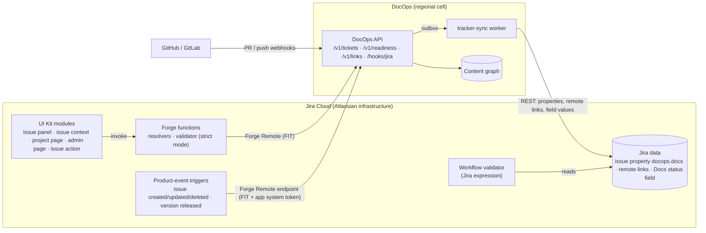
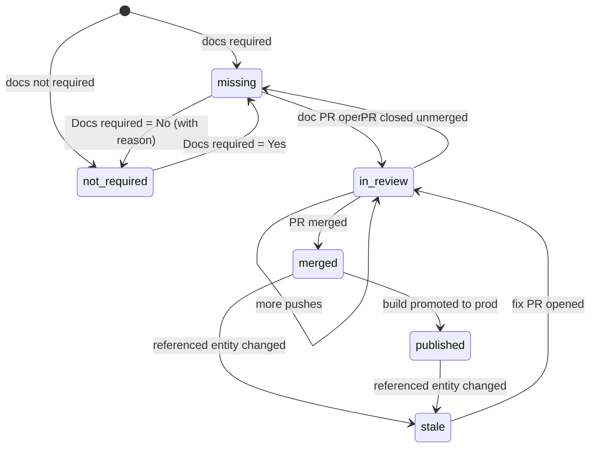

# DocOps: Jira Integration Design

This design covers the Forge app structure, the data contract written into Jira, the custom fields, the docs-status state machine, workflow enforcement, automation rules, the release-readiness view, and the Data Center strategy. The platform choice and the 2026 platform facts behind it are recorded in [ADR-0009](adr/0009-jira-forge-app.md).

## 1. Goals

| Goal | Mechanism |
|---|---|
| Every ticket shows whether its docs exist, are in review, merged, published or stale | Issue panel, issue context glance, *Docs status* field |
| Links form automatically from normal developer behavior | PR titles, branches and commits containing `PAY-123`; page frontmatter `tickets:` |
| Tickets with user-facing changes can't close without merged docs | Workflow validator on the *Done* transition |
| Release managers see readiness per fix version and act on it | *Docs readiness* project page with bulk doc-task creation |
| Jira remains a system of record | Status and links are written to Jira (issue property, remote links, field), not kept only in DocOps |

## 2. Architecture



Responsibilities are deliberately asymmetric:

- **Forge functions are thin.** They authenticate, map context (issue key, project, fix version) and render.
- **All logic runs in DocOps.** That includes status computation, linking and readiness, so the same pure functions serve Jira, the CLI (`docops readiness`) and the web app.
- **Outbound updates to Jira** run in the `tracker-sync` worker, which uses the app system token (`x-forge-oauth-system`) received on trigger calls, or OAuth for Data Center. Updates are idempotent and coalesced per issue.

## 3. Forge app structure

```text
apps/jira-forge/
├── manifest.yml                 # modules, remotes, permissions (below)
├── package.json                 # @forge/api, @forge/bridge, @forge/react, @forge/resolver
├── src/
│   ├── index.ts                 # resolver definitions → invokeRemote("docops", …)
│   ├── contract.ts              # typed contract shared by the UI and the resolvers
│   ├── validation.ts            # pure: validates every resolver payload (user input)
│   ├── view-model.ts            # pure: API payload → panel/readiness view model
│   └── frontend/
│       ├── issue-panel.tsx      # Docs panel: status lozenge, pages, PRs, "Link doc" action
│       ├── issue-context.tsx    # Glance in the issue context area
│       ├── readiness.tsx        # Project page: readiness per fix version
│       ├── admin.tsx            # Configure: connect tenant, field mapping, projects
│       ├── link-dialog.tsx      # Issue action: search & link a page
│       ├── api.ts               # typed invoke() wrapper over @forge/bridge
│       └── shared.tsx           # loader hook, status lozenge, error notice, link form
└── test/                        # node:test suites for the pure modules
```

### 3.1 `manifest.yml`

<!-- docops:include path="../apps/jira-forge/manifest.yml" lang="yaml" -->
```yaml
app:
  id: ari:cloud:ecosystem::app/00000000-0000-0000-0000-000000000000
  runtime:
    name: nodejs24.x

modules:
  jira:issuePanel:
    - key: docops-docs-panel
      resource: issue-panel
      resolver: { function: resolver }
      render: native
      title: Docs
      icon: https://static.docops.example/forge/docs-16.svg
  jira:issueContext:
    - key: docops-docs-glance
      resource: issue-context
      resolver: { function: resolver }
      render: native
      title: Docs status
      label: Docs
  jira:projectPage:
    - key: docops-readiness
      resource: readiness
      resolver: { function: resolver }
      render: native
      title: Docs readiness
  jira:adminPage:
    - key: docops-admin
      resource: admin
      resolver: { function: resolver }
      render: native
      title: DocOps
      useAsConfig: true
  jira:issueAction:
    - key: docops-link-doc
      resource: link-dialog
      resolver: { function: resolver }
      render: native
      title: Link documentation
  jira:customField:
    - key: docs-status
      name: Docs status
      description: Documentation status computed by DocOps (read-only).
      type: string
      readOnly: true
  jira:workflowValidator:
    - key: docs-merged-validator
      name: Docs merged (DocOps)
      description: Blocks the transition when docs are required but not merged or published.
      expression: >-
        issue.properties['docops.docs'] == null
        || issue.properties['docops.docs'].required != 'yes'
        || ['merged', 'published'].includes(issue.properties['docops.docs'].status)
      errorMessage: "Docs required: link a merged doc change, or set Docs required = No with a reason."
  trigger:
    - key: docops-issue-events
      endpoint: docops-events
      events:
        - avi:jira:created:issue
        - avi:jira:updated:issue
        - avi:jira:deleted:issue
        - avi:jira:released:version
      filter:
        ignoreSelf: true          # our own property/field writes do not loop back
  function:
    - key: resolver
      handler: index.handler
  endpoint:
    - key: docops-events
      remote: docops
      route:
        path: /hooks/jira
      auth:
        appSystemToken:
          enabled: true           # lets the worker write properties, links and field values

remotes:
  - key: docops
    baseUrl:
      default: https://api.docops.example
      EU: https://api.eu.docops.example
    operations: [compute, fetch]

resources:
  - { key: issue-panel, path: src/frontend/issue-panel.tsx }
  - { key: issue-context, path: src/frontend/issue-context.tsx }
  - { key: readiness, path: src/frontend/readiness.tsx }
  - { key: admin, path: src/frontend/admin.tsx }
  - { key: link-dialog, path: src/frontend/link-dialog.tsx }

permissions:
  scopes:
    - read:jira-work              # read issues, versions, projects
    - write:jira-work             # issue properties, remote links, doc sub-tasks
    - read:app-system-token
    - storage:app
  external:
    fetch:
      backend:
        - remote: docops
```
<!-- docops:end-include -->

Notes:

- **Scopes are minimal.** Classic `read:jira-work` and `write:jira-work` cover issue properties, remote links and issue creation. Moving to granular scopes (`write:issue.property:jira`, `write:issue.remote-link:jira`) is tracked for the Marketplace security review. Writing app field values uses `PUT /rest/api/3/app/field/{fieldIdOrKey}/value`, which only the owning app may call.
- **Residency.** The per-region `baseUrl` keeps tenant data in the tenant's cell. Forge hosted storage is used only for non-content configuration (the tenant connection), and secrets are set with `forge variables set --encrypt`.
- **Auth.** Every remote call carries a FIT, an RS256 JWT that DocOps verifies against `https://forge.cdn.prod.atlassian-dev.net/.well-known/jwks.json` with `iss = forge/invocation-token`, `aud =` the app ARI (`DOCOPS_FORGE_APP_ID`), `exp` (30 s of clock skew) and a `jti` replay cache. `app.installationId` resolves the tenant through `tenant_routes` (kind `forge_installation`). The token carries the installation ARI (`ari:cloud:ecosystem::installation/<uuid>`) and the admin page shows its UUID, and DocOps keys the route on the UUID, so either form registers the installation. The call then acts as the installation's service account, whose `tracker_app` role covers only what the resolvers call ([Security §3](08-security-compliance.md#3-rbac-matrix)). Trigger calls to `/hooks/jira` are authenticated by the FIT alone, with no HMAC.

## 4. Data contract in Jira

### 4.1 Issue entity property `docops.docs`

The property is limited to 32 KB of JSON. It is written by the `tracker-sync` worker and read by the validator and by any customer automation.

```json
{
  "v": 1,
  "required": "yes",
  "status": "in_review",
  "reasons": ["PR acme/payments#482 open (touches docs/guides/refunds.md)"],
  "pages": [
    { "path": "guides/refunds.md", "url": "https://docs.acme.example/payments/guides/refunds/", "stale": false }
  ],
  "pullRequests": [{ "repo": "acme/payments", "number": 482, "state": "open" }],
  "updatedAt": "2026-10-18T14:05:12Z",
  "source": "docops://cells/us-1"
}
```

### 4.2 Remote issue links

Remote links are upserted by `globalId` (`POST /rest/api/3/issue/{key}/remotelink`), so they are idempotent:

| Target | `globalId` | Title |
|---|---|---|
| Page | `docops:page:{tenantId}:{pageId}` | `📄 Refund a payment (docs)` |
| Pull request | `docops:pr:{provider}:{repo}#{number}` | `PR #482 · Rename amount → amount_cents` |
| Preview | `docops:preview:{buildId}` | `Preview: Refund a payment` (removed on PR close) |

### 4.3 Custom fields

| Field | Type | Owner | Purpose |
|---|---|---|---|
| **Docs status** | Forge `jira:customField` (`string`, `readOnly: true`) | App | Values `Not required`, `Missing`, `In review`, `Merged`, `Published`, `Stale`; JQL-searchable (`"Docs status" = Missing AND fixVersion = 2.4.0`) |
| **Docs required** | Standard select custom field (Yes / No), created by a Jira administrator during setup. The admin page lists the steps; the app cannot create fields itself because it does not request the broad `manage:jira-configuration` scope (T31). | Customer | Input to status. Its default is set by automation rule R1. |
| **Docs not required reason** | Standard paragraph field | Customer | Required by rule R2 when *Docs required* = No; mirrored to the DocOps audit log |

## 5. Linking

| Source | Provenance (`ticket_links.source`) | Example |
|---|---|---|
| PR title, body or branch | `pr_title`, `pr_body`, `branch_name` | `feature/PAY-123-partial-refunds` |
| Commit message | `commit_message` | `PAY-123 document partial refunds` |
| Page frontmatter | `frontmatter` | `tickets: [PAY-123]` |
| Jira panel or issue action | `tracker_panel` | "Link documentation" dialog; also written to the Jira property and remote link |
| API | `api` | `POST /v1/links` |

Keys are extracted with `integrations.jira.keyPattern` and filtered to `integrations.jira.projects`. Unknown keys are resolved lazily against Jira and cached. A PR is a **doc change** when it modifies any file under the docs root, or any page-generating source such as `api/openapi.yaml`.

## 6. Docs status state machine



The status is a **pure function** in `@docops/engine` (`computeDocsStatus`). The API, CLI, worker and tests all call the same implementation:

```ts
// precedence (first match wins)
if (!required && docLinks.length === 0) return "not_required";
if (openDocPullRequests.length > 0)    return "in_review";
if (linkedPages.some((p) => p.stale))  return "stale";
if (mergedDocChanges.length > 0)       return linkedPages.length > 0 && linkedPages.every((p) => p.published)
                                         ? "published" : "merged";
return required ? "missing" : "not_required";
```

**Readiness** for a fix version is `readyPercent = (published + merged + not_required) / total × 100`, with `blockers = missing + stale`. A release is *ready* when `blockers = 0` and `in_review = 0`.

## 7. Workflow enforcement

| Mode | Implementation | Trade-off |
|---|---|---|
| **Standard** (default) | Expression validator reading `issue.properties['docops.docs']` (manifest above) | No network call during the transition; uses the last pushed status (seconds old). If the property is absent, the transition is allowed. |
| **Strict** | Function validator: a Forge function calls `GET /v1/tickets/{key}/docs` and returns `{ result, errorMessage }` | Authoritative and current. Adds about 200–400 ms to the transition, and fails closed when DocOps is unreachable (configurable). |

Admins add the validator to the *Done* transition of the relevant workflows. The setup wizard lists matching workflows and links to each.

## 8. Automation rules

DocOps ships these as an importable Jira Automation rule set (JSON) plus app-native behavior:

| # | Trigger | Condition | Action | Where |
|---|---|---|---|---|
| R1 | Issue created | Type in (Story, Bug) and component in (*Public API*, *SDK*, *CLI*) | Set *Docs required* = Yes | Jira Automation |
| R2 | Field value changed: *Docs required* | New value = No and *Docs not required reason* is empty | Revert to Yes and comment "Add a reason to waive docs" | Jira Automation |
| R3 | Issue transitioned to *In Review* | *Docs status* = Missing | Comment to the assignee with a link to the DocOps `docops new` guide | Jira Automation |
| R4 | Version released (`avi:jira:released:version`) | — | DocOps generates release notes for the version as a PR (V1) and snapshots readiness for audit | App trigger |
| R5 | DocOps `docops.drift.detected` or new undocumented public entity (merged) | No existing doc task for the entity key | Create a *Doc task* sub-task under the originating issue, assigned to the page owner | DocOps worker |
| R6 | Scheduled weekly | JQL `"Docs status" = Stale` | Digest to page owners (Slack, Teams or email) | DocOps notification service |
| R7 | DocOps `docops.release.readiness_changed` | `readyPercent` < 80 within 3 days of the release date | Notify the release manager | Jira Automation (incoming webhook) |

## 9. Release readiness view

```text
┌ Docs readiness · PAY · Fix version [2.4.0 ▾] ───────────────────── data as of 14:05:12 ┐
│  Ready 82%  ▕██████████████████▏      Blockers 3 (Missing 2, Stale 1)   In review 4     │
│  [Create doc tasks for Missing (2)]  [Export CSV]  [Open traceability report]           │
├──────────┬───────────────────────────────────┬────────────┬─────────────┬───────────────┤
│ Issue    │ Summary                           │ Docs req.  │ Docs status │ Pages / PRs   │
├──────────┼───────────────────────────────────┼────────────┼─────────────┼───────────────┤
│ PAY-123  │ Partial refunds                   │ Yes        │ ● In review │ refunds.md #482│
│ PAY-131  │ Rename amount → amount_cents      │ Yes        │ ● Stale     │ payments.md   │
│ PAY-140  │ Webhook retries                   │ Yes        │ ● Missing   │ —             │
│ PAY-152  │ Internal metrics                  │ No (reason)│ ○ Not req.  │ —             │
└──────────┴───────────────────────────────────┴────────────┴─────────────┴───────────────┘
```

- The data comes from `GET /v1/readiness`. The ticket mirror is kept fresh by triggers, and a JQL refresh (`POST /rest/api/3/search/jql`, paginated by `nextPageToken`) runs when the mirror is older than 60 s.
- Accessibility: the table has a header row and row headers; the status lozenge carries text, not only color; and everything is operable from the keyboard.
- **Only issues the viewer can see.** DocOps answers as the app, so it covers every mirrored issue. The Forge resolver then runs the same fix-version JQL *as the viewing user*, which applies project permissions and issue security levels, keeps only the rows Jira returned, and recomputes the totals from them so hidden issues don't leak through the counts. If the search fails or the version has more than 2,000 issues (20 pages of 100), the view fails closed and shows nothing.
- *Create doc tasks* calls `POST /v1/readiness/doc-tasks`, which is idempotent per (parent issue, fix version) and audited. The resolver first checks the user's own *Create issues* permission and that every requested ticket is in the visible set.

## 10. Jira Data Center strategy

| Capability | Cloud (Forge) | Data Center (REST-only) |
|---|---|---|
| Issue panel | `jira:issuePanel` | Remote links plus the issue property, visible in the standard issue view; a DocOps web app deep link |
| Docs status field | Forge read-only field | A standard text field updated by DocOps through REST (admin creates it at setup) |
| Validator | Expression or function | ScriptRunner validator snippet (provided) or the customer's own scripted validator calling `/v1/tickets/{key}/docs` |
| Events | Forge triggers through Forge Remote | Admin webhooks with a secret: `X-Hub-Signature: sha256=…`, deduplicated by `X-Atlassian-Webhook-Identifier` |
| Auth to Jira | App system token | OAuth 2.0 (incoming link) or a personal access token for a service user |
| Network | Atlassian → DocOps cell | Customer firewall: DocOps self-hosted inside the network, or an allowlisted egress from the SaaS cell |

We recommend minimal DC investment because of the announced 2029-03-28 end of life. Customers migrating to Cloud keep their links, because links live in Jira itself (properties and remote links) and DocOps rebuilds its mirror from them.

## 11. Other trackers (connector SDK)

```ts
export interface TrackerConnector {
  kind: "jira" | "jira_dc" | "linear" | "azure_boards" | "github";
  parseKeys(text: string): string[];
  getTickets(keys: string[]): Promise<TrackerTicket[]>;
  ticketsInRelease(project: string, release: string): AsyncIterable<TrackerTicket>;
  writeStatus(ticket: TrackerTicket, status: DocsStatusSnapshot): Promise<void>;   // property/field equivalent
  upsertLink(ticket: TrackerTicket, link: RemoteLink): Promise<void>;
  createTask(parent: TrackerTicket, task: DocTaskDraft): Promise<TrackerTicket>;
  verifyWebhook(req: Request): Promise<VerifiedEvent | null>;
}
```

| Tracker | Status write | Link write | Release concept |
|---|---|---|---|
| Linear (V2) | Custom attachment metadata | Attachment (URL) | Cycle / project milestone |
| Azure Boards (V2) | Work item field (custom) | Hyperlink / ArtifactLink | Iteration path or tag |
| GitHub Issues (V2) | Issue field or label | Timeline comment and checks | Milestone |

## 12. Testing

- **Unit:** `computeDocsStatus`, key extraction and readiness aggregation are pure and table-tested in `packages/engine` and `packages/jira`.
- **Contract:** recorded Jira payloads (issue updated, version released, JQL pages) replay through `/hooks/jira`. A fake Jira client asserts the exact property, remote-link and field calls.
- **Forge:** view-model functions are unit-tested without Forge dependencies. `forge tunnel` is used for manual end-to-end checks against a development site, and the expression validator is verified there before each Marketplace release.
