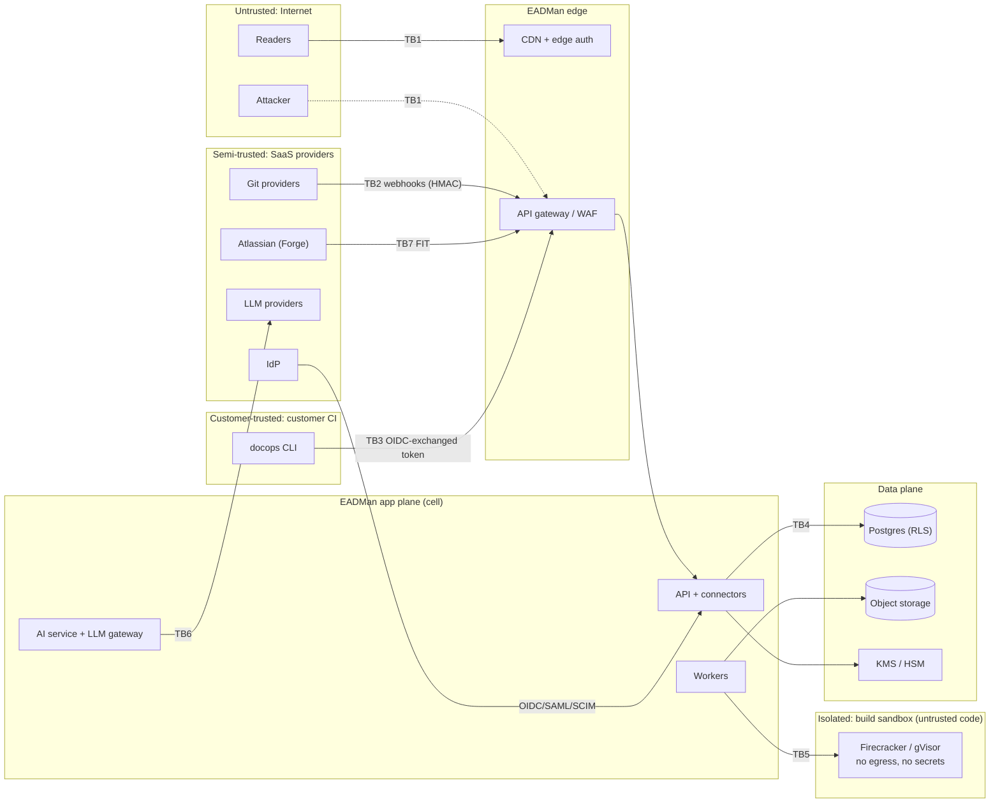

# EADMan: Security and Compliance Design

This document covers the threat model (STRIDE), the RBAC matrix and the audit schema, with compliance mappings for SOC 2, ISO 27001, GDPR and HIPAA. Several mechanisms are verified by tests in the MVP scaffold, and each section says which.

## 1. Assets, trust boundaries and security objectives

| Asset | Sensitivity | Where it lives |
|---|---|---|
| Unpublished and internal documentation | Confidential (may describe vulnerabilities and infrastructure) | Customer Git; derived copies in Postgres, the search index and object storage |
| Credentials: GitHub App keys, installation and user tokens, Jira tokens, webhook secrets | Secret | Envelope-encrypted columns, KMS; minted short-lived per job |
| Embeddings and chunks | Confidential (inversion risk) | Search index |
| AI prompts and answers | Confidential | `ai_answers` (ciphertext or hash) |
| Audit log | Integrity-critical evidence | `audit_events`, WORM export |
| Build artifacts and portal content | Integrity-critical (public face) | Object storage, CDN |
| Identity data (users, groups) | Personal data | Postgres (SCIM mirror) |



**Objectives.** (1) Tenant isolation must hold under application bugs. (2) No path lets unauthorized content reach a user or a model. (3) Everything that publishes is attributable, signed and reproducible. (4) Untrusted code never runs with secrets or network access. (5) Every control produces evidence an auditor can verify.

## 2. Threat model (STRIDE)

Likelihood and impact are rated H, M or L. Residual risk is the risk after mitigations. "Verified by" names the automated test or control evidence.

| ID | STRIDE | Boundary / component | Threat | L / I | Mitigations | Residual | Verified by |
|---|---|---|---|---|---|---|---|
| T01 | S | TB2 webhook receivers | Forged Git or Jira webhooks mark PRs merged or tickets done | M / H | HMAC (`X-Hub-Signature-256`, Jira `X-Hub-Signature`) with constant-time compare; delivery-ID dedupe; 5-minute replay window. **Confirm before acting:** gating transitions (merged, released) are re-read from the provider API before taking effect. | L | `apps/api/test/webhooks.test.ts` (bad signature rejected, duplicates ignored) |
| T02 | S/E | TB3 CI → API | Stolen CI credentials publish to prod | M / H | OIDC federation pinned to **immutable** claims (`repository_id`, `repository_owner_id`) plus `ref` and `environment`; 15-minute tokens; prod promotion needs environment protection and approval; alert on publish from an unusual ref or actor | L | Trust-policy unit tests; publish audit review |
| T03 | S | Identity | SAML assertion forgery (XML signature wrapping) or replay | L / H | Vetted SAML library; signed response **and** assertion required; strict audience, recipient and `InResponseTo`; assertion replay cache; ±3 minute skew | L | SAML conformance suite (V1) |
| T04 | S | TB7 Forge | Spoofed Forge calls or FIT replay | L / H | RS256 signature checked against Atlassian's JWKS (cached; a token naming an unknown `kid` refetches at most every 30 s); `iss = forge/invocation-token`; `aud =` app ARI (`DOCOPS_FORGE_APP_ID`); `exp` and `nbf` enforced with 30 s of clock skew; `jti` replay cache shared by all replicas; `app.installationId` → tenant through `tenant_routes`, and an unknown installation gets a 401. The call acts as the installation's service account, limited to the `tracker_app` role (§3) | L | `apps/api/test/forge.test.ts` (valid token; wrong `iss` or `aud`, expired, replayed `jti` and bad signatures rejected; unknown installation; the Forge principal cannot publish; FITs on `/hooks/jira`) |
| T05 | S | Web app | Session hijacking | M / M | `HttpOnly; Secure; SameSite=Lax` cookies; 10-minute access JWT with rotation; re-authentication for admin actions; session revocation on SCIM deprovisioning (≤ 60 s) | L | E2E session tests |
| T06 | T/E | TB5 hosted builds | Repository content (MDX expressions, plugins, doc tests) runs code on our infrastructure | H / H | Builds run primarily in **customer CI** (ADR-0010). Hosted builds use Firecracker or gVisor sandboxes with no network egress, no credentials, read-only base images, CPU, memory and time limits, and are destroyed after each job. MDX expressions are evaluated only in sandboxes. | L | Sandbox escape tests; egress-deny tests |
| T07 | T | Build → serve | Artifacts tampered between build and serving | L / H | Content-addressed blobs (sha256 checked on upload); signed manifest (cosign keyless in SaaS, KMS key when self-hosted); signature checked at promotion; versioned buckets with Object Lock for prod | L | `apps/api/test/builds.test.ts` (digest mismatch rejected) |
| T08 | T/R | Audit | Audit records altered or deleted | L / H | DB grants revoke UPDATE and DELETE; append-only trigger; per-tenant SHA-256 hash chain; KMS-signed daily checkpoints; WORM export | L | `packages/db/test/rls.test.ts` (append-only); `apps/api/test/audit.test.ts` (chain verification detects tampering) |
| T09 | T | AI suggestions | An AI patch smuggles a malicious link or script into docs | M / M | Patch confined to flagged lines; link allowlist check; sanitized rendering; human approval plus CODEOWNERS review | L | Patch validator tests |
| T10 | T/E | Supply chain | Compromised dependency, action or CLI release | M / H | Lockfiles; third-party actions pinned by SHA; Renovate with review; OSV scanning; CycloneDX SBOM per release; SLSA L3 provenance; Sigstore-signed CLI binaries and action; `npm --provenance` | M | CI supply-chain job |
| T11 | T | `docops.yaml` | A PR weakens gates (`block` → `off`) to sneak changes through | M / M | Org **policy floor**: tenants set minimum levels the repository config can't go below. The `config/gate-weakened` finding requires a maintainer label. A CODEOWNERS entry for `docops.yaml` is recommended. | L | Config policy tests (V1) |
| T12 | R | Gates and publishing | Disputed overrides, waivers, dismissals or publishes | M / M | Every action audited with actor, auth method, IP, reason and request/trace ID. Waivers and dismissals need a reason. Prod approver identity comes from the CI environment protection. | L | Audit coverage test (each mutating route emits an event) |
| T13 | I | TB4 data | Cross-tenant leakage through an application bug | M / H | `FORCE ROW LEVEL SECURITY` on every tenant table; app role without `BYPASSRLS`; `withTenant()` required; per-tenant DEKs; tenant-partitioned indexes; continuous canary probes | L | `packages/db/test/rls.test.ts` |
| T14 | I | Search / AI | Users or the model see unauthorized content | M / H | Mandatory principal filter inside the index query; live ACL re-check of citations; permission-trap eval with a hard gate of zero | L | AI eval `qa-permission-traps`; search ACL tests |
| T15 | I | Previews | Unreleased docs exposed through preview URLs | M / M | Previews require auth (repository read permission or SSO); unguessable build IDs; `noindex`; expiry 7 days after the PR closes | L | Preview auth tests |
| T16 | I | Content | Secrets committed in docs get published, indexed or sent to an LLM | M / H | `secrets/detected` gate (block); redaction before indexing and before LLM calls; publish refuses builds with findings | L | Secret-rule tests |
| T17 | I/E | Link checker, `$ref`, webhooks | SSRF to metadata or internal services | M / H | Egress proxy denying private, link-local, loopback and metadata ranges (IPv4 and IPv6), with DNS resolution pinned against rebinding; remote `$ref` disabled unless allowlisted; webhook URLs must be `https` and public; per-host rate limits | L | `packages/checks/test/ssrf.test.ts` |
| T18 | I/E | Portal | XSS through Markdown, HTML, OpenAPI descriptions or embeds | M / H | Raw HTML dropped or sanitized by allowlist; strict CSP with no inline scripts (hashed islands only); Trusted Types; user content and try-it served from a separate origin; sandboxed iframes | L | Renderer sanitization tests |
| T19 | I | Try-it console | API credentials entered by readers leak | M / M | Credentials held in memory only and never persisted or logged; requests go direct from the browser where CORS allows, otherwise through a stateless proxy that never logs auth headers; per-environment host allowlist | L | Console security review |
| T20 | I | Index | Embeddings inverted to recover text | L / M | Embeddings never exposed by the API; encrypted at rest; tenant-scoped; deleted with the source | L | API schema review |
| T21 | I | TB6 LLM | Provider retains or trains on content | L / H | Tenant-approved providers only; zero retention where offered; contractual no-training; redaction; self-hosted option | L | Vendor reviews; DPA |
| T22 | I | AI output | Prompt injection exfiltrates data through answers | M / H | Sources delimited as data; **no tools** during generation; link allowlist; images never rendered; CSP; injection eval with a hard gate of zero | L | AI eval `injection` |
| T23 | I/E | Operations | Operator or support access to tenant content | L / H | No standing access. Just-in-time access, time-boxed and approved (customer approval configurable), recorded in the tenant's own audit log. Break-glass alerts security on-call. | L | Access reviews (quarterly) |
| T24 | I | Analytics | Reader tracking or personal data in analytics | M / M | No third-party trackers; IP truncation; pseudonymous session IDs; consent-aware collection; 25-month retention | L | Privacy review |
| T25 | D | Ingestion / queues | Webhook floods and build storms starve tenants | M / M | Per-tenant and per-installation rate limits; build coalescing; queue quotas; priority lanes; autoscaling caps | L | Load tests |
| T26 | D | Config regex | ReDoS through `keyPattern` or custom rules | M / M | User regexes run on a linear-time engine (RE2-compatible) with timeouts | L | Fuzz tests |
| T27 | D | Uploads | Oversized or decompression-bomb uploads | M / M | Blob ≤ 25 MiB; manifest ≤ 100k entries; streaming hash; decompression ratio limits | L | `apps/api/test/builds.test.ts` |
| T28 | D | AI | Token-cost exhaustion through the public Ask endpoint | M / M | Per-tenant budgets; per-IP and per-session limits; sufficiency gate; anonymous high-rate clients challenged | L | Rate-limit tests |
| T29 | E | RBAC | Privilege escalation through role misconfiguration | M / H | Deny by default; the matrix in §3 is enforced by `@docops/core` policy and checked against this document in CI; role grants audited and notified; SCIM groups as the source | L | `packages/core/test/policy.test.ts` (doc ↔ code parity) |
| T30 | E | Sandbox | Container or VM escape | L / H | MicroVM isolation; seccomp; non-root; read-only root filesystem; no host mounts; dedicated node pools; kernel patch SLAs | L | Third-party pen test |
| T31 | E | Forge app | Over-privileged Atlassian scopes | L / M | Minimal scopes; migration to granular scopes; Marketplace security review | L | Manifest review |
| T32 | E | Git tokens | GitHub App tokens misused or overscoped | L / H | Fine-grained App permissions (contents:read, pull_requests:write, checks:write, metadata:read); user-to-server tokens for editor commits; installation tokens minted per job (≤ 1 h) and never persisted | L | Permission manifest tests |
| T33 | I/E | TB7 Forge | Confused deputy: a user calls a Forge resolver with another issue or project key. The app calls EADMan as itself, so it could return linked pages, PRs or readiness for issues the user cannot browse, or write on the user's behalf | M / M | The issue and project come from the trusted Forge context. A key from the payload is honoured only after a check made *as the user* (fetching the issue, `BROWSE_PROJECTS`). Writes need the user's own `CREATE_ISSUES`, `LINK_ISSUES` or `ADMINISTER` permission. Readiness rows and doc-task targets are limited to issues a JQL search *as the user* returns, so issue security levels apply. Every payload is validated | L | `apps/jira-forge/test/validation.test.ts`, `resolvers.test.ts` (EADMan is never called after a denial) |

## 3. RBAC matrix

Roles are bound to users, groups or service accounts at **org**, **space** or **page** scope (`role_bindings`). A binding applies to its scope and everything beneath it. Pages marked `access: restricted` are readable only through page-scope bindings or `space_admin` and above. The effective permission is the intersection of the role's permissions and the credential's scopes ([API design §2](04-api-design.md#2-authentication-and-authorization)).

Legend: ✓ allowed · — denied · own = only for the principal's own tokens.

| Permission | org_owner | org_admin | space_admin | maintainer | editor | commenter | viewer | auditor | billing_admin | ci_publisher | tracker_app |
|---|---|---|---|---|---|---|---|---|---|---|---|
| `page.read` | ✓ | ✓ | ✓ | ✓ | ✓ | ✓ | ✓ | ✓ | — | ✓ | ✓ |
| `page.comment` | ✓ | ✓ | ✓ | ✓ | ✓ | ✓ | — | — | — | — | — |
| `page.propose` | ✓ | ✓ | ✓ | ✓ | ✓ | — | — | — | — | — | — |
| `suggestion.decide` | ✓ | ✓ | ✓ | ✓ | ✓ | — | — | — | — | — | — |
| `link.manage` | ✓ | ✓ | ✓ | ✓ | ✓ | — | — | — | — | ✓ | ✓ |
| `checks.write` | ✓ | ✓ | ✓ | ✓ | — | — | — | — | — | ✓ | — |
| `preview.publish` | ✓ | ✓ | ✓ | ✓ | ✓ | — | — | — | — | ✓ | — |
| `deployment.promote.nonprod` | ✓ | ✓ | ✓ | ✓ | — | — | — | — | — | ✓ | — |
| `deployment.promote.prod` | ✓ | ✓ | ✓ | ✓ | — | — | — | — | — | ✓ | — |
| `finding.dismiss` | ✓ | ✓ | ✓ | ✓ | — | — | — | — | — | — | — |
| `gate.waive` | ✓ | ✓ | ✓ | ✓ | — | — | — | — | — | — | — |
| `readiness.read` | ✓ | ✓ | ✓ | ✓ | ✓ | ✓ | ✓ | ✓ | — | — | ✓ |
| `readiness.doc_tasks` | ✓ | ✓ | ✓ | ✓ | — | — | — | — | — | — | ✓ |
| `analytics.read` | ✓ | ✓ | ✓ | ✓ | — | — | — | ✓ | — | — | — |
| `space.settings` | ✓ | ✓ | ✓ | — | — | — | — | — | — | — | — |
| `space.members` | ✓ | ✓ | ✓ | — | — | — | — | — | — | — | — |
| `audit.read` | ✓ | ✓ | — | — | — | — | — | ✓ | — | — | — |
| `audit.export` | ✓ | — | — | — | — | — | — | ✓ | — | — | — |
| `tenant.export` | ✓ | ✓ | — | — | — | — | — | — | — | — | — |
| `org.members` | ✓ | ✓ | — | — | — | — | — | — | — | — | — |
| `org.sso` | ✓ | ✓ | — | — | — | — | — | — | — | — | — |
| `integration.manage` | ✓ | ✓ | — | — | — | — | — | — | — | — | — |
| `ai.settings` | ✓ | ✓ | — | — | — | — | — | — | — | — | — |
| `webhook.manage` | ✓ | ✓ | — | — | — | — | — | — | — | — | — |
| `token.manage` | ✓ | ✓ | own | own | own | own | own | own | own | — | — |
| `billing.manage` | ✓ | — | — | — | — | — | — | — | ✓ | — | — |

Design notes:

- **Approval and merge stay with the Git provider.** Branch protection and CODEOWNERS decide who can merge. EADMan mirrors those decisions and doesn't duplicate them, so there is one source of truth for review policy.
- **Separation of duties.** `auditor` is read-only, including audit export, and cannot change configuration. `org_admin` cannot export the audit trail, which keeps the administrator separate from the evidence. `billing_admin` cannot read content.
- **`ci_publisher`** is for service accounts only. `deployment.promote.prod` additionally requires the environment's `requireApproval` approver when that is configured.
- **`tracker_app`** is for service accounts only: the identity of a tracker app's installation, today the Jira Forge app. Each installation gets the account `forge:<installation id>`, created on its first verified call (T04) with an org-scope binding, which is audited as `role.granted`. Its permissions are what the app's resolvers call: page search (`page.read`), ticket docs and readiness (`readiness.read`), links (`link.manage`) and doc tasks (`readiness.doc_tasks`). The credential's scopes are capped the same way (`docs:read`, `readiness:read`, `links:write`), so it can't publish, promote or change settings. The app applies the Jira user's own permissions before it calls (T33). Later calls don't re-grant the role, so an administrator can narrow the binding to spaces or remove it.
- **AI principal.** The assistant has no role. It retrieves *as the asking user* (§2 T14), and suggestions are committed by the accepting human.
- **Break-glass.** An `org_owner` can activate time-boxed emergency access that requires a second owner's approval. It pages security and is audited (`break_glass.activated`).

## 4. Audit schema

### 4.1 Event shape

```json
{
  "$schema": "https://json-schema.org/draft/2020-12/schema",
  "$id": "https://schemas.docops.example/audit-event.v1.json",
  "type": "object",
  "additionalProperties": false,
  "required": ["id", "tenantId", "seq", "occurredAt", "actor", "action", "resource", "outcome", "prevHash", "hash"],
  "properties": {
    "id": { "type": "string", "format": "uuid" },
    "tenantId": { "type": "string", "format": "uuid" },
    "seq": { "type": "integer", "minimum": 1, "description": "Per-tenant, gapless" },
    "occurredAt": { "type": "string", "format": "date-time" },
    "actor": {
      "type": "object",
      "additionalProperties": false,
      "required": ["type", "id"],
      "properties": {
        "type": { "enum": ["user", "service_account", "system", "ai"] },
        "id": { "type": "string" },
        "display": { "type": ["string", "null"] },
        "ip": { "type": ["string", "null"] },
        "userAgent": { "type": ["string", "null"] },
        "authMethod": { "enum": ["sso_oidc", "sso_saml", "api_token", "ci_oidc", "forge_fit", "system", null] },
        "onBehalfOf": { "type": ["string", "null"], "description": "Impersonation or JIT support access" }
      }
    },
    "action": { "type": "string", "pattern": "^[a-z_]+(\\.[a-z_]+)+$", "examples": ["deployment.promoted"] },
    "resource": {
      "type": "object",
      "additionalProperties": false,
      "required": ["type"],
      "properties": { "type": { "type": "string" }, "id": { "type": ["string", "null"] } }
    },
    "outcome": { "enum": ["success", "failure", "denied"] },
    "reason": { "type": ["string", "null"] },
    "requestId": { "type": ["string", "null"] },
    "traceId": { "type": ["string", "null"] },
    "details": { "type": "object", "description": "Action-specific; secrets and content are never included" },
    "prevHash": { "type": "string", "pattern": "^[a-f0-9]{64}$" },
    "hash": { "type": "string", "pattern": "^[a-f0-9]{64}$" }
  }
}
```

### 4.2 Action taxonomy (excerpt)

| Domain | Actions |
|---|---|
| Identity | `auth.login`, `auth.failed`, `auth.logout`, `token.created`, `token.revoked`, `scim.user_provisioned`, `scim.user_deprovisioned`, `sso.config_updated` |
| Access | `role.granted`, `role.revoked`, `break_glass.activated`, `support.access_granted`, `support.access_ended` |
| Content and delivery | `repository.connected`, `snapshot.applied`, `build.created`, `build.finalized`, `deployment.promoted`, `deployment.rolled_back` |
| Gates | `check.recorded`, `finding.dismissed`, `gate.waived`, `config.gate_weakened` |
| Tracker | `link.created`, `link.deleted`, `readiness.doc_tasks_created`, `docs_status.pushed` |
| AI | `ai.settings_updated`, `ai.answer`, `ai.suggestion_created`, `ai.suggestion_accepted`, `ai.suggestion_rejected` |
| Data | `export.created`, `audit.exported`, `data.deleted`, `webhook.subscription_created` |

### 4.3 Integrity: the hash chain

```text
genesis_n0 = SHA-256("docops:audit:v1:" || tenant_id)
hash_n     = SHA-256( prev_hash_n || JCS(event_n without {prevHash, hash}) )
```

- JCS is RFC 8785 canonical JSON, so the hash is independent of serializer key order.
- Appends serialize per tenant through `audit_chain_heads` (row lock). `seq` is gapless.
- **Checkpoints.** Daily, `{tenantId, seq, hash, time}` is signed with an asymmetric KMS key (ECDSA P-256), stored in the WORM bucket and, optionally, timestamped by an RFC 3161 TSA.
- **Verification.** `GET /v1/audit-events` returns `chain.verified` for the page it serves. `docops-admin audit verify --tenant <id> [--from <seq>]` recomputes the full chain and checks checkpoint signatures.

### 4.4 Export and SIEM mapping (OCSF 1.9.0)

| EADMan field | OCSF API Activity (`class_uid` 6003, category 6 *Application Activity*) |
|---|---|
| `action` | `api.operation`; `activity_id` 1 Create, 2 Read, 3 Update, 4 Delete, 99 Other; `type_uid = 600300 + activity_id` |
| `occurredAt` | `time` |
| `actor.id`, `actor.display` | `actor.user.uid`, `actor.user.name` |
| `actor.ip`, `actor.userAgent` | `src_endpoint.ip`, `http_request.user_agent` |
| `resource.type`, `resource.id` | `resources[0].type`, `resources[0].uid` |
| `outcome` | `status_id` (1 Success, 2 Failure), plus `status` |
| `requestId` | `api.request.uid` |
| `hash`, `seq` | `unmapped.docops.hash`, `unmapped.docops.seq` |
| Product | `metadata.product.name = "EADMan"`, `metadata.version = "1.9.0"` |

Export targets: S3 with Object Lock (compliance mode), Splunk HEC, Datadog, Microsoft Sentinel and syslog (RFC 5424 over TLS). Default retention is 1 year, configurable up to 7 years.

## 5. Identity and access management

- **SSO.** OIDC (MVP) and SAML 2.0 (V1). MFA is enforced at the IdP. Domain verification precedes SSO enforcement. Local passwords are disabled once SSO is enforced, except for break-glass owners.
- **SCIM 2.0** (V1) for users and groups. Deprovisioning revokes sessions, API tokens and pending suggestions within 60 s.
- **Tokens.** API tokens are prefixed (`dop_`) for secret scanning (registered with GitHub secret-scanning partner programs), hashed with SHA-256 at rest, scoped, and expire within 365 days. Lookups go through a `SECURITY DEFINER` function, so the app role never needs cross-tenant reads.
- **Workload identity.** CI providers' OIDC tokens are exchanged for 15-minute tokens. Trust policies pin immutable identifiers (GitHub `repository_id` and `repository_owner_id`; GitLab `project_id` and `namespace_id`).

## 6. Data protection

| Topic | Design |
|---|---|
| Classification | Public · Internal · Confidential · Restricted. Spaces carry a classification label, AI and analytics respect exclusions, and Restricted spaces are never sent to third-party LLMs. |
| Encryption | TLS 1.3 at the edge and mTLS internally. AES-256 at rest. Envelope encryption (tenant KEK → per-class DEKs) for credentials, AI logs and Yjs snapshots. BYOK/CMK through AWS KMS, Azure Key Vault, GCP KMS or Vault Transit. |
| Residency | US, EU and APAC cells. Content, backups, logs, search and LLM inference stay in-region. The global plane holds routing only. |
| Retention | Configurable per data class ([Data model §2](03-data-model.md#2-source-of-truth-classification)). Previews expire after 7 days. |
| Deletion | Repository disconnect purges derived data within 24 h. Tenant offboarding exports the data, then crypto-shreds the tenant KEK. DSAR export and deletion complete within 30 days, and Git content remains the customer's. |
| Backups | Encrypted, in-region, PITR 7–35 days; restore tested quarterly |

## 7. Secure development lifecycle

- **Threat modeling.** Every feature with a new trust boundary updates this document. Security review is a release gate.
- **Automation in CI.** CodeQL/Semgrep SAST, dependency and license scanning (OSV, SBOM diff), secret scanning, IaC scanning (Checkov) and DAST against preview environments. Container images are minimal (distroless) and signed.
- **Tests as controls.** RLS isolation, webhook signatures, audit-chain integrity, RBAC doc-to-code parity, SSRF guards and AI leakage canaries all run on every PR. They are listed in the "Verified by" column above.
- **Vulnerability management.** CVSS-based SLAs: critical 72 h, high 14 d, medium 60 d. Public disclosure program and bug bounty. Annual third-party pen test, plus one before each major release.
- **Incident response.** 24×7 on-call. Customer notification for security incidents within 72 h, or faster where contracts require. Postmortems use EADMan' own template.

## 8. Compliance mapping

| Framework | Control | EADMan implementation |
|---|---|---|
| **SOC 2** (TSC 2017) | CC6.1 logical access | SSO, SCIM, RBAC (§3), RLS, least-privilege tokens |
| | CC6.6 / CC6.7 boundary protection, transmission | WAF, TLS 1.3, mTLS, egress controls |
| | CC7.2 monitoring | OTel, SLO alerts, audit to SIEM |
| | CC8.1 change management | Our own SDLC; **and** EADMan produces CC8.1 evidence for customers (traceability report) |
| **ISO/IEC 27001:2022** | A.5.15 / A.8.3 access control | §3, §5 |
| | A.5.23 cloud services | Vendor (LLM, cloud) assessments, DPA |
| | A.8.15 logging, A.8.16 monitoring | §4, architecture §11 |
| | A.8.24 cryptography | §6 |
| | A.8.25 / A.8.28 secure development and coding | §7 |
| | A.8.32 change management | Gates, approvals and traceability |
| **GDPR** | Art. 5, 25 data minimization, by design | Analytics minimization; AI off by default; hashed questions |
| | Art. 28 processor terms; Art. 30 records | DPA; subprocessor list; records of processing |
| | Art. 32 security; Art. 33 breach notice | §2, §6, §7 (72 h) |
| | Art. 44+ transfers | Regional cells; SCCs for support access |
| **HIPAA** (HIPAA-ready) | §164.312(a) access control | §3, §5 |
| | §164.312(b) audit controls | §4 |
| | §164.312(c) integrity | Hash chain, signed builds |
| | §164.312(e) transmission security | TLS 1.3, mTLS |
| | BAA and PHI | Available on dedicated or self-hosted tiers. The `secrets/detected` gate is extended with PHI detectors to keep PHI out of docs. |
| **Accessibility** | WCAG 2.2 AA; EU Accessibility Act (applies since 2025-06-28); EN 301 549 | Accessible portal, editor and admin UI; automated a11y gates on our own UI; VPAT/ACR published |
