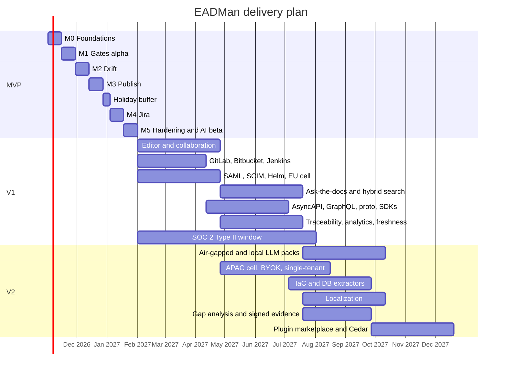

# EADMan: MVP, V1 and V2 Roadmap

## 1. Phasing principles

1. **Ship a thin vertical slice of the core promise first:** a PR that changes an API gets blocked or helped because a doc is now wrong, and the release shows its docs readiness in Jira. Everything in the MVP serves that loop.
2. **Deterministic before AI.** The MVP's value must hold with AI switched off ([assumption A6](01-product-requirements.md#2-assumptions)).
3. **One integration of each kind, done deeply:** GitHub, Jira Cloud and OpenAPI first. The connector SDK and contract-test kit make the second and third integrations cheaper.
4. **Design partners steer.** Eight partners are signed by week 4. Each has a named champion, weekly feedback and an agreed success metric.
5. **Evidence from day one.** SOC 2 controls are built in from the MVP, not bolted on afterwards.

## 2. MVP: 12 weeks (target start 2026-11-02, GA to design partners by early February 2027, including a holiday buffer)

### 2.1 Scope

| In the MVP | Out of the MVP (deferred to) |
|---|---|
| GitHub (cloud, GHES ≥ 3.12) App, webhooks, check runs, PR comments and suggestions | GitLab, Bitbucket, Azure DevOps (V1) |
| `docops` CLI: `init`, `config validate`, `extract`, `check`, `diff`, `coverage`, `build`, `preview`, `publish`, `readiness`, `link`, `new`, `sync` | `test` (doc tests), `release-notes`, `ask`, `export`, `reindex` (V1) |
| Gates: links and anchors, frontmatter, coverage, `schema/changed-without-docs`, drift (stale reference, stale value, changed entity), includes, secrets, built-in style and a11y lint | Vale passthrough, axe on previews, doc tests (V1) |
| Extractors: OpenAPI 3.0/3.1 and JSON Schema config | AsyncAPI, GraphQL, protobuf, SDKs (V1); IaC and DB (V2) |
| GitHub Action (`node24`), sticky comment, annotations, SARIF | GitLab component, Jenkins plugin (V1; the CLI works in any CI today) |
| Static portal: versions from tags, OpenAPI reference, Pagefind search, custom domain, previews | Multi-audience builds, hybrid search API, try-it console, analytics (V1); localization (V2) |
| Jira Cloud Forge app: issue panel, *Docs status* field, validator, readiness page, doc tasks; linking from PRs, commits and frontmatter | Jira DC (V1); other trackers (V2) |
| AI **beta** (opt-in): drift patch suggestions with provenance | Ask-the-docs, drafts, semantic drift (V1); gap analysis (V2) |
| OIDC SSO, org and space RBAC, API tokens, CI OIDC exchange, audit log with hash chain and export | SAML, SCIM, page-level ACL (V1); Cedar ABAC (V2) |
| Multi-tenant SaaS (US cell); docker-compose for evaluation | Helm self-hosted and EU cell (V1); air-gapped, APAC, BYOK (V2) |

### 2.2 Milestones (two-week increments)

| Milestone | Weeks | Deliverable | Demo |
|---|---|---|---|
| **M0 Foundations** | 1–2 | Monorepo, CI, Postgres schema with RLS, outbox and queue, OIDC login, `docops.yaml` schema, CLI skeleton, OTel baseline | A tenant is created and the RLS isolation tests are green |
| **M1 Gates alpha** | 3–4 | `docops check` offline (links, frontmatter, OpenAPI entities, coverage); GitHub Action with annotations and sticky comment | Gates run in 3 partner repositories in `warn` mode |
| **M2 Drift** | 5–6 | Entity diff, impact analysis, drift rules, `schema/changed-without-docs`, deterministic replacement suggestions; snapshot and check-run APIs; dismissals | A renamed parameter is blocked with a one-click suggestion |
| **M3 Publish** | 7–8 | Renderer, OpenAPI reference, CAS publish, previews, versioned portal on CDN, custom domains | A PR preview is live, merge publishes to dev, and a tag promotes the same build to prod |
| **M4 Jira** | 9–10 | Forge app (panel, field, validator, readiness, doc tasks), PR and commit linking, docs status state machine | Rita runs a release readiness review in Jira |
| **M5 Hardening and AI beta** | 11–12 | AI drift patches (opt-in), audit export, RBAC UI, SLO dashboards, runbooks, external pen test, SOC 2 Type I readiness | Design-partner GA |

### 2.3 MVP exit criteria

| Criterion | Target |
|---|---|
| Design partners gating real PRs | ≥ 5 of 8 at `block` level for at least one rule group |
| Deterministic drift precision (labeled corpus plus dismissal data) | ≥ 95% |
| PR check posted after CI completes (p95) | < 3 min |
| Full build of 5k pages (p95, hosted) | < 60 s |
| Release readiness used in real release cycles | ≥ 3 partners × 1 release |
| Security | Pen test with no open highs; zero cross-tenant findings; RLS, webhook and audit tests in CI |

### 2.4 MVP team (9 FTE core plus 2 shared at 50%)

| Role | FTE | Owns |
|---|---|---|
| Product manager | 1 | Partners, scope, metrics |
| Engineering manager / tech lead | 1 | Architecture, delivery, ADRs |
| Product designer (UX and accessibility) | 1 | PR comment UX, Jira UI Kit screens, portal theme, accessibility |
| Backend / platform engineers | 2 | API, data model, RLS, queue, auth, publish pipeline, infrastructure-as-code |
| Integrations engineer | 1 | GitHub App, Jira Forge app, webhooks |
| DX / CLI engineer | 1 | CLI, engine, Action, extractors |
| Frontend engineer | 1 | Portal, renderer, admin UI |
| ML / AI engineer | 1 | Drift AI, eval harness, LLM gateway |
| SRE / security (shared) | 0.5 | Cells, SLOs, threat model, SOC 2 controls |
| Tech writer / DevRel (shared) | 0.5 | Dogfooded docs, partner onboarding, templates |

## 3. V1: months 4–9

| Quarter | Themes | Key deliverables |
|---|---|---|
| **Months 4–6** | Authoring and breadth | WYSIWYG editor with real-time collaboration (TipTap, Yjs, Hocuspocus; opaque MDX nodes; fidelity suite); GitLab and Bitbucket; GitLab CI component and Jenkins; doc tests; Vale passthrough; axe accessibility on previews; SAML, SCIM, page-level ACL; **Helm self-hosted GA**; **EU cell** |
| **Months 7–9** | Intelligence and evidence | **Ask-the-docs** (RAG, permission-filtered, cited) and the hybrid search API; AsyncAPI, GraphQL and protobuf extractors; TypeScript, Python and Java SDK extractors; release notes; portal analytics and feedback; freshness SLAs with CODEOWNERS; **traceability report** (CSV, JSON, PDF); Jira DC REST integration; Azure DevOps; VS Code extension; MCP server; Backstage plugin; try-it console; multi-audience builds |

**Compliance.** The SOC 2 Type II observation window opens at the start of V1, aiming for a report around month 10. The VPAT/ACR (WCAG 2.2 AA) is published.

**Team growth (about 16).** Add 2 frontend/editor engineers, 1 integrations engineer, 1 ML engineer, 1 SRE, and 1 security/compliance engineer.

**V1 exit criteria.**
- L2 API coverage ≥ 85% across active tenants.
- Escaped drift < 1 per 100 changed entities.
- Ask-the-docs citation accuracy ≥ 98% with zero permission leaks in continuous canaries.
- Editor round-trip fidelity of 100% on the corpus.
- 3 self-hosted production customers.

## 4. V2: months 10–18

| Theme | Deliverables |
|---|---|
| Regulated and sovereign | **Air-gapped installs** (offline licensing, local LLM packs with vLLM, BGE-M3 and a reranker); **APAC cell**; **BYOK/CMK**; dedicated single-tenant SaaS; HIPAA BAA; ISO 27001 certification |
| Reference everywhere | Terraform, CloudFormation/CDK, Helm and Kubernetes extractors; database schema docs from migrations; Structurizr/C4; Go, C# and Rust SDK extractors |
| Global content | Localization workflow (XLIFF, translation memory, machine translation with review, per-locale freshness) |
| Insight loop | **Gap analysis** from search, Ask and support tickets (Zendesk, ServiceNow, JSM); deflection measurement widget |
| Evidence and policy | Signed traceability bundles (in-toto attestations); Cedar ABAC policies; org policy floors for gates |
| Ecosystem | Plugin marketplace (extractors, rules, components); JetBrains extension; Linear, Azure Boards and GitHub Issues connectors; GraphQL API GA |

**Team (about 22–25).** Platform and regions (6), integrations (4), editor and portal (5), AI (3), DX/CLI (2), security and compliance (2), plus PM, design and writing.

## 5. Timeline

## 6. Critical path and risks

| Risk | Phase | Mitigation | Trigger to re-plan |
|---|---|---|---|
| Forge Marketplace review delays | MVP M4 | Private installs for design partners; submit in week 9 | Review exceeds 3 weeks |
| Drift false positives erode trust | MVP M2 | Contextual mentions; `warn` first; precision dashboard; auto-demotion | Precision < 90% on any partner |
| Editor round-trip fidelity | V1 | Opaque MDX nodes; corpus suite from partner repositories; editor ships behind a flag | Corpus fidelity < 100% at month 5 |
| Self-hosted support load | V1 | Single Helm chart, a support bundle (`docops-admin support-bundle`), reference architectures | > 20% of engineering time on self-hosted issues |
| LLM cost and latency | V1 | Sufficiency gate; caching; per-tenant budgets; eval-gated routing | Cost per answer > 2× budget |
| Hiring | All | Staggered start dates; contractors for the Forge UI and Helm | Two or more roles unfilled at month 4 |
