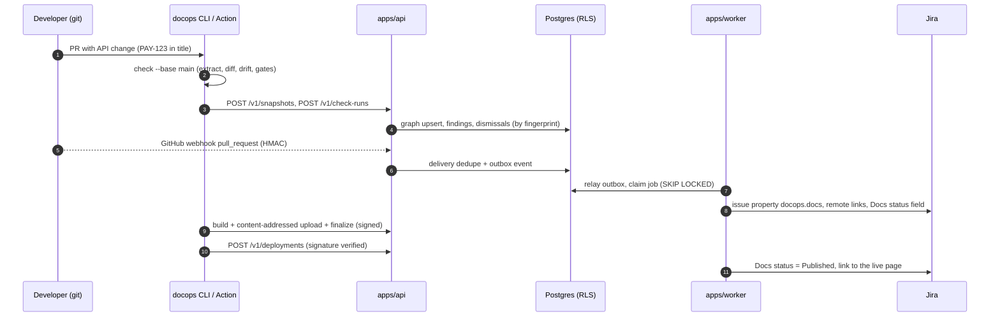

# EADMan: MVP Code Scaffold

This repository contains a working TypeScript monorepo that implements the MVP spine of the design. Every claim in this document is backed by an automated test (§5).

The scaffold covers the CLI, the core engine, the API and worker services, the GitHub Action, the Jira linking flow, the OpenAPI reference renderer and the AI layer. A Jira Forge app and the deployment artifacts are included too.

## 1. Quick start

Requirements: Node.js ≥ 22.12 (24 LTS recommended) and git. Docker is needed only for the compose stack.

```bash
npm ci
npm test
```

```bash
npm run typecheck
```

Run the gates on the bundled example (Acme Payments) or on this repository's own docs:

```bash
npm run docops -- check -C examples/acme-payments
```

```bash
npm run dogfood
```

Build the example portal (pages plus the generated OpenAPI reference) and serve it locally:

```bash
npm run docops -- preview -C examples/acme-payments
```

Run the API locally. Without `DATABASE_URL` it uses embedded PGlite, so no database is needed. PGlite allows only one process per data directory, so in this mode the API also runs the worker in its own process. First generate a random admin token for your machine. Never reuse a token from documentation: the API grants it `org_owner` on first start.

```bash
mkdir -p .docops && echo "dop_$(openssl rand -hex 20)" > .docops/dev-token
```

```bash
DOCOPS_BOOTSTRAP_TOKEN=$(cat .docops/dev-token) npm run api
```

To run workers as separate processes, as in production, point the API and `npm run worker` at Postgres with `DATABASE_URL`. The Compose stack in [deploy/](../deploy/) does this.

Then point the CLI at the local API:

```bash
DOCOPS_API_URL=http://localhost:8787 DOCOPS_TOKEN=$(cat .docops/dev-token) npm run docops -- check -C examples/acme-payments --upload
```

Bundle the distributable CLI and the GitHub Action (single files, no `node_modules`):

```bash
npm run build
```

## 2. Repository layout

```text
.
├── docs/                      # The design package: a EADMan space, gated in CI (dogfooding)
├── api/openapi.yaml           # OpenAPI 3.1 contract (63 operations, 12 webhooks)
├── docops.yaml                # This repository's own EADMan configuration
├── examples/
│   ├── acme-payments/         # Sample service repo: docs, OpenAPI, config schema, CODEOWNERS
│   └── ci/                    # GitHub Actions, GitLab CI and Jenkins pipelines (embedded in docs/05)
├── packages/
│   ├── core/                  # Domain types, UUIDv7, JCS hashing, RBAC policy, CloudEvents, errors, globs
│   ├── config/                # docops.yaml loader + JSON Schema (canonical) with line-accurate errors
│   ├── markdown/              # Markdown/MDX → mdast; links, anchors, code, mentions, pragmas, includes
│   ├── extractors/            # OpenAPI 3.x and JSON Schema extractors → entities with fingerprints
│   ├── engine/                # Reference index, entity diff, drift rules, coverage, docs-status machine
│   ├── checks/                # All gates, SSRF-guarded link checker, doc tests, 7 report formats
│   ├── renderer/              # Accessible static site + OpenAPI reference + try-it + search index
│   ├── git/                   # Shell-free git wrapper (refs, merge base, changed files, diff hunks)
│   ├── github/                # Webhook signatures, REST client (checks, comments, suggestions), Actions runtime
│   ├── jira/                  # Key extraction, Jira REST v3 client + fake, docs-status push, doc tasks
│   ├── db/                    # PostgreSQL schema (RLS), PGlite/pg clients, repositories, queue, audit chain
│   ├── ai/                    # LLM gateway (Claude, OpenAI-compatible, mock), RAG, drift AI, prompts, eval harness
│   ├── cli/                   # `docops` CLI (init, check, diff, coverage, build, publish, readiness, …)
│   └── github-action/         # docops/action (node24) + action.yml
├── apps/
│   ├── api/                   # Hono API: 47/47 MVP operations, webhooks, CAS builds, serving, OIDC exchange
│   ├── worker/                # Queue consumers: linking, Jira mirror, docs-status sync, webhook delivery
│   └── jira-forge/            # Forge app (UI Kit): issue panel, readiness page, validator, admin, actions
├── deploy/                    # Dockerfile, docker-compose, Helm chart (incl. air-gapped values)
└── scripts/                   # Test runner and esbuild bundling
```

## 3. What is implemented

| Capability (spec) | Where | Proven by |
|---|---|---|
| Git-native content model, frontmatter, anchors, MDX | `markdown` | `packages/markdown/test/parse.test.ts` |
| `docops.yaml` schema with line/column errors | `config` | `packages/config/test/config.test.ts` (validates the example and this repository's config) |
| OpenAPI 3.0/3.1 and JSON Schema extraction; stable keys; fingerprints; remote `$ref` refused | `extractors` | `packages/extractors/test/extractors.test.ts` (extracts our own spec: 63 operations, 12 webhooks) |
| Reference index: explicit, link, code sample (curl, fetch, raw HTTP), contextual mentions | `engine` | `packages/engine/test/engine.test.ts` |
| Entity diff with rename detection and breaking / user-visible classification | `engine` | same |
| Drift rules: `stale-reference`, `stale-value`, `changed-entity`, `schema/changed-without-docs`, `coverage/undocumented-entity`, with deterministic one-click replacements | `engine` | same, plus the CLI and Action tests |
| Links and anchors, frontmatter, style, accessibility, secrets, freshness, ownership (CODEOWNERS), includes | `checks` | `packages/checks/test/checks.test.ts` |
| SSRF-guarded external link checking (blocks loopback, private and metadata addresses, including through DNS) | `checks` | `packages/checks/test/ssrf.test.ts` |
| Doc tests with isolation and secret redaction | `checks` | `checks.test.ts` |
| Reports: text, JSON, SARIF 2.1.0, Markdown, JUnit, GitLab Code Quality, GitHub annotations | `checks` | `checks.test.ts` |
| CLI with exit codes 0/1/2/3/4, `--report fmt=file`, `--changed-only`, `--upload`, fail-open / fail-closed | `cli` | `packages/cli/test/cli.test.ts` (real git repositories) |
| Static portal: accessible layout, version switcher, search, CSP-safe assets, sanitized MDX components, GFM alerts, snippets and variables | `renderer` | `packages/renderer/test/*.test.ts` |
| OpenAPI reference renderer with parameter, body and response tables, curl and fetch samples, try-it console | `renderer` | `packages/renderer/test/acme.test.ts`, `build.test.ts` |
| Content-addressed publish, Ed25519-signed manifests, promotion that verifies signatures, signed expiring preview links | `api` + `cli` | `apps/api/test/builds.test.ts`, `cli.test.ts` |
| Multi-tenant Postgres with forced RLS, SECURITY DEFINER token lookup, append-only audit | `db` | `packages/db/test/rls.test.ts` |
| Content graph, staleness by written-against fingerprints, coverage SQL, readiness | `db` | `packages/db/test/repos.test.ts` |
| Transactional outbox, Postgres queue (SKIP LOCKED, coalescing, backoff, dead-letter), idempotency ledger | `db` + `worker` | `repos.test.ts`, `apps/worker/test/linking-flow.test.ts` |
| Migrations that every replica can run at start-up: advisory-locked, all-or-nothing | `db` | `packages/db/test/migrate.test.ts` |
| REST API: 47 of 47 MVP-tagged operations, RFC 9457 errors, cursor pagination, scopes ∩ roles | `api` | `apps/api/test/api.test.ts`, `contract.test.ts` (every route exists in `api/openapi.yaml`) |
| CI workload identity: OIDC → 15-minute repo- and environment-bound token, pinned immutable claims | `api` | `api.test.ts` (RS256 tokens signed in the test) |
| GitHub webhooks: HMAC, delivery dedupe, tenant routing; Jira webhooks: HMAC | `api` | `apps/api/test/webhooks.test.ts` |
| Jira Forge app calls: Forge Invocation Tokens verified against Atlassian's JWKS (RS256, `iss`, `aud`, `exp`, a `jti` replay cache shared by all replicas), installation → tenant, one `tracker_app` service account per installation; FITs on `/hooks/jira` too | `api` + `db` | `apps/api/test/forge.test.ts` (RS256 tokens and a JWKS made in the test) |
| **Jira linking flow**: PR → keys with provenance → In review → Merged → Published; issue property, remote links and *Docs status* field written to Jira; Jira webhook mirror; readiness; doc tasks | `worker` + `api` + `jira` | `linking-flow.test.ts`, `api.test.ts`, `packages/jira/test/jira.test.ts` |
| Hash-chained audit log, tamper detection, auditor-only access | `db` + `api` | `apps/api/test/audit.test.ts` |
| GitHub Action: check run (batches of 50 annotations), sticky comment, ```` ```suggestion ```` only on diff lines, SARIF, outputs, job summary | `github-action` | `packages/github-action/test/action.test.ts` |
| Claude adapter: citations through document blocks, structured outputs through `messages.parse`, refusals, server-side fallback | `ai` | `packages/ai/test/anthropic.test.ts` (fake client, no network) |
| Permission-filtered hybrid search, sufficiency gate, verbatim-quote verification, output filtering, live ACL re-check | `ai` | `packages/ai/test/answer.test.ts`, `search.test.ts` |
| AI drift verification and patch validation | `ai` | `packages/ai/test/drift.test.ts` |
| Evaluation harness with hard gates (zero leaks, zero injections, 100% valid quotes) | `ai` | `packages/ai/test/eval.test.ts`; `npm run eval` |
| RBAC matrix in the docs equals the enforced policy; DDL in the docs equals the migration; our API is 100% documented | `core`, `db`, dogfood | `policy.test.ts`, `docs-sync.test.ts`, `npm run dogfood` |
| Forge app: view models, payload validation, and authorization as the calling Jira user (trusted context first; the user's own permission is checked before every write and before reading an issue or project named in a payload) | `jira-forge` | `apps/jira-forge/test/view-model.test.ts`, `validation.test.ts`, `resolvers.test.ts` (the real resolvers, bundled against in-memory Forge stubs) |

### 3.1 The flows end to end



## 4. Engineering conventions

- **One language, no build step for development.** TypeScript runs directly on Node's type stripping (`--experimental-strip-types` on Node 22; on by default from 22.18 and 24). Only erasable syntax is allowed (`erasableSyntaxOnly`): no enums, namespaces or parameter properties. Local imports use `.ts` extensions, and `verbatimModuleSyntax` is on. **TypeScript 7** type-checks the whole repository (`npm run typecheck`). esbuild bundles the distributables.
- **Few, mainstream dependencies:** unified/remark (mdast), hast utilities, yaml, Ajv, Hono, pg, PGlite (+ pgvector), and the Anthropic SDK. There is no test framework (`node:test`) and no Actions toolkit; the documented runtime file protocols are used directly.
- **Hermetic tests.** Postgres runs embedded in-process (PGlite, PostgreSQL 18). GitHub, Jira, LLM providers and DNS are faked at the network boundary. Git tests create real temporary repositories.
- **Contracts are files.** `api/openapi.yaml`, `packages/config/schema/docops.schema.json` and `packages/db/migrations/0001_init.sql` are canonical. Tests fail when code or docs drift from them.

## 5. Test inventory

`npm test` runs every `*.test.ts` in the repository with the Node test runner: 340 tests in 43 files at the time of writing.

| Area | Test files | Focus |
|---|---|---|
| Foundations | `core`, `config`, `markdown`, `extractors` | Determinism (UUIDv7, JCS), config errors, parsing, extraction |
| Engine and gates | `engine`, `checks` | Drift scenario (rename, stale value, new endpoint), every rule, reporters, SSRF |
| Services | `db`, `api`, `worker` | RLS, queue, audit chain, all MVP endpoints, OIDC, CAS, the Jira linking flow |
| Delivery surfaces | `cli`, `github-action`, `renderer`, `jira-forge` | Real git repositories, PR annotations and suggestions, accessible HTML, XSS, view models |
| AI | `ai` | Claude adapter shapes, RAG guardrails, drift validation, evaluation gates |

## 6. Known limitations of the scaffold

These are deliberate MVP cuts. Each points to where the design covers it.

| Area | Scaffold | Production design |
|---|---|---|
| Identity | API tokens and CI OIDC; SSO not wired | OIDC/SAML/SCIM identity service ([Security §5](08-security-compliance.md#5-identity-and-access-management)) |
| Forge auth | FITs are verified on every API route and on `/hooks/jira` ([Security T04](08-security-compliance.md#2-threat-model-stride)), but not yet against a live Forge app. An installation is routed to its tenant by a `tenant_routes` row (kind `forge_installation`, key: the installation UUID) inserted by an operator, because there is no API for it. Atlassian's Isolated Cloud, whose tokens are signed by keys at other hosts (`icLabel`), is not supported. The app system token sent with triggers is not used: the worker writes to Jira with `JIRA_EMAIL` and `JIRA_API_TOKEN` | Installation registration in the admin API and UI; tracker-sync writes with the app system token ([Jira §2](06-jira-integration.md#2-architecture)) |
| Storage | Content-addressed blobs and CI snapshots on a filesystem volume or in an S3-compatible bucket (`DOCOPS_S3_BUCKET`: SigV4 over `fetch`, static access keys); manifests in Postgres | A CDN with edge auth in front of the bucket; workload identity (IAM roles for service accounts, EKS Pod Identity) instead of static keys |
| Secrets at rest | Webhook secrets stored as raw bytes in the scaffold | Envelope encryption with the tenant DEK and KMS ([Architecture §8.2](02-system-architecture.md#82-encryption)) |
| Queue | Postgres queue (embedded mode) | Plus the Kafka relay in scale mode ([ADR-0004](adr/0004-outbox-and-queue.md)) |
| Hosted builds | Builds run in the CLI (customer CI) | Plus Firecracker/gVisor sandboxes for browser-originated edits |
| AI gateway | Providers, RAG, drift validation, evals | Plus redaction, budgets, audit events and streaming. Enum values in structured outputs are validated client-side after parsing. |
| Editor | Not included | TipTap + Yjs (V1, [ADR-0008](adr/0008-portal-and-editor.md)) |
| Multi-version builds | Single version per build; the version switcher is data-driven | Tag matrix builds (V1) |
| Diagrams | ```` ```mermaid ```` blocks render as code in the portal | Mermaid bundled with the portal assets and rendered in the browser, with no CDN (V1) |
| Portal isolation | Strict CSP (no inline script or style) sent as a header and a `<meta>`; try-it runs on the portal origin | Plus Trusted Types and a separate origin for try-it and user content ([Security §2, T18](08-security-compliance.md#2-threat-model-stride)) |
| Vale, axe | Built-in style and a11y subsets | Vale passthrough; axe-core on previews (V1) |
| Deployment | Dockerfile, Compose stack (with an optional S3-compatible service) and Helm chart ([deploy/](../deploy/)). Several API replicas need shared blob storage: an S3-compatible bucket (`objectStorage.type: s3`) or one ReadWriteMany claim. The image has not been built in CI, and the chart was checked with a template-rendering harness, not `helm lint` | Signed images; chart CI with `helm lint` and kubeconform; AI gateway settings and OTLP export (V1) |
| Jira app | Forge app with typed resolvers that authorize as the calling user ([apps/jira-forge](../apps/jira-forge/)); not yet run on a live Jira site. Expression validator only; Jira administrators create the *Docs required* fields by hand | Strict-mode function validator, CSV and traceability export from the readiness page (V1) |

## 7. From scaffold to MVP

The scaffold front-loads the riskiest parts of milestones M0–M2, M4 and M5 ([Roadmap §2.2](09-roadmap.md#22-milestones-two-week-increments)): the data model and RLS, the deterministic engine and gates, the Jira loop and the audit chain. The remaining MVP work is mostly productization:

- the GitHub App installation flow and permissions;
- SSO;
- the web UI for findings, dismissals and readiness;
- registering Forge installations from the admin UI, and Marketplace hardening;
- object storage and CDN publishing;
- the AI beta's patch-suggestion job wiring;
- SLO dashboards and the pen test.
