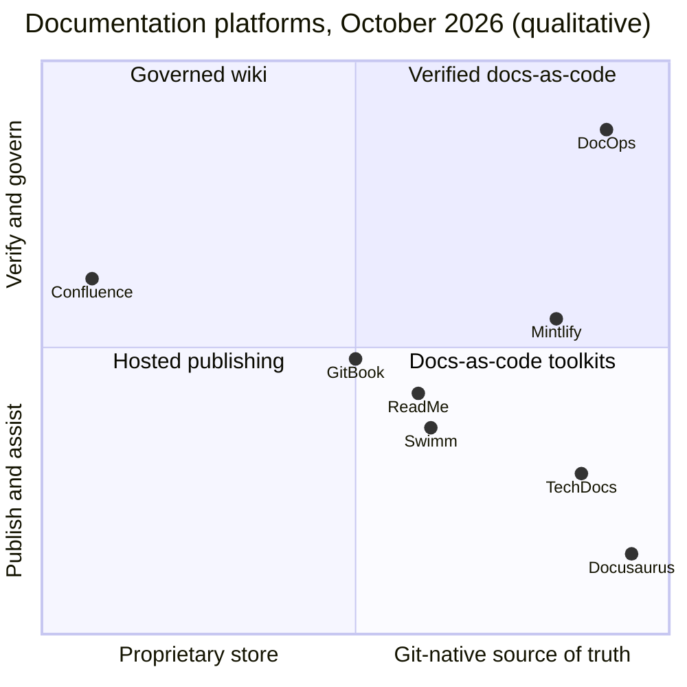

# DocOps: Competitive Positioning

> Market scan as of **2026-10-18**, based on vendor documentation, pricing pages and changelogs. Products in this category ship quickly, so re-verify before external use. Claims marked † come from secondary sources or are inferred from documentation gaps.

## 1. Positioning statement

**For engineering organizations that must ship accurate, auditable documentation with every release, DocOps is the docs-as-code platform that verifies documentation against the code before merge.** Hosted doc portals that help write content after the fact can't do that. DocOps deterministically blocks drift on the pull request, proves release readiness inside Jira, and runs anywhere, including air-gapped environments with local models.

## 2. Market map

The category has converged on AI writing assistants. Mintlify, GitBook and ReadMe all now ship agents that draft or update docs, from prompts, from Slack or Jira, or *after* code merges. **Nobody verifies docs against code deterministically before merge**, and nobody ties documentation to release readiness and audit evidence. That is the gap DocOps targets.

## 3. Capability comparison

Legend: ● strong / native · ◐ partial, add-on or enterprise-only · ○ absent.

| Capability | DocOps | Confluence | GitBook | ReadMe | Mintlify | TechDocs | Docusaurus | Swimm |
|---|---|---|---|---|---|---|---|---|
| Git as source of truth (content in the customer repo) | ● | ○ | ◐ bidirectional sync with a hosted store | ◐ Git-backed (ReadMe-hosted repo), bidirectional sync | ● | ● | ● | ◐ legacy feature |
| WYSIWYG editing with round trip to Git | ● (V1) | ● (no Git) | ● | ● | ● | ○ | ○ | ◐ |
| Real-time collaboration and reviews | ● (V1) | ● | ◐ live edits not on Git-synced content | ◐ Pro+ | ● | ○ (Git PRs) | ○ (Git PRs) | ○ |
| **Pre-merge, deterministic drift detection with blocking gate** | ● | ○ | ○ | ○ | ○ | ○ | ○ | ◐ snippet-level sync (legacy) |
| Coverage gate for new APIs and config keys | ● | ○ | ○ | ○ | ○ | ○ | ○ | ○ |
| AI doc updates from code changes | ● suggestions on the PR, quote-validated | ○ | ◐ manual `@gitbook` on PR or issue | ◐ AI Writer on PR open (advisory) | ● Automations after merge (AI PRs) | ○ | ○ | ○ (pivoted) |
| Broken-link gate in CI | ● | ○ | ○ (traffic-based 404 report) | ● | ● | ○ | ● build fails | ○ |
| Code-sample (doc) tests | ● deterministic (V1) | ○ | ○ | ○ | ◐ agent-driven `mint test` | ○ | ○ | ○ |
| Accessibility checks | ● | ○ | ○ | ○ | ● `mint a11y` | ○ | ○ | ○ |
| OpenAPI reference and try-it | ● | ◐ marketplace | ● | ● | ● | ◐ catalog API docs | ◐ community plugin | ○ |
| AsyncAPI / GraphQL / protobuf | ● (V1) | ○ | ○ | ◐ GraphQL incomplete | ● AsyncAPI, GraphQL | ◐ catalog types | ○ | ○ |
| SDK, IaC and DB reference | ● (V1/V2) | ○ | ○ | ○ | ○ | ○ | ○ | ○ |
| **Jira fix-version docs readiness and close-gate** | ● | ◐ release-notes page from a version | ○ | ○ | ○ | ◐ plugins | ○ | ○ |
| Traceability evidence (requirement → release) | ● | ○ | ○ | ○ | ○ | ○ | ○ | ○ |
| Cited AI answers | ● quote-verified | ● Rovo | ● | ◐ add-on | ● | ◐ Spotify Portal only | ◐ DocSearch Ask AI | ◐ |
| Permission-filtered retrieval | ● pre-filter plus live re-check | ● | ◐ | ◐ Enterprise groups | ◐ authenticated MCP or groups | ◐ | ○ | ◐ |
| SAML / SCIM / audit log | ● / ● (V1) / ● | ● (Guard) | ◐ Enterprise / ○ undocumented / ◐ beta | ◐ Enterprise / ○ undocumented / ◐ | ◐ Enterprise | ◐ OAuth2/SAML / ○ / ◐ | ○ | ◐† |
| Data residency | ● US, EU, APAC cells | ● | ○ US only | ○† | ◐ EU hosting | n/a (self-hosted) | n/a | ◐† |
| Self-hosted / air-gapped with full AI | ● / ● (V2, local LLMs) | ○ (DC end of life 2029; no Rovo on DC) | ○ | ○ | ◐ Enterprise; air-gapped static export limits AI | ● / ○ | ● / ○ | ◐† |
| Open formats and full export | ● | ◐ | ◐ | ◐ | ● | ● | ● | ◐ |

## 4. Battlecards

### Mintlify: the closest competitor

- **Strengths.** Excellent default design and developer experience. Git-native MDX. A fast-moving AI roadmap: an agent with Slack, Jira and Linear connectors; **Automations** that trigger on merged PRs in connected repositories; MCP and `llms.txt` generation. Its CLI covers broken links, a11y, validation and `mint test`. GitHub PR checks cover broken links and Vale. Enterprise adds SAML, SCIM and audit logs. Strong momentum (Series B, April 2026).
- **Where DocOps wins.**
  - Our drift gate is **deterministic and pre-merge, on the code PR**. Their automations fire *after* merge and open AI-written PRs, so drift ships first.
  - Entity-level **coverage gates** for new endpoints and config keys.
  - **Jira readiness and the close-gate**.
  - Traceability evidence.
  - **Self-hosted with full AI on local models.** Their air-gapped mode is a static export with outbound-dependent AI disabled.
  - Internal docs (runbooks, ADRs) receive the same treatment as public docs.
- **Ask the buyer.** "What happens today when a PR renames an API field: who finds out, and when?" "Can you show an auditor which docs shipped with release 2.4?"
- **Coexistence and migration.** Mintlify content is already MDX in Git, so DocOps can run gates on a Mintlify repository from day one with no migration. The portal can switch later.

### GitBook

- **Strengths.** A polished WYSIWYG editor with change requests. Bidirectional Git Sync with GitHub and GitLab. An AI assistant with citations. **GitBook Agent** (open beta since December 2025) drafts and reviews change requests. Channels let users mention `@gitbook` on a PR, issue or Jira ticket. Quality monitoring (October 2026) surfaces content gaps from reader questions.
- **Where DocOps wins.**
  - In DocOps, Git is the true source of truth. GitBook syncs Git with its own hosted store, and live co-editing is unavailable on Git-synced sections.
  - Drift detection runs against code automatically. GitBook's content gaps come from reader signals, not code diffs, and its PR agent must be invoked manually.
  - EU and APAC residency, where GitBook stores data in the US only.
  - Self-hosting.
  - SCIM, which is undocumented for GitBook.
  - Jira readiness.
- **Ask the buyer.** "Do your regulators accept US-only storage?" "Who is notified when the code changes but nobody mentions `@gitbook`?"

### ReadMe

- **Strengths.** API developer hubs with Try It. Refactored is Git-backed with bidirectional sync across GitHub, GitLab and Bitbucket. AI Writer opens a review branch when a PR opens. The rdme CLI and GitHub Action handle OpenAPI uploads. AI linter and Docs Audit. Usage-aware API docs.
- **Where DocOps wins.**
  - Internal and operational docs, not just external API hubs.
  - Deterministic gates that block.
  - Jira readiness.
  - Infrastructure and SDK reference.
  - Governance: SCIM and residency.
  - Self-hosting.
  - Cited answers are core rather than a paid add-on.
- **Where ReadMe wins.** API usage metrics and logs inside the hub, which are a non-goal for us. Coexistence: DocOps can gate the OpenAPI and MDX that ReadMe syncs.

### Atlassian Confluence (plus Rovo)

- **Strengths.** Ubiquitous. Strong non-technical collaboration. The deepest native Jira integration, including release-notes pages from versions. Rovo search, chat and agents across Atlassian content, with an MCP server. Broad certifications, data residency, FedRAMP Moderate (Government Cloud).
- **Where DocOps wins.**
  - Content lives next to code and is reviewed in PRs.
  - Gates, versioning by release, generated reference docs and drift detection, none of which Confluence offers.
  - Public portals.
  - **Self-hosted continuity.** Confluence Data Center closed to new customers in March 2026 and reaches end of life in March 2029, with no Rovo on DC.
- **Positioning.** *Complement, don't replace.* Confluence stays the wiki for plans and meeting notes, and DocOps owns product and engineering docs. We import Confluence spaces into Markdown, and our Jira app sits next to Confluence links.

### Backstage TechDocs (and Spotify Portal)

- **Strengths.** Open source, Git-native MkDocs, integrated with the software catalog and ownership data. Spotify Portal adds a managed IDP and the AiKA assistant.
- **Where DocOps wins.**
  - WYSIWYG editing for writers.
  - Quality gates and drift detection; TechDocs has no link checking or drift detection.
  - Versioning.
  - Public and partner portals.
  - Enterprise governance and AI in self-hosted setups.
- **Ecosystem risks for TechDocs.** The upstream theme (Material for MkDocs) has been in maintenance mode since November 2025. 2026 advisories showed that repository-controlled `mkdocs.yml` can lead to code execution in builds, which illustrates why DocOps runs builds in customer CI or in sandboxes (ADR-0010).
- **Positioning.** *Complement.* The DocOps Backstage plugin (V1) shows coverage, freshness and readiness on catalog entities, and TechDocs sites can be imported unchanged as Markdown.

### Docusaurus

- **Strengths.** Free and MIT-licensed. Flexible React and MDX. Versioning and i18n. The build fails on broken links. DocSearch v4 with Ask AI (bring your own LLM).
- **Where DocOps wins.** Docusaurus is a framework, not a platform: no drift detection, coverage, Jira, governance, previews, analytics or editor.
- **Positioning.** *Upgrade path.* Docusaurus content is MDX and works with DocOps gates immediately. Teams keep their site and add gates, or migrate rendering later.

### Swimm

- **Status.** Swimm 2.0 (March 2026) repositioned it as an "understanding platform" for legacy and mainframe modernization, and in May 2026 it became a service company priced per project. Its original code-coupled docs (auto-sync, PR checks) still exist in its documentation but no longer lead its offering.
- **Implication.** Swimm's former users of code-coupled docs are a natural audience for DocOps: entity-level drift detection generalizes Swimm's snippet-level idea to APIs, config and infrastructure.

### Not analyzed in this scan

Redocly, Fern, Document360 and Docsie are adjacent, mostly in API documentation and SDK generation or knowledge bases. Battlecards will be added after the V1 scan.

## 5. Where DocOps does not try to win

| Area | Leader | Our stance |
|---|---|---|
| General wiki and meeting notes | Confluence, Notion | Integrate and import |
| API usage analytics and logs | ReadMe | Non-goal |
| Zero-setup beautiful hosted docs for a startup's public API | Mintlify | Competitive but not our wedge. We win when verification, governance or self-hosting matter. |
| Free static site for an OSS project | Docusaurus | Free CLI gates for OSS repositories serve as community adoption |
| Internal developer portal | Backstage | Plugin, not competitor |

## 6. Defensibility

1. **The content graph.** Entity-level links between docs, code, tickets and releases make each additional integration more valuable and are hard to retrofit onto page-centric products.
2. **The deterministic engine and labeled drift corpus.** Precision is measurable, and the corpus compounds with every dismissal and accepted suggestion (with tenant opt-in).
3. **Workflow position.** Being a required check on PRs and a validator on Jira transitions makes DocOps part of the release process, not a destination site.
4. **Enterprise trust surface.** Self-hosting, air-gapping, residency, BYOK and audit evidence take years to build. Hosted-first competitors are early on most of them.
5. **Open formats.** No lock-in lowers adoption friction, and we compete on the verification layer rather than on owning the content.

## 7. Pricing hypothesis (to validate with design partners)

| Tier | For | Includes | Value metric (hypothesis) |
|---|---|---|---|
| **Free / OSS** | Public repositories | CLI gates, GitHub Action, static build | None |
| **Team** | Up to 50 engineers | Hosted portal, previews, Jira app, AI beta (opt-in) | Per active contributor |
| **Business** | Multiple teams | Audiences, SSO, analytics, Ask-the-docs, traceability | Per active contributor plus AI usage |
| **Enterprise** | Regulated organizations | SAML/SCIM, residency cells, self-hosted or air-gapped, BYOK, audit export, SLAs | Annual platform fee plus contributors |

Reference points from public pricing as of 2026-10-18:

- Mintlify Pro: $450 per month (annual billing).
- GitBook: Essential $65 per month plus $12 per user; Ultimate $249 per month plus $12 per user.
- ReadMe Pro: $250 per month.
- Confluence Cloud list price from 2026-10-13: Standard $7.15, Premium $14.10 per user per month (1–100 users).

## 8. Sources

- Mintlify: [Automations](https://www.mintlify.com/docs/agent/workflows), [CLI](https://www.mintlify.com/docs/cli/commands.md), [CI checks](https://www.mintlify.com/docs/deploy/ci), [self-hosting](https://www.mintlify.com/docs/deploy/self-host.md), [pricing](https://www.mintlify.com/pricing)
- GitBook: [Git Sync](https://gitbook.com/docs/integrations/git-sync/enabling-github-sync), [Docs Agent](https://www.gitbook.com/blog/introducing-docs-agent), [Channels](https://gitbook.com/docs/gitbook-agent/channels.md), [quality monitoring](https://www.gitbook.com/blog/new-quality-monitoring-layer), [security FAQ](https://gitbook.com/docs/policies/privacy-and-security/security/security-faq.md), [pricing](https://www.gitbook.com/pricing)
- ReadMe: [bi-directional sync](https://docs.readme.com/main/docs/bi-directional-sync.md), [GitHub AI Writer](https://docs.readme.com/main/docs/github-ai-writer.md), [Docs Audit](https://docs.readme.com/main/docs/docs-audit.md), [pricing](https://readme.com/pricing)
- Atlassian: [Data Center end of life](https://www.atlassian.com/licensing/data-center), [Rovo MCP server](https://support.atlassian.com/atlassian-rovo-mcp-server/docs/getting-started-with-the-atlassian-remote-mcp-server/), [release notes from versions](https://support.atlassian.com/jira-cloud-administration/docs/create-release-notes/)
- Backstage: [TechDocs](https://backstage.io/docs/features/techdocs/), [AI and MCP actions](https://backstage.io/docs/ai/)
- Docusaurus: [3.10 release](https://docusaurus.io/blog/releases/3.10), [search](https://docusaurus.io/docs/search)
- Swimm: [Swimm 2.0](https://swimm.io/blog/swimm-2-0-the-understanding-platform-for-ai-modernization), [services model](https://swimm.io/blog/weve-stopped-asking-customers-to-bet-on-the-right-tool)
